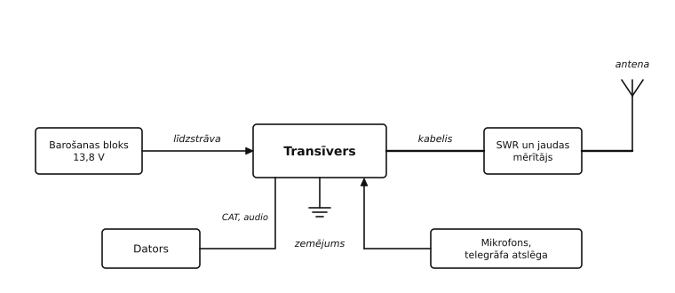

# 1. nodaļa. Kas ir radioamatierisms

Šī nodaļa izskaidro, kas ir radioamatieris, ko viņš ēterā dara un ko nedara,
un iepazīstina ar pamatjēdzieniem, kas atkārtosies visā grāmatā.

**Video lekcija:** LRAL bezmaksas kurss, 1. nodarbība (QR kods).
**Eksāmena programma:** normatīvie akti (definīcijas); darba noteikumi un procedūras.
**Mācību laiks:** ap 1,5 stundām.

## Pēc šīs nodaļas tu pratīsi

- pateikt, kas juridiski ir radioamatieris un radioamatieru dienests;
- nosaukt sešas lietas, ko radioamatieris ēterā nedara;
- izskaidrot, no kā sastāv izsaukuma signāls;
- paskaidrot, kas ir QSO un QSL;
- atšķirt galvenos sakaru veidus: SSB, FM, CW un ciparu darba veidus.

## 1.1. Kas ir radioamatieris

Vārdam "radioamatieris" ir divas nozīmes.

**Juridiski** radioamatieris ir fiziska persona, kura ir nokārtojusi
radioamatieru eksāmenu un saņēmusi radioamatiera eksaminācijas apliecību [1].
Bez apliecības un radiostacijas atļaujas raidīt nedrīkst; klausīties drīkst
ikviens.

**Dzīvē** radioamatieris ir cilvēks, kuru interesē, kā radioviļņi izplatās un
kā darbojas radiotehnika, un kurš grib to izmēģināt pats. Pasaulē šo hobiju
pazīst ar nosaukumu **HAM radio**.

**Radioamatieru dienests** ir viens no radiosakaru dienestiem, līdzās,
piemēram, apraidei, aviācijas un jūras sakariem. Tā definīcijā ir trīs mērķi
un viens nosacījums [1]:

- pašizglītošanās;
- savstarpējie sakari;
- tehniskie pētījumi;
- to visu dara cilvēki, kuriem radiotehnika ir interese, nevis peļņas avots.

> **Atceries:** "amatieris" šeit nenozīmē "nepratējs". Tas nozīmē "bez
> materiālas ieinteresētības". Daudzi radioamatieri ir profesionāli inženieri.

## 1.2. Ko radioamatieris dara un ko nedara

Radioamatieri būvē raidītājus, uztvērējus un antenas, nodibina sakarus cits ar
citu, eksperimentē un apmainās ar pieredzi. Daudzus aizrauj sakari ar tālām
zemēm (**DX**), citus — sacensības operatora meistarībā (**contest**), vēl
citus — tehnikas konstruēšana vai ārkārtas sakaru nodrošināšana [1].

Ir sešas lietas, ko radioamatieris nedara [1]:

| Ko nedara | Kāpēc |
| --- | --- |
| Neizmanto sakarus komerciāliem mērķiem | Dienests ir bez materiālas ieinteresētības |
| Neraida neadresētus ziņojumus, piemēram, mūziku vai apraidi | Tas ir apraides dienesta uzdevums |
| Neraida šifrētus ziņojumus | Radioamatieru ziņojumi ir atklāti |
| Neraida anonīmi | Katram raidījumam jābūt ar izsaukuma signālu |
| Netraucē citiem sakaru dienestiem | Traucējumi var apdraudēt drošību |
| Neraida ārpus atļautajām frekvencēm un jaudām | Tās nosaka radiostacijas kategorija |

Par katru no šiem aizliegumiem sīkāk stāsta 3. un 4. nodaļa.

## 1.3. Kāpēc?

Kāpēc lietot radio, ja var piezvanīt vai nosūtīt ziņu? Tāpēc pašu, kāpēc
cilvēki iet pārgājienos, lai gan var aizbraukt ar auto, un makšķerē, lai gan
zivis var nopirkt. Prieks ir pašā darīšanā: sakars ar staciju otrā pasaules
malā, ko esi nodibinājis ar paša uzbūvētu antenu, nav salīdzināms ar
telefona zvanu.

Hobijam ir arī praktiska puse [1]:

- **pašizglītība** — elektronika, fizika, valodas, ģeogrāfija;
- **noderība sabiedrībai** — krīzes situācijā radioamatieru sakari darbojas
  arī tad, kad mobilie tīkli un internets nedarbojas, jo tiem nevajag
  infrastruktūru starp abām stacijām.

## 1.4. Izsaukuma signāls

**Izsaukuma signāls** ir radioamatiera oficiālais vārds ēterā. Tas ir unikāls:
pasaulē nav divu radioamatieru ar vienādu izsaukuma signālu. To piešķir valsts
atbildīgā iestāde; Latvijā tie ir SIA "Elektroniskie sakari" (ES) [1].

Izsaukuma signāls sastāv no divām daļām:

| Daļa | Ko norāda | Piemērā YL3ABC |
| --- | --- | --- |
| Prefikss | Valsti vai teritoriju | YL3 |
| Sufikss | Konkrēto staciju | ABC |

Latvijas prefikss ir **YL**. Dažu citu valstu prefiksi: LY — Lietuva,
ES — Igaunija, DL — Vācija, ON — Beļģija, PY — Brazīlija. Dzirdot izsaukuma
signālu, pēc prefiksa uzreiz zini, no kuras valsts stacija raida.

Pastāv arī īpašie izsaukuma signāli, ko piešķir jubilejām un pasākumiem,
piemēram, YL100RADIO; to uzbūve ir tāda pati.

> **Uzmanību!** Izsaukuma signāls obligāti jānosauc raidījuma laikā. Raidījumi
> bez izsaukuma signāla ir aizliegti [2].

Kā veidojas Latvijas izsaukuma signāli un ko nozīmē papildzīmes /P un /M,
stāsta 4. nodaļa.

## 1.5. QSO un QSL

**QSO** ir radiosakars starp divām radioamatieru stacijām. Lai sakars būtu
noticis, abām stacijām jāapmainās ar trim lietām [1]:

1. izsaukuma signāliem;
2. signāla ziņojumu, proti, cik labi viena otru dzird;
3. apstiprinājumu, ka ziņojums saņemts.

Pārējais — vārds, atrašanās vieta, aparatūra, laikapstākļi — ir pēc izvēles.
Katru QSO ieraksta stacijas žurnālā.

**QSL kartīte** ir rakstisks apstiprinājums, ka sakars noticis. Stacijas tās
viena otrai nosūta pa pastu vai elektroniski. Kartītes krāj, un ar tām
pierāda sakarus, kad piesakās diplomiem vai kārto A kategorijas eksāmenu.

Kā QSO notiek soli pa solim, māca 5. nodaļa.

## 1.6. Sakaru veidi

Radioamatieri sazinās ne tikai ar balsi [1].

| Veids | Kā izskatās | Kur lieto |
| --- | --- | --- |
| Balss, SSB | Vienas sānjoslas telefonija (USB vai LSB) | Visbiežāk īsviļņos (HF), tālajiem sakariem |
| Balss, FM | Frekvences modulācija | VHF un UHF, vietējiem sakariem un atkārtotājiem |
| Telegrāfs, CW | Morzes kods | Visos diapazonos; ļoti efektīvs ar mazu jaudu |
| Ciparu darba veidi (ciparu režīmi) | FT8, FT4, RTTY, PSK31 — signālu raida un atšifrē dators | Visos diapazonos; darbojas arī ar ļoti vājiem signāliem |
| Datu sakari | JS8, VarAC, Winlink — e-pasts un ziņas pa radio | Ārkārtas sakaros, ekspedīcijās |
| Satelītu sakari | Sakari caur amatieru satelītiem | VHF un UHF |
| EME | Signālu atstaro no Mēness | VHF un augstāk; lielām antenām |

Kas ir SSB, FM un CW no tehniskās puses, skaidro 8. nodaļa. B kategorijas
eksāmenā Morzes kods nav jāprot.

## 1.7. Aparatūra

Radioamatiera stacijā parasti ir [1]:

- **raiduztvērējs** (transīvers) — raidītājs un uztvērējs vienā korpusā;
- **antena** un kabelis, kas to savieno ar raiduztvērēju;
- **barošanas avots**;
- **mēriekārtas**, vismaz stāvviļņa (SWR) un jaudas mērītājs;
- **dators** ar interfeisu ciparu darba veidiem un žurnālam.

Jaudas pastiprinātājs ir papildu iekārta, kas iesācējam nav vajadzīga.

> **Praktisks padoms.** Nepērc aparatūru, pirms neesi nokārtojis eksāmenu un
> paklausījies ēteru. Pēc mēneša klausīšanās tu zināsi, kuri diapazoni un
> sakaru veidi tevi interesē, un pirksi to, kas vajadzīgs. Par pirmās stacijas
> izvēli stāsta 19. nodaļa.

## Eksāmenā jāzina

- Radioamatieris ir fiziska persona, kura nokārtojusi eksāmenu un saņēmusi
  radioamatiera eksaminācijas apliecību.
- Radioamatieru dienesta mērķi: pašizglītošanās, savstarpējie sakari,
  tehniskie pētījumi; bez materiālas ieinteresētības.
- Aizliegts: komerciāla izmantošana, apraide, šifrēšana, anonīmi raidījumi,
  traucējumi citiem dienestiem, darbs ārpus atļautajām frekvencēm un jaudām.
- Latvijas prefikss ir YL; izsaukuma signālus piešķir SIA "Elektroniskie sakari".
- QSO ir radiosakars; QSL ir sakara apstiprinājums.

## Pamēģini pats

**1. Atšifrē izsaukuma signālus (10 minūtes).** Meklētājā ieraksti
"amateur radio prefix list" un noskaidro, no kurām valstīm ir stacijas
JY5IB, 9A3B, OH2XX, SP5ABC un K4A.

**2. Paklausies ēteru (15 minūtes).** Atver kādu no tuvākajiem WebSDR
uztvērējiem:

- websdr.venta.lv:8901 (Ventspils);
- websdr.virac.eu (Ventspils, VIRAC);
- es4o.erau.ee (Igaunija).

Izvēlies 40 m vai 20 m diapazonu un sameklē vienu balss
sakaru un vienu telegrāfa signālu. Šajos diapazonos dzirdamas stacijas no
visas Eiropas un tālākām zemēm. 20 m diapazonā B kategorija raidīt nedrīkst,
bet klausīties drīkst ikviens. Pieraksti:

- [ ] vienu izsaukuma signālu, ko izdevās saklausīt;
- [ ] kurā frekvencē tas bija;
- [ ] vai saprati, no kuras valsts stacija raida.

## Kopsavilkums

- Radioamatieris ir persona ar nokārtotu eksāmenu un apliecību; hobiju pasaulē
  sauc par HAM radio.
- Radioamatieru dienests pastāv pašizglītībai, savstarpējiem sakariem un
  tehniskiem pētījumiem, bez peļņas nolūka.
- Sakari ir atklāti: bez šifrēšanas, bez anonimitātes, bez komercijas un
  apraides.
- Izsaukuma signāls sastāv no prefiksa (valsts) un sufiksa (stacija);
  Latvijas prefikss ir YL.
- QSO ir sakars starp divām stacijām; QSL ir tā apstiprinājums.
- Sakaru veidi ir dažādi: SSB un FM balss, CW telegrāfs, ciparu darba veidi,
  satelīti.

## Paškontroles jautājumi

1. Kas juridiski ir radioamatieris?
    - A. Jebkurš cilvēks, kuram pieder raiduztvērējs
    - B. Fiziska persona, kura nokārtojusi radioamatieru eksāmenu un saņēmusi eksaminācijas apliecību
    - C. Radioamatieru biedrības biedrs
    - D. Persona, kas klausās radioamatieru sakarus
2. Kuri ir radioamatieru dienesta mērķi?
    - A. Ziņu un mūzikas pārraide plašai publikai
    - B. Lēti sakari uzņēmumu vajadzībām
    - C. Valsts iestāžu rezerves sakari
    - D. Pašizglītošanās, savstarpējie sakari un tehniskie pētījumi
3. Kuru no šīm darbībām radioamatieris nedrīkst veikt?
    - A. Raidīt šifrētus ziņojumus
    - B. Stāstīt korespondentam par savu antenu
    - C. Piedalīties sacensībās
    - D. Sazināties ar citas valsts radioamatieri
4. Kāds ir Latvijas radioamatieru izsaukuma signālu prefikss?
    - A. LY
    - B. LV
    - C. YL
    - D. ES
5. Kas Latvijā piešķir radioamatieru izsaukuma signālus?
    - A. Latvijas Radioamatieru līga
    - B. SIA "Elektroniskie sakari"
    - C. Starptautiskā Telesakaru savienība (ITU)
    - D. Radioamatieris izvēlas pats
6. Kas ir QSO?
    - A. Radiosakars starp divām radioamatieru stacijām
    - B. Stacijas atrašanās vieta
    - C. Vispārējs izsaukums visām stacijām
    - D. Traucējumi no citām stacijām
7. Kam kalpo QSL kartīte?
    - A. Tā ir atļauja raidīt
    - B. Tā ir eksāmena apliecība
    - C. Tajā pieraksta visus dienas sakarus
    - D. Tā apstiprina, ka sakars ir noticis
8. Kuru balss sakaru veidu visbiežāk lieto īsviļņos (HF)?
    - A. FM
    - B. FT8
    - C. SSB
    - D. CW
9. Kuru balss sakaru veidu parasti lieto vietējiem sakariem VHF un UHF diapazonos?
    - A. SSB
    - B. FM
    - C. RTTY
    - D. EME
10. Ko radioamatieri sauc par DX?
    - A. Sakarus ar tālām stacijām
    - B. Sakarus ar mazu jaudu
    - C. Sakarus caur atkārtotāju
    - D. Ciparu darba veidus

**Atvērtie jautājumi**

11. Nosauc trīs lietas, ko radioamatieris ēterā nedara, un vienai no tām
    paskaidro, kāpēc šāds aizliegums ir vajadzīgs.
12. Kurš sakaru veids no 1.6. tabulas tevi interesē visvairāk un kāpēc?

## Atbildes

| Nr. | Atbilde | Skaidrojums |
| --- | --- | --- |
| 1 | B | Izšķirošais ir nokārtots eksāmens un apliecība, nevis aparatūra vai dalība biedrībā. |
| 2 | D | Pārējie varianti apraksta apraidi, komerciālus un valsts sakarus, kas ir citi dienesti. |
| 3 | A | Radioamatieru ziņojumiem jābūt atklātiem; šifrēšana ir aizliegta. |
| 4 | C | YL ir Latvija; LY ir Lietuva, ES ir Igaunija. |
| 5 | B | Izsaukuma signālus piešķir valsts atbildīgā iestāde, nevis biedrība. |
| 6 | A | QTH ir atrašanās vieta, CQ ir vispārējs izsaukums, QRM ir traucējumi. |
| 7 | D | QSL ir sakara apstiprinājums; sakarus pieraksta žurnālā. |
| 8 | C | SSB aizņem šauru joslu un ir efektīva tālajiem sakariem. |
| 9 | B | FM dod tīru skaņu vietējos sakaros un tiek lietota atkārtotājos. |
| 10 | A | DX ir tāls sakars; darbu ar mazu jaudu sauc par QRP. |

## Padziļināti

- **Kāpēc "HAM"?** Vārda izcelsmei ir vairākas versijas, un neviena nav
  droši pierādīta. Eksāmenā to nejautā.
- **SWL.** Īsviļņu klausītāji (short wave listener) uztver sakarus, bet paši
  neraida. Tā ir laba sagatavošanās eksāmenam, un atļauja tam nav vajadzīga.

## Nodaļas avoti

1. LRAL bezmaksas kurss 2026, 1. nodarbība "Kas tas ir HAM radio?",
   prezentācija un video lekcija. lral.lv.
2. Ministru kabineta 2023. gada 23. maija noteikumi Nr. 257 "Radioamatieru
   eksaminācijas apliecību un radioamatieru radiostacijas atļauju saņemšanas
   kārtība, kā arī radioamatieru radiostaciju lietošanas kārtība".
   <https://likumi.lv/ta/id/342127>
