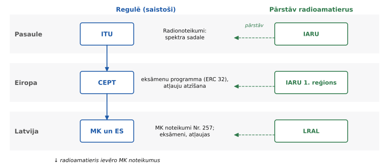

# 3. nodaļa. Normatīvie akti

Šī nodaļa izskaidro, kas un kā regulē radioamatieru darbību, un izved cauri
Ministru kabineta noteikumiem Nr. 257 — galvenajam dokumentam, ko jautā
eksāmena juridiskajā daļā.

**Video lekcija:** LRAL bezmaksas kurss, 2. nodarbība (QR kods).
**Eksāmena programma:** nacionālie un starptautiskie normatīvie akti.
**Mācību laiks:** ap 3 stundām.

## Pēc šīs nodaļas tu pratīsi

- nosaukt, ko dara ITU, CEPT, IARU, SIA "Elektroniskie sakari" un LRAL;
- atrast vajadzīgo tēmu MK noteikumos Nr. 257;
- pateikt, ko radioamatieris drīkst un ko nedrīkst raidīt;
- nosaukt galvenos radiostacijas lietošanas nosacījumus un to skaitļus;
- rīkoties pareizi, ja tava stacija rada traucējumus.

## 3.1. Kas nosaka noteikumus

Radioviļņi nepazīst valstu robežu, tāpēc noteikumi veidojas trīs līmeņos
[1], [2]. Pasaules līmenī frekvenču spektru starp dienestiem sadala **ITU**,
Starptautiskā Telesakaru savienība, kas ir ANO aģentūra. Tā izstrādā
Radionoteikumus, un valstīm tie ir saistoši. Eiropā darbojas **CEPT**,
Eiropas Pasta un telesakaru administrāciju konference. Tā saskaņo eksāmenu
programmas un atļauju atzīšanu starp valstīm; tās ieteikumi nav tieši
saistoši, bet valstis tos ievieš savos noteikumos. Latvijā noteikumus izdod
Ministru kabinets, bet ikdienas darbu veic SIA "Elektroniskie sakari" (ES):
tā rīko eksāmenus, izsniedz atļaujas, piešķir izsaukuma signālus un uzrauga,
kā noteikumi tiek pildīti. Šie noteikumi ir saistoši katram radioamatierim.

Līdzās regulatoriem darbojas radioamatieru pašu organizācijas [2]. **IARU**,
Starptautiskā Radioamatieru savienība, pārstāv radioamatierus pie ITU un
izstrādā joslu plānus un ētikas ieteikumus, bet regulēšanas pilnvaru tai nav.
**LRAL**, Latvijas Radioamatieru līga, ir Latvijas nacionālā organizācija un
IARU biedre; tā pārstāv Latvijas radioamatierus valsts iestādēs un
starptautiski.

ITU un IARU pasauli dala trīs reģionos. Latvija ir **1. reģionā** kopā ar
Eiropu, Āfriku un Tuvajiem Austrumiem [2].

> **Atceries:** ITU sadala spektru, CEPT saskaņo Eiropu, ES izsniedz atļaujas.
> IARU un LRAL pārstāv radioamatierus, bet atļaujas neizsniedz.

## 3.2. MK noteikumi Nr. 257

Latvijas radioamatieru galvenais dokuments ir Ministru kabineta 2023. gada
23. maija noteikumi Nr. 257 "Radioamatieru eksaminācijas apliecību un
radioamatieru radiostacijas atļauju saņemšanas kārtība, kā arī radioamatieru
radiostaciju lietošanas kārtība" [1]. Eksāmena juridiskie jautājumi ir
sastādīti tieši pēc tiem.

Noteikumi seko tam ceļam, ko tu pats ej. Vispirms tie skaidro, kā nokārtot
eksāmenu un saņemt atļauju, tad — kā veidojas izsaukuma signāls. Pēc tam
nāk tas, kas vajadzīgs ikdienā: ko drīkst raidīt, kā lietot staciju un ko
darīt, ja tā traucē citiem. Beigās ir īpaši gadījumi: ārvalstu radioamatieri,
kuģi un gaisa kuģi. Šī nodaļa iet tādā pašā secībā; eksāmenus skaidro 2. nodaļa,
izsaukuma signālus — 4. nodaļa. Punktu numurus rakstu iekavās, lai tekstu
vari atrast oriģinālā.

> **Praktisks padoms.** Izlasi noteikumus vienreiz pilnībā vietnē likumi.lv.
> Tās ir apmēram 15 lappuses, un tad nodaļa kļūs vēl skaidrāka.

## 3.3. Tava atļauja

Noteikumos svarīgi atšķirt divus dokumentus. **Radioamatieris** ir fiziska
persona, kas nokārtojusi eksāmenu un saņēmusi **eksaminācijas apliecību**; tā
apliecina kvalifikāciju. Taču ar apliecību vien raidīt nedrīkst: vajag arī
**radiostacijas atļauju**, tas ir, tiesības lietot **radiostaciju**
(raidītāju un uztvērēju kopumu ar papildiekārtām) ar konkrētu izsaukuma
signālu [1].

Par atļauju jāzina trīs lietas. Radiostaciju drīkst lietot tikai ar derīgu
atļauju (29. punkts). Atļauju izsniedz uz laiku līdz **pieciem gadiem** (30.
punkts). Ja mainās personas dati, kontaktadrese vai stacijas atrašanās vieta,
par to jāpaziņo ES **30 dienu laikā** (31. punkts) [1].

Radiostacijas iedala trīs veidos (16. punkts). Pēc lietošanas tās ir
**individuālās** un **koplietošanas** (kluba) stacijas; pēc darbības —
**apkalpojamās** un **neapkalpojamās**; pēc kategorijas — A, B un C.
Neapkalpojamas ir, piemēram, **atkārtotājs**, kas uztverto signālu raida tālāk
citā frekvencē, un **radiobāka**, kas pastāvīgi raida radioviļņu izplatīšanās
novērošanai [1].

No stacijas veida ir atkarīgs, kas par to atbild. Individuālajai stacijai
atbild īpašnieks, kuram izsniegta atļauja (20. punkts). Koplietošanas un
neapkalpojamajai stacijai atbild atbildīgā persona ar HAREC apliecību vai
A kategorijas atļauju (21. un 22. punkts) [1].

Ārvalstu radioamatieriem noteikumi paredz CEPT atļauju (pēc ieteikuma
T/R 61-01; tā atbilst A kategorijai) un NOVICE atļauju (pēc ieteikuma
ECC/REC (05)06; tā atbilst B kategorijai). Par tām sīkāk 4. nodaļā (73.–76.
punkts) [1].

## 3.4. Ko drīkst runāt un ar ko

Radioamatieru sakaru pamatā ir atklātība. Ziņojumi ir atklāti: drīkst
lietot Q kodus un darba saīsinājumus, bet šifrēt nedrīkst (39. punkts).
Līdzīgi ar svešiem ziņojumiem: ja nejauši uztver ziņojumu, kas nav
radioamatieru, to nedrīkst pierakstīt, publicēt vai izpaust (40. punkts) [1].

Sakari atļauti tikai ar citiem radioamatieriem (41. punkts). Izņēmums ir
ārkārtas gadījumi: ar citu dienestu drīkst sazināties, ja **apdraudēta cilvēka
dzīvība** vai notiek valsts vadīta glābšanas operācija vai tās mācības
(42. punkts). Par
šādu sakaru **trīs darbdienu laikā** jāziņo ES (43. punkts) [1].

> **Uzmanību!** Ja esi sazinājies ar cita dienesta staciju ārkārtas situācijā,
> ar to viss nebeidzas: trīs darbdienu laikā ES jāpaziņo, ar ko, kad, kurā
> frekvencē un par ko runāji [1]. Tāpēc ārkārtas sakaru vienmēr pieraksti.

Runāt drīkst par tehniskām ziņām, eksperimentiem un īsām personiskām
piezīmēm (44. punkts). Nepatiesu vai maldinošu informāciju raidīt ir
aizliegts (46. punkts) [1].

Raidījumam parasti jābūt adresētam. Neadresēti raidījumi ir aizliegti ar
dažiem izņēmumiem (47. punkts); neadresēts ir raidījums, kas nav domāts
konkrētam korespondentam. Atļauta ir antenas un raidītāja regulēšana ar
mazāko iespējamo jaudu, vēlams uz slodzes ekvivalenta, kā arī radiobākas,
mērījumi, informatīvi biļeteni un mācību raidījumi [1]. CQ nav neadresēts
raidījums: tas ir izsaukums, uz kuru gaida atbildi.

Katrs sakars jāidentificē: izsaukuma signāls jānosauc sakara sākumā, beigās un
vismaz reizi **10 minūtēs** (48. punkts). Kad pie stacijas neesi, raidītājs
nedrīkst ieslēgties pats, un to nedrīkst lietot citas personas (51. punkts).
Visbeidzot jāievēro IARU ētikas principi un vispārpieņemtās uzvedības normas
(52. punkts) [1]. Notikušu sakaru apliecina **QSL kartīte**; par to vairāk
5. nodaļā.

## 3.5. Kā lietot staciju

Noteikumu 53.–61. punkts nosaka, kā stacija jālieto. Jāievēro IARU joslu
plāni, un jālieto mazākā jauda, ar kuru sakars vēl iespējams (53. punkts).
Ja raidītājs spēj pārsniegt atļauto jaudu, tam jābūt izejas jaudas mērītājam
(54. punkts) [1]. **Atkārtotājus** drīkst lietot tikai joslās virs **29 MHz**
(56. punkts) [1].

Stacijai jābūt tīrai un drošai. Spriegums uz antenām un **fīderiem** (līnijām,
kas pārvada augstfrekvences signālu starp staciju un antenu) nedrīkst
pārsniegt **42 V** (53. punkts). Ārpusjoslas izstarojumu kopējā jauda drīkst
būt ne vairāk kā **1 %** no izstarotās jaudas (57. punkts). Stacija nedrīkst
apdraudēt cilvēkus, īpašumu un vidi (58. punkts); spriegumu vadošās daļas
jānosedz, un antenai nedrīkst būt iespējams nejauši pieskarties (59.–60.
punkts). ES var noteikt papildu ierobežojumus (61. punkts) [1].

> **Piemērs.** Tu raidi ar 100 W. Cik liela drīkst būt ārpusjoslas izstarojumu
> kopējā jauda?
>
> 1. Robeža ir 1 % no izstarotās jaudas.
> 2. 100 W × 0,01 = 1 W.
> 3. Ārpus atļautās joslas kopā drīkst nonākt ne vairāk kā 1 W.

## 3.6. Kad stacija traucē

Radioamatierim jānodrošina, ka viņa stacija nerada kaitīgus traucējumus
(62.–63. punkts). Ja traucējumi tomēr rodas, noteikumi paredz kārtību
(64. punkts) [1]. Vispirms radioamatieris pilnveido savu staciju, līdz
traucējumi novērsti. Ja vaina ir traucētajā uztvērējā, to novērš uztvērēja
īpašnieks. Par papildu pasākumiem abas puses vienojas, bet, ja vienoties
neizdodas, ierobežojumus nosaka ES.

> **Uzmanību!** Ja tava stacija traucē navigācijas vai drošības dienestiem,
> raidīšana jāpārtrauc **nekavējoties** un to drīkst atsākt tikai pēc cēloņa
> novēršanas (65. punkts) [1].

Kā traucējumus atrast un novērst tehniski, māca 16. nodaļa.

## 3.7. Īpašas situācijas

**Mobilās un pārnēsājamās stacijas.** Tās drīkst lietot visā Latvijā, izņemot
vietas, kur raidīšana aizliegta, un tuvāk par **100 m** no lidostas vai
lidlauka teritorijas robežas (66. punkts). Stacijas uz kuģošanas līdzekļiem
Latvijas ūdeņos uzskata par mobilām (67. punkts) [1].

**Svešas stacijas lietošana.** Stacijas īpašnieks drīkst atļaut to lietot citam
radioamatierim, kuram ir derīga atļauja (70. punkts) [1].

**Apmācība.** A kategorijas radioamatieris drīkst savā uzraudzībā ļaut raidīt
cilvēkam, kurš vēl mācās. Apmācībā lieto B kategorijas joslas un jaudas
(71.–72. punkts) [1]. Tā tu vari izmēģināt īstu QSO vēl pirms eksāmena, ja
blakus sēž A kategorijas operators.

**Kuģi un gaisa kuģi.** Raidīt no Latvijas kuģa starptautiskajos ūdeņos vai no
gaisa kuģa drīkst tikai A kategorijas radioamatieri un tikai ar kapteiņa
atļauju (77. un 82. punkts) [1]. B kategorijai tas nav atļauts; eksāmenā
pietiek zināt šo faktu.

## Eksāmenā jāzina

- ITU ir augstākais starptautiskais regulators; Latvija ir ITU un IARU
  1. reģionā.
- Radioamatierus Latvijā regulē MK noteikumi Nr. 257; uzrauga
  SIA "Elektroniskie sakari".
- Atļauja: līdz 5 gadiem; par izmaiņām jāpaziņo 30 dienu laikā.
- Ziņojumi ir atklāti; šifrēt aizliegts; atļauti Q kodi un saīsinājumi.
- Sakari ar citiem dienestiem tikai dzīvības glābšanai un glābšanas
  operācijās; jāziņo ES 3 darbdienu laikā.
- Identificēšanās: sākumā, beigās, vismaz reizi 10 minūtēs.
- 42 V — lielākais spriegums uz antenām un fīderiem.
- 1 % — lielākā ārpusjoslas izstarojumu kopējā jauda.
- 100 m — tuvāk lidostai mobilo staciju lietot nedrīkst.
- Atkārtotāji tikai virs 29 MHz.
- Traucējot drošības dienestiem, raidīšana jāpārtrauc nekavējoties.
- No kuģa un gaisa kuģa drīkst raidīt tikai A kategorija.

## Pamēģini pats

**1. Atrodi punktu (20 minūtes).** Atver MK noteikumus Nr. 257 vietnē
likumi.lv un atrodi, kurā punktā teikts:

- [ ] ka raidīt bez izsaukuma signāla ir aizliegts;
- [ ] ka atļauju izsniedz līdz pieciem gadiem;
- [ ] ka apmācībā lieto B kategorijas nosacījumus.

**2. Izvērtē situāciju.** Tavs kaimiņš sūdzas, ka, tev raidot, viņa
televizorā parādās svītras. Uzraksti trīs teikumos, kas pēc 64. punkta jādara
tev un kas — kaimiņam.

## Kopsavilkums

- Noteikumi veidojas trīs līmeņos: ITU pasaulē, CEPT Eiropā, MK noteikumi
  un ES Latvijā.
- IARU un LRAL pārstāv radioamatierus, bet nav regulatori.
- Raidīt drīkst tikai ar derīgu atļauju, kas izsniegta līdz pieciem gadiem.
- Sakari ir atklāti un tikai ar citiem radioamatieriem; izņēmums ir dzīvības
  glābšana.
- Izsaukuma signāls jānosauc sākumā, beigās un reizi 10 minūtēs.
- Stacijai jābūt drošai un tīrai: 42 V, 1 %, mazākā vajadzīgā jauda.
- Par traucējumiem atbild radioamatieris; drošības dienestu traucēšana
  nozīmē tūlītēju raidīšanas pārtraukšanu.

## Paškontroles jautājumi

1. Kura organizācija pasaules līmenī sadala radiofrekvenču spektru starp dienestiem?
    - A. IARU
    - B. CEPT
    - C. ITU
    - D. LRAL
2. Kurā ITU reģionā atrodas Latvija?
    - A. 1. reģionā
    - B. 2. reģionā
    - C. 3. reģionā
    - D. Latvija nav nevienā reģionā
3. Kādas pilnvaras ir IARU?
    - A. Tā izsniedz radiostaciju atļaujas
    - B. Tā piešķir izsaukuma signālus
    - C. Tā nosaka sodus par pārkāpumiem
    - D. Tā pārstāv radioamatierus un izstrādā joslu plānus, bet regulēšanas pilnvaru tai nav
4. Uz cik ilgu laiku izsniedz radiostacijas atļauju?
    - A. Uz vienu gadu
    - B. Līdz pieciem gadiem
    - C. Uz desmit gadiem
    - D. Uz mūžu
5. Tu esi pārcēlies uz citu dzīvesvietu kopā ar staciju. Cik ilgā laikā par to jāpaziņo SIA "Elektroniskie sakari"?
    - A. 3 darbdienu laikā
    - B. 10 dienu laikā
    - C. 30 dienu laikā
    - D. Līdz atļaujas termiņa beigām
6. Ko drīkst lietot radioamatieru sakaros?
    - A. Q kodus un darba saīsinājumus
    - B. Jebkuru šifru, ja korespondents to zina
    - C. Tikai pilnus teikumus bez saīsinājumiem
    - D. Šifrus, ja saturs ir personisks
7. Kādā gadījumā radioamatieris drīkst sazināties ar cita radiosakaru dienesta staciju?
    - A. Ja šī stacija izsauc pirmā
    - B. Ja tas notiek naktī
    - C. Nekad
    - D. Ja apdraudēta cilvēka dzīvība vai notiek valsts vadīta glābšanas operācija
8. Cik ilgā laikā pēc sakara ar cita dienesta staciju par to jāinformē SIA "Elektroniskie sakari"?
    - A. Nekavējoties pa radio
    - B. Trīs darbdienu laikā
    - C. 30 dienu laikā
    - D. Nav jāinformē
9. Kāds lielākais spriegums pieļaujams uz antenām un fīderiem?
    - A. 12 V
    - B. 24 V
    - C. 42 V
    - D. 230 V
10. Raidītāja izstarotā jauda ir 50 W. Cik liela drīkst būt ārpusjoslas izstarojumu kopējā jauda?
    - A. 0,5 W
    - B. 1 W
    - C. 5 W
    - D. 0,05 W
11. Tava stacija traucē aviācijas navigācijas sakarus. Ko dari?
    - A. Samazini jaudu uz pusi un turpini
    - B. Pabeidz iesākto sakaru un tad meklē cēloni
    - C. Pārej uz citu diapazonu
    - D. Nekavējoties pārtrauc raidīt un neatsāc, kamēr cēlonis nav novērsts
12. Cik tuvu lidostas teritorijas robežai drīkst lietot mobilo vai pārnēsājamo radiostaciju?
    - A. Ne tuvāk par 100 m
    - B. Ne tuvāk par 10 m
    - C. Ne tuvāk par 1 km
    - D. Ierobežojumu nav
13. Kurš no šiem neadresētajiem raidījumiem ir atļauts?
    - A. Mūzikas pārraide draugiem
    - B. Reklāmas paziņojums
    - C. Īss raidījums antenas noregulēšanai ar mazāko jaudu
    - D. Ziņu pārraide pilsētas iedzīvotājiem
14. Kurš drīkst raidīt no radiostacijas uz Latvijas kuģa starptautiskajos ūdeņos?
    - A. Jebkurš radioamatieris ar kapteiņa atļauju
    - B. A kategorijas radioamatieris ar kapteiņa atļauju
    - C. B kategorijas radioamatieris bez īpašas atļaujas
    - D. Tikai kuģa radists

**Atvērtie jautājumi**

15. Paskaidro, kāpēc radioamatieru ziņojumiem jābūt atklātiem un kāpēc
    šifrēšana ir aizliegta.
16. Ar ko atšķiras ITU un IARU loma? Atbildi divos teikumos.

## Atbildes

| Nr. | Atbilde | Skaidrojums |
| --- | --- | --- |
| 1 | C | ITU ir ANO aģentūra, kuras lēmumi ir saistoši valstīm. |
| 2 | A | 1. reģions: Eiropa, Āfrika, Tuvie Austrumi. |
| 3 | D | IARU ir radioamatieru organizāciju savienība, nevis regulators. |
| 4 | B | 30. punkts: līdz pieciem gadiem. |
| 5 | C | 31. punkts: 30 dienu laikā. Trīs darbdienas attiecas uz ārkārtas sakaru paziņošanu. |
| 6 | A | 39. punkts: ziņojumi ir atklāti, Q kodi un saīsinājumi ir atļauti. |
| 7 | D | 42. punkts. |
| 8 | B | 43. punkts. |
| 9 | C | 53. punkts: 42 V. |
| 10 | A | 1 % no 50 W ir 0,5 W. |
| 11 | D | 65. punkts: nekavējoties, līdz cēloņa novēršanai. |
| 12 | A | 66. punkts. |
| 13 | C | 47. punkts: antenas regulēšana ar mazāko jaudu ir viens no izņēmumiem. |
| 14 | B | 77. punkts: tikai A kategorija un ar kapteiņa atļauju. |

Atvērtie jautājumi: piecpadsmitajā jāpiemin, ka dienests pastāv pašizglītībai
un eksperimentiem bez komerciāla vai slepena nolūka un ka atklātība ļauj
uzraudzīt spektra lietošanu. Sešpadsmitajā — ka ITU ir valstu regulators ar
saistošiem lēmumiem, bet IARU pārstāv radioamatierus un dod ieteikumus.

## Padziļināti

- **ITU Radionoteikumi.** Radioamatieru dienestam veltīts 25. pants; tur
  noteikts, ka administrācijas pārbauda operatoru kvalifikāciju. No tā
  izriet eksāmena nepieciešamība.
- **CEPT T/R 61-01 un T/R 61-02.** Pirmais ieteikums ļauj īslaicīgi strādāt
  citā CEPT valstī bez papildu atļaujas, otrais saskaņo HAREC eksāmenu.
  B kategorijai atbilst ERC 32. ziņojums un ieteikums ECC/REC (05)06.

## Nodaļas avoti

1. Ministru kabineta 2023. gada 23. maija noteikumi Nr. 257 "Radioamatieru
   eksaminācijas apliecību un radioamatieru radiostacijas atļauju saņemšanas
   kārtība, kā arī radioamatieru radiostaciju lietošanas kārtība".
   <https://likumi.lv/ta/id/342127> (skatīts 2026-11-12).
2. LRAL bezmaksas kurss 2026, 2. nodarbība "Juridiskie jautājumi",
   prezentācija un video lekcija. lral.lv.
