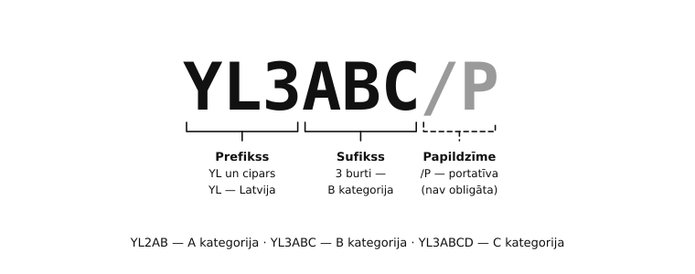
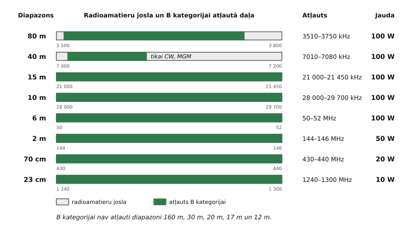

# 4. nodaļa. Izsaukuma signāli, joslas un jaudas

Šī nodaļa iemāca izlasīt jebkuru Latvijas izsaukuma signālu un precīzi pasaka,
kurās frekvencēs un ar kādu jaudu drīkst raidīt B kategorijas stacija.

**Video lekcija:** LRAL bezmaksas kurss, 2. nodarbība (QR kods).
**Eksāmena programma:** nacionālie un starptautiskie normatīvie akti; izsaukuma signāli.
**Mācību laiks:** ap 2 stundām.

## Pēc šīs nodaļas tu pratīsi

- pēc izsaukuma signāla noteikt stacijas kategoriju;
- izskaidrot papildzīmes /P, /M, /MM, /AM un /R;
- pareizi izveidot izsaukuma signālu, strādājot ārvalstīs;
- nosaukt B kategorijas joslas un lielāko atļauto jaudu katrā;
- pārbaudīt, vai konkrēta frekvence un darba veids tev ir atļauts.

## 4.1. Latvijas izsaukuma signāla uzbūve

Izsaukuma signālus piešķir SIA "Elektroniskie sakari" (ES). Pamata izsaukuma
signāls sastāv no prefiksa **YL**, viena cipara un sufiksa. Sufiksa garums
rāda stacijas kategoriju (32.–33. punkts) [1].

| Kategorija | Burti sufiksā | Piemērs |
| --- | --- | --- |
| A | 2 | YL2AB |
| B | 3 | YL3ABC |
| C | 4 | YL3ABCD |

Pārejot uz augstāku kategoriju, izsaukuma signāls var mainīties: no C uz B
piešķir signālu ar trīs burtiem, no B uz A — ar diviem [1].

> **Piemērs.** Kādas kategorijas stacijas ir YL2KF, YL3RZA un YL1ABCD?
>
> 1. Atmet prefiksu un ciparu: paliek KF, RZA, ABCD.
> 2. Saskaiti burtus: 2, 3, 4.
> 3. Atbilde: A kategorija, B kategorija, C kategorija.

Slēgtas stacijas izsaukuma signālu citai stacijai nepiešķir (34. punkts) [1].
Tavs izsaukuma signāls paliek tavs.

## 4.2. Īpašie un sacensību izsaukuma signāli

Bez pamata signāla pastāv vēl divi veidi [1].

| Veids | Uzbūve | Kam piešķir | Piemērs | Punkts |
| --- | --- | --- | --- | --- |
| Īpašais | YL, cipari un burti pēc izvēles | A un B kategorijai, uz laiku līdz vienam gadam | YL100RADIO | 35. |
| Sacensību | YL, cipars un viens burts | Tikai A kategorijai; lieto tikai starptautiskās sacensībās | YL9E | 36. |

Īpašos signālus izmanto jubilejām un pasākumiem. Ja ēterā dzirdi neparasti
garu YL signālu ar skaitli, tā gandrīz noteikti ir īpašā stacija.

## 4.3. Papildzīmes

Aiz izsaukuma signāla ar slīpsvītru pievieno zīmi, kas pasaka, kur stacija
atrodas (37. punkts) [1].

| Zīme | Nozīme | Piemērs |
| --- | --- | --- |
| /P | Portatīva (pārnēsājama) stacija | YL3ABC/P |
| /M | Mobila stacija sauszemes transportlīdzeklī vai kuģošanas līdzeklī iekšējos ūdeņos | YL3ABC/M |
| /MM | Stacija uz Latvijas kuģa starptautiskajos ūdeņos | YL2AB/MM |
| /AM | Stacija Latvijas gaisa kuģī | YL2AB/AM |
| /R | Atkārtotājs | YL2XX/R |

Atkārtotājam var piešķirt arī signālu ar trīs burtu sufiksu, kura pirmais
burts ir R, piemēram, YL2RKA; tad /R nepievieno [1].

Mobilai vai pārnēsājamai stacijai /M un /P **drīkst** pievienot (68. punkts);
zīmes /MM un /AM attiecas tikai uz A kategoriju, jo no kuģa un gaisa kuģa
B kategorija raidīt nedrīkst [1].

> **Uzmanību!** Raidīt bez izsaukuma signāla vai ar signālu, kas tev nav
> piešķirts, ir aizliegts (38. punkts) [1].

## 4.4. Darbs ārvalstīs un viesi Latvijā

Radioamatieru atļaujas Eiropā ir savstarpēji atzītas, tāpēc ceļojumā staciju
var ņemt līdzi [1], [2].

| Tava atļauja | Kam tā atbilst | Kā strādā viesis Latvijā |
| --- | --- | --- |
| A kategorija | CEPT atļauja (ieteikums T/R 61-01) | Pēc A kategorijas nosacījumiem (73. punkts) |
| B kategorija | NOVICE atļauja (ieteikums ECC/REC (05)06) | Pēc B kategorijas nosacījumiem (74. punkts) |

Viesojoties citā valstī, savam izsaukuma signālam priekšā liek šīs valsts
prefiksu un slīpsvītru:

- Latvijas stacija Lietuvā: **LY/YL2AB**;
- Lietuvas stacija Latvijā: **YL/LY1AB** (75. punkts) [1].

Ārvalsts radioamatierim pēc pieprasījuma jāuzrāda atļauja un personu
apliecinošs dokuments. Ja viesim nav ne CEPT, ne NOVICE atļaujas, viņš var
lūgt ES pagaidu atļauju uz laiku līdz vienam gadam (76. punkts) [1].

> **Praktisks padoms.** NOVICE atļauju atzīst mazāk valstu nekā CEPT atļauju,
> un atļautās joslas un jaudas katrā valstī ir savas. Pirms brauciena
> pārbaudi, vai galamērķa valsts ir ieviesusi ieteikumu ECC/REC (05)06 un
> kādi ir tās iesācēju nosacījumi.

## 4.5. B kategorijas joslas un jaudas

Šī ir nodaļas svarīgākā tabula. Tā ir MK noteikumu Nr. 257 2. pielikums [1];
kolonna "Diapazons" pievienota ērtībai.

| Diapazons | Frekvenču josla | Statuss | Lielākā jauda | Piezīme |
| --- | --- | --- | --- | --- |
| 80 m | 3510–3750 kHz | PRIM | 100 W | |
| 40 m | 7010–7080 kHz | PRIM | 100 W | Tikai CW un MGM |
| 15 m | 21 000–21 450 kHz | PRIMeks | 100 W | |
| 10 m | 28 000–29 700 kHz | PRIMeks | 100 W | |
| 6 m | 50–50,5 MHz | PRIM | 100 W | |
| 6 m | 50,5–52 MHz | sek | 100 W | |
| 2 m | 144–146 MHz | PRIMeks | 50 W | |
| 70 cm | 430–440 MHz | PRIM | 20 W | |
| 23 cm | 1240–1300 MHz | sek | 10 W | |

Kā lasīt tabulu:

- **Statuss** pasaka, kādas tiesības joslā ir radioamatieriem [1].
    - **PRIMeks** — josla ir tikai radioamatieriem.
    - **PRIM** — radioamatieri ir primārais dienests, bet josla var būt
      kopīga ar citiem.
    - **sek** — sekundārs dienests: nedrīkst traucēt primārajiem dienestiem
      un nevar prasīt aizsardzību no to traucējumiem.
- **Jauda** tabulā ir raidītāja galotnes jauda (pX), proti, lielākā jauda
  signāla maksimumos [1].
- **MGM** (machine generated modes) ir ciparu darba veidi, piemēram, FT8
  un RTTY.

> **Atceries:** HF un 6 m — 100 W. Tālāk jauda krītas: 2 m — 50 W,
> 70 cm — 20 W, 23 cm — 10 W.

> **Uzmanību!** 40 m diapazonā B kategorija drīkst strādāt tikai telegrāfā
> un ciparu darba veidos. Balss sakari (SSB) tur B kategorijai nav atļauti.

## 4.6. Kur B kategorija nedrīkst raidīt

Tikpat svarīgi ir zināt robežas. B kategorijai **nav** atļauti:

- citi diapazoni, piemēram, 160 m, 30 m, 20 m, 17 m un 12 m — to tabulā nav vispār;
- 80 m diapazona malas: zem 3510 kHz un virs 3750 kHz;
- 40 m diapazonā viss ārpus 7010–7080 kHz.

Klausīties drīkst visur.

> **Piemērs.** Vai B kategorijas stacija drīkst raidīt šādi?
>
> | Frekvence, veids, jauda | Atbilde | Kāpēc |
> | --- | --- | --- |
> | 3,690 MHz, SSB, 100 W | Jā | 80 m josla, jauda nepārsniedz 100 W |
> | 3,760 MHz, SSB, 50 W | Nē | Virs 3750 kHz |
> | 7,060 MHz, SSB, 50 W | Nē | 40 m tikai CW un MGM |
> | 7,074 MHz, FT8, 50 W | Jā | 40 m josla, ciparu darba veids |
> | 14,200 MHz, SSB, 10 W | Nē | 20 m diapazons B kategorijai nav atļauts |
> | 145,500 MHz, FM, 50 W | Jā | 2 m josla, tieši lielākā atļautā jauda |
> | 433,500 MHz, FM, 50 W | Nē | 70 cm lielākā jauda ir 20 W |

> **Praktisks padoms.** SSB signāls aizņem ap 3 kHz. Ja noskaņojies tieši uz
> joslas malu, daļa signāla nonāk ārpus tās. Turies vismaz 3 kHz no malas:
> LSB režīmā no apakšējās, USB režīmā no augšējās.

## 4.7. Blakusizstarojumi

Raidītājs izstaro ne tikai vajadzīgo signālu, bet arī nevēlamus signālus citās
frekvencēs — blakusizstarojumus. MK noteikumu 4. pielikums nosaka, cik stipri
tiem jābūt vājinātiem. Stacijām zem 30 MHz prasība ir vismaz
43 + 10·lg(P) dB vai 50 dB atkarībā no tā, kura prasība ir vieglāka [1].
Rūpnieciski ražoti transīveri šīs prasības izpilda; pašbūvētam raidītājam tās
jāpārbauda. Vairāk par to stāsta 12. un 16. nodaļa.

## Eksāmenā jāzina

- Prefikss YL + cipars + sufikss; A — 2 burti, B — 3 burti, C — 4 burti.
- /P portatīva, /M mobila, /MM uz kuģa starptautiskajos ūdeņos, /AM gaisa
  kuģī, /R atkārtotājs.
- Raidīt bez izsaukuma signāla ir aizliegts.
- Ārvalsts radioamatieris Latvijā: YL/ + savs izsaukuma signāls. CEPT atļauja
  atbilst A kategorijai, NOVICE atļauja — B kategorijai.
- Pagaidu atļauja ārvalstniekam bez CEPT vai NOVICE atļaujas: līdz 1 gadam.
- B kategorijas joslas: 3510–3750 kHz, 7010–7080 kHz (CW, MGM),
  21 000–21 450 kHz, 28 000–29 700 kHz, 50–52 MHz, 144–146 MHz,
  430–440 MHz, 1240–1300 MHz.
- Jaudas: 100 W līdz 52 MHz; 50 W 2 m; 20 W 70 cm; 10 W 23 cm.
- Īpašais izsaukuma signāls: līdz 1 gadam. Sacensību signāls: viens burts
  sufiksā, tikai A kategorijai.

## Pamēģini pats

**1. Uzzīmē savu joslu karti (20 minūtes).** Uz rūtiņu lapas uzzīmē frekvenču
asi katram HF diapazonam un iekrāso B kategorijai atļauto daļu. Pieraksti
klāt lielāko jaudu. Lapu noliec pie stacijas vai mācību galda.

**2. Atpazīsti stacijas (10 minūtes).** Atver WebSDR un sameklē trīs Latvijas
stacijas. Katrai nosaki:

- [ ] kategoriju pēc sufiksa garuma;
- [ ] vai ir papildzīme un ko tā nozīmē;
- [ ] vai frekvence, kurā stacija raida, ir atļauta B kategorijai.

## Kopsavilkums

- Sufiksa garums rāda kategoriju: 2, 3 vai 4 burti.
- Papildzīme aiz slīpsvītras pasaka, kur stacija atrodas.
- Ārvalstīs priekšā liek viesvalsts prefiksu: LY/YL2AB.
- B kategorijai ir astoņi diapazoni no 80 m līdz 23 cm.
- Lielākā jauda ir 100 W īsviļņos un 6 m, mazāka augstākās frekvencēs.
- 40 m diapazonā B kategorijai tikai CW un ciparu darba veidi.
- Pirms raidi, pārbaudi trīs lietas: josla, darba veids, jauda.

## Paškontroles jautājumi

1. Cik burtu ir B kategorijas radiostacijas izsaukuma signāla sufiksā?
    - A. Divi
    - B. Trīs
    - C. Četri
    - D. Viens
2. Kādas kategorijas stacija ir YL2GT?
    - A. A kategorijas
    - B. B kategorijas
    - C. C kategorijas
    - D. Sacensību stacija
3. Ko nozīmē /P aiz izsaukuma signāla?
    - A. Stacija raida ar pilnu jaudu
    - B. Stacija ir kluba stacija
    - C. Stacija ir portatīva
    - D. Stacija ir atkārtotājs
4. Tu raidi no automašīnas, braucot pa Latviju. Kuru papildzīmi drīksti pievienot?
    - A. /AM
    - B. /MM
    - C. /R
    - D. /M
5. Kā izskatās Igaunijas radioamatiera ES1ABC izsaukuma signāls, kad viņš raida no Latvijas?
    - A. YL/ES1ABC
    - B. ES1ABC/YL
    - C. ES/YL1ABC
    - D. YL1ABC
6. Kāda ir lielākā atļautā jauda B kategorijas stacijai 144–146 MHz joslā?
    - A. 10 W
    - B. 20 W
    - C. 50 W
    - D. 100 W
7. Kāda ir lielākā atļautā jauda B kategorijas stacijai 430–440 MHz joslā?
    - A. 100 W
    - B. 20 W
    - C. 50 W
    - D. 10 W
8. Kurus darba veidus B kategorija drīkst lietot 7010–7080 kHz joslā?
    - A. Visus
    - B. Tikai SSB
    - C. Tikai FM
    - D. Tikai CW un MGM
9. Kurā no šīm frekvencēm B kategorijas stacija drīkst raidīt SSB?
    - A. 21,300 MHz
    - B. 14,200 MHz
    - C. 7,060 MHz
    - D. 3,780 MHz
10. Ko nozīmē statuss "sek" joslu tabulā?
    - A. Joslu drīkst lietot tikai sekundi ilgiem raidījumiem
    - B. Josla ir tikai radioamatieriem
    - C. Radioamatieri ir sekundārs dienests un nedrīkst traucēt primārajiem
    - D. Joslā drīkst strādāt tikai A kategorija
11. Uz cik ilgu laiku piešķir īpašo izsaukuma signālu?
    - A. Līdz vienam gadam
    - B. Līdz pieciem gadiem
    - C. Uz vienu mēnesi
    - D. Uz mūžu
12. Kurai kategorijai var piešķirt sacensību izsaukuma signālu ar vienu burtu sufiksā?
    - A. Visām
    - B. Tikai A kategorijai
    - C. A un B kategorijai
    - D. Tikai kluba stacijām

**Atvērtie jautājumi**

13. Tu gribi nodibināt SSB sakaru 80 m diapazonā LSB režīmā. Kāda ir zemākā
    frekvence, uz kuras tu droši vari noskaņoties, un kāpēc?
14. Uzraksti no galvas B kategorijas joslu un jaudu tabulu. Salīdzini ar
    4.5. apakšnodaļu.

## Atbildes

| Nr. | Atbilde | Skaidrojums |
| --- | --- | --- |
| 1 | B | A — 2 burti, B — 3 burti, C — 4 burti. |
| 2 | A | Sufiksā GT ir divi burti. |
| 3 | C | /P nāk no "portable". |
| 4 | D | /M ir mobila stacija sauszemes transportlīdzeklī; /MM un /AM ir kuģim un gaisa kuģim. |
| 5 | A | Priekšā liek viesvalsts prefiksu un slīpsvītru. |
| 6 | C | 2 m diapazonā 50 W. |
| 7 | B | 70 cm diapazonā 20 W. |
| 8 | D | 40 m diapazonā B kategorijai balss sakari nav atļauti. |
| 9 | A | 21,300 MHz ir 15 m joslā. 14,200 MHz ir 20 m, kas nav atļauts; 7,060 MHz tikai CW un MGM; 3,780 MHz ir virs 3750 kHz. |
| 10 | C | Sekundārs dienests nedrīkst traucēt primārajiem un nevar prasīt aizsardzību no tiem. |
| 11 | A | 35. punkts: līdz vienam gadam. |
| 12 | B | 36. punkts. |

Atvērtie jautājumi: trīspadsmitajā atbilde ir ap 3,513 MHz, jo LSB signāls
aizņem ap 3 kHz uz leju no noskaņotās frekvences un tam jāpaliek virs
3510 kHz.

## Padziļināti

- **Prefiksa cipars.** Cipars Latvijas izsaukuma signālā nenorāda reģionu.
  Dažās citās valstīs tas apzīmē apgabalu.
- **A kategorijas joslas.** A kategorijai ir pieejami visi radioamatieru
  diapazoni un lielāka jauda; tabula ir MK noteikumu 1. pielikumā.
- **6 m robežnosacījums.** 50–52 MHz joslai noteikumos ir papildu prasība par
  lauka intensitāti pie Latvijas robežas ar valstīm, kur šī josla
  radioamatieriem nav iedalīta [1].

## Nodaļas avoti

1. Ministru kabineta 2023. gada 23. maija noteikumi Nr. 257 "Radioamatieru
   eksaminācijas apliecību un radioamatieru radiostacijas atļauju saņemšanas
   kārtība, kā arī radioamatieru radiostaciju lietošanas kārtība", 32.–38. un
   73.–76. punkts, 2. un 4. pielikums. <https://likumi.lv/ta/id/342127>
   (skatīts 2026-11-12).
2. LRAL bezmaksas kurss 2026, 2. nodarbība "Juridiskie jautājumi",
   prezentācija un video lekcija. lral.lv.
