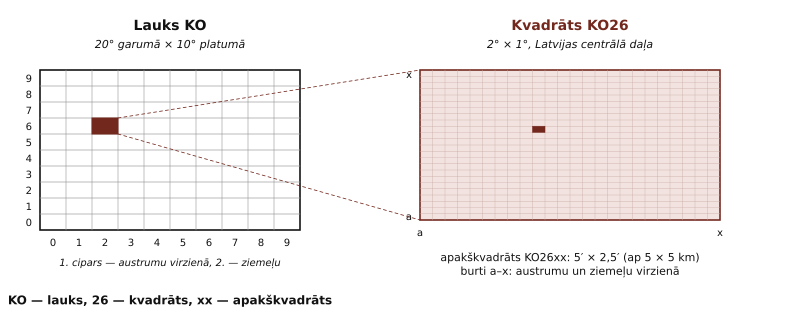
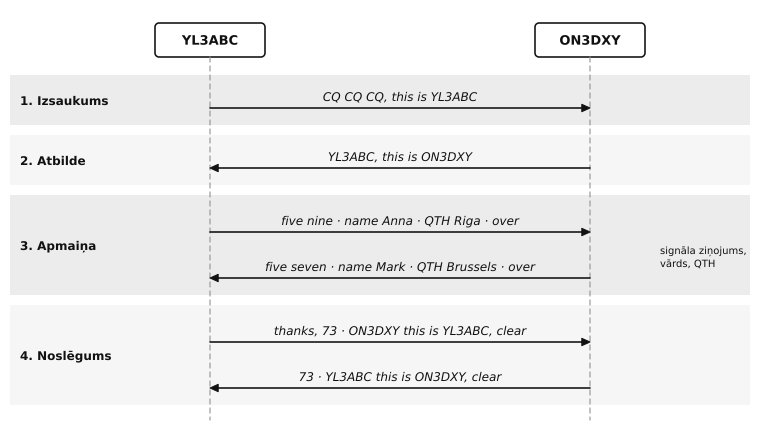
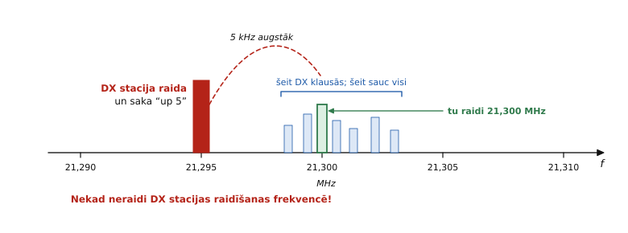
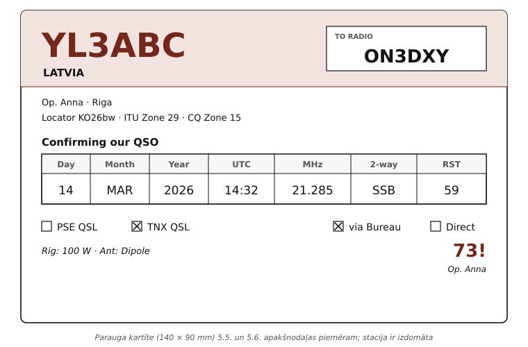
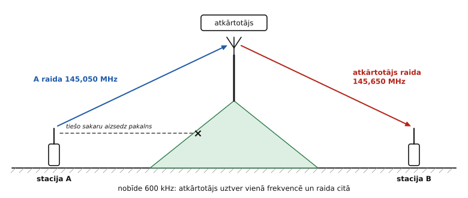

# 5. nodaļa. Radiosakaru prakse

Šī nodaļa iemāca, kā uzsākt, vadīt un pabeigt radiosakaru tā, lai tevi saprastu
jebkurā pasaules malā.

**Video lekcija:** LRAL bezmaksas kurss, 4. nodarbība (QR kods).
**Eksāmena programma:** darba noteikumi un procedūras.
**Mācību laiks:** ap 3 stundām.

## Pēc šīs nodaļas tu pratīsi

- nosaukt jebkuru izsaukuma signālu ar ITU fonētisko alfabētu;
- izskaidrot biežāk lietotos Q kodus un saīsinājumus;
- dot un saprast signāla ziņojumu RS un RST sistēmā;
- nodibināt pilnu QSO no CQ līdz 73 un ierakstīt to žurnālā;
- rīkoties pareizi, ja dzirdi ārkārtas izsaukumu.

## 5.1. Vispirms klausies

Labs operators vairāk klausās nekā runā. Ēteru vienlaikus lieto tūkstošiem
staciju, un frekvence nepieder nevienam: to nevar nopirkt vai rezervēt. To
drīkst lietot tas, kurš izpilda trīs nosacījumus [1]:

1. frekvence ir atļauta tavas kategorijas radiostacijai;
2. darba veids atbilst IARU joslu plānam;
3. frekvenci šobrīd nelieto neviens cits.

Pirmos divus nosacījumus pārbaudi tabulās (C un D pielikums). Trešo pārbaudi ar
ausīm: paklausies vismaz pusminūti, tad pajautā un nosauc savu izsaukuma
signālu.

| Darba veids | Kā jautā |
| --- | --- |
| Telefonija latviski | "Vai frekvence ir brīva? Šeit YL3ABC." |
| Telefonija angliski | "Is this frequency in use? This is YL3ABC." |
| Telegrāfs (CW) | QRL? DE YL3ABC |

Ja kāds atbild, ka frekvence ir aizņemta, pasaki paldies un meklē citu.
Ciparu darba veidos dari to pašu: pirms raidi, pārliecinies, ka izvēlētajā
vietiņā neviens nestrādā.

> **Praktisks padoms.** Pirms pirmā QSO dažus vakarus tikai klausies.
> Transīveru tam nevajag: Latvijas un Igaunijas WebSDR uztvērēji ir pieejami
> pārlūkprogrammā (sk. "Pamēģini pats"). Dzirdēsi, kā sarunas notiek īstenībā,
> un pirmais izsaukums vairs nebūs lēciens nezināmajā.

> **Uzmanību!** Neregulē raidītāju un nenoskaņo antenu uz frekvences, kur
> notiek sakars. Arī dažu sekunžu nesējs citiem ir traucējums.

Trīs uzvedības pamatlikumi der visām nodaļas situācijām [1]:

- lieto mazāko jaudu, ar kuru sakars ir drošs;
- runā pieklājīgi un īsi; ēterā teikto dzird visi, tāpēc neizpaud personisku
  informāciju un neapspried politiku, reliģiju vai komercdarījumus;
- nejaucies svešā nepabeigtā sakarā.

Par ētera kultūru plašāk stāsta 6. nodaļa.

## 5.2. Fonētiskais alfabēts

Izsaukuma signālu nekad nesaka "kā rakstās", jo trokšņos B, D, P un T izklausās
vienādi. Katru burtu aizstāj ar starptautiski pieņemtu vārdu. Eksāmenā jāzina
ITU fonētiskais alfabēts; tas pats ir NATO alfabēts [1].

| Burts | Vārds | Burts | Vārds |
| --- | --- | --- | --- |
| A | Alfa | N | November |
| B | Bravo | O | Oscar |
| C | Charlie | P | Papa |
| D | Delta | Q | Quebec |
| E | Echo | R | Romeo |
| F | Foxtrot | S | Sierra |
| G | Golf | T | Tango |
| H | Hotel | U | Uniform |
| I | India | V | Victor |
| J | Juliett | W | Whiskey |
| K | Kilo | X | X-ray |
| L | Lima | Y | Yankee |
| M | Mike | Z | Zulu |

Ciparus sarunā ar ārvalstu stacijām saka angliski. Slīpsvītru izrunā "stroke"
vai "slash".

> **Piemērs.** Nosauc fonētiski izsaukuma signālu YL3ABC/P.
>
> 1. Sadali pa zīmēm: Y – L – 3 – A – B – C – / – P.
> 2. Katram burtam atrodi vārdu: Yankee, Lima, Alfa, Bravo, Charlie, Papa.
> 3. Saliec kopā: "Yankee Lima Three Alfa Bravo Charlie stroke Papa".

> **Praktisks padoms.** Ēterā dzirdēsi arī citus vārdus, piemēram, "Germany"
> burta G vietā vai nacionālos alfabētus. Saprast tos ir noderīgi, bet pats
> lieto ITU alfabētu: to zina visi.

## 5.3. Q kodi un saīsinājumi

**Q kodi** ir trīs burtu saīsinājumi, kas sākas ar Q un aizstāj veselu teikumu.
Tie radās telegrāfā, bet tagad tos lieto arī balss sakaros. Ar jautājuma zīmi
kods ir jautājums, bez tās — atbilde vai paziņojums. Noteikumi atļauj lietot
Q kodus un darba saīsinājumus, bet aizliedz jebkādu šifrēšanu [2].

| Kods | Nozīme | Piemērs sarunā |
| --- | --- | --- |
| QTH | Atrašanās vieta | "Mans QTH ir Jelgava." |
| QSO | Radiosakars | "Paldies par QSO!" |
| QSL | Apstiprinu, sapratu; arī sakara apstiprinājuma kartīte | "QSL, visu sapratu." |
| QRZ? | Kas mani sauc? | "QRZ? Šeit YL3ABC." |
| QRL? | Vai frekvence aizņemta? | Telegrāfā pirms CQ |
| QSY | Mainu frekvenci | "QSY 5 kHz uz augšu." |
| QRM | Traucējumi no citām stacijām | "Atkārto, liels QRM." |
| QRN | Dabiskie traucējumi, piemēram, pērkons | "Šovakar stiprs QRN." |
| QSB | Signāla stiprums svārstās | "Tavs signāls ar QSB." |
| QRP | Mazinu jaudu; darbs ar mazu jaudu | "Strādāju QRP, 5 W." |
| QRO | Palielinu jaudu | |
| QRX | Uzgaidi | "QRX vienu minūti." |
| QRT | Beidzu raidīt | "Eju QRT, 73!" |

Bez Q kodiem sarunās pastāvīgi dzirdami daži saīsinājumi [1]:

| Saīsinājums | Nozīme |
| --- | --- |
| CQ | Vispārējs izsaukums visām stacijām |
| DE | "No"; telegrāfā starp abiem izsaukuma signāliem |
| DX | Tāla stacija, tāls sakars |
| 73 | Labākie sveicieni; sakara noslēgumā |
| 88 | Sirsnīgi sveicieni; tradicionāli, ja operatore ir sieviete |
| TNX | Paldies |
| WX | Laikapstākļi |
| UP | Klausos augstākā frekvencē (sk. 5.6.) |

> **Atceries:** QRM vai QRN? M kā "man-made" — cilvēku radīti traucējumi.
> N kā "natural" — dabas radīti.

> **Uzmanību!** Saīsinājumu ir simtiem. Iesācējam pietiek ar šīm divām
> tabulām; retus saīsinājumus labāk nelietot, jo korespondents tos var nezināt.

## 5.4. Signāla ziņojums un atrašanās vieta

Katrā QSO abas stacijas pasaka, cik labi dzird viena otru. To dara ar **RST
sistēmu**: trīs cipari, katrs savam rādītājam [1].

| Burts | Ko vērtē | Skala | Mazākā vērtība | Lielākā vērtība |
| --- | --- | --- | --- | --- |
| R (readability) | Saprotamība | 1–5 | 1 — nav saprotams | 5 — pilnīgi saprotams |
| S (strength) | Signāla stiprums | 1–9 | 1 — tik tikko dzirdams | 9 — ļoti stiprs |
| T (tone) | Toņa kvalitāte | 1–9 | 1 — rupjš, trokšņains | 9 — tīrs tonis |

- **Telefonijā** (SSB, FM) dod tikai divus ciparus, RS: "pieci deviņi",
  "five nine".
- **Telegrāfā un RTTY** dod visus trīs, piemēram, 599.
- **Ciparu darba veidos**, piemēram, FT8, programma pati izmēra signāla un
  trokšņa attiecību decibelos.

> **Piemērs.** Korespondents saka: "You are five three." Ko tas nozīmē?
>
> 1. Pirmais cipars ir R = 5: tevi saprot pilnīgi.
> 2. Otrais cipars ir S = 3: signāls ir vājš.
> 3. Secinājums: sakars notiek, bet rezerves nav. Runā skaidri un īsi.

Signāla stiprumu nolasa no uztvērēja S metra, saprotamību novērtē pats.

> **Praktisks padoms.** Dod godīgu ziņojumu. Ja visiem saki "59", korespondents
> neuzzina neko par savu antenu un jaudu. Īsts "44" ir noderīgāks par
> pieklājīgu "59".

**Atrašanās vieta.** Sarunā pietiek nosaukt pilsētu vai novadu: "QTH Cēsis".
Ciparu darba veidos (piemēram, FT8) un VHF sakaros vietu norāda ar **lokatoru**
(WW jeb Maidenhead lokatoru). Tas ir īss burtu un ciparu kods, kas apzīmē
rūtiņu uz pasaules kartes: jo garāks kods, jo mazāka rūtiņa. Pirmie divi burti
ir lauks (visa Latvija ir laukā KO), divi cipari — kvadrāts tajā (Rīga ir
KO26), vēl divi burti — sīkāka rūtiņa (KO26bw). Četras zīmes norāda apgabalu
ap 100 km, sešas — dažus kilometrus [1].

> **Praktisks padoms.** Savu lokatoru nerēķini ar roku: to parāda žurnāla
> programmas un lokatora kalkulatori pēc adreses vai kartes.

## 5.5. Izsaukums un QSO uzbūve

**CQ** ir vispārējs izsaukums: "saucu visas stacijas, atbildiet, kas dzirdat".
Izsaukumā vienmēr nosauc savu izsaukuma signālu, jo raidījumi bez tā ir
aizliegti [2].

Izsaukumu var sašaurināt, aiz CQ pasakot, ko meklē [1]:

| Izsaukums | Kam tas adresēts |
| --- | --- |
| CQ DX | Tālām stacijām; tuvējām neatbildēt |
| CQ EU, CQ SA | Norādītajam kontinentam |
| CQ YL, CQ JA | Norādītās valsts stacijām |
| CQ CONTEST, CQ TEST | Sacensību dalībniekiem |
| CQ POTA, CQ SOTA | Attiecīgās programmas dalībniekiem |
| Konkrēts izsaukuma signāls | Vienai stacijai, ja par sakaru ir norunāts (SKED) |

**Atbilde uz CQ.** Telefonijā parasti pietiek vienreiz skaidri nosaukt savu
izsaukuma signālu un klausīties. Telegrāfā raida: `YL3ABC DE YL3XXX K`. Ja
korespondents tavu signālu sadzirdējis nepareizi, izlabo to uzreiz.

Katram QSO ir četras daļas [1]:

1. **Izsaukums** — CQ vai konkrētas stacijas izsaukšana.
2. **Atbilde** — korespondents nosauc savu izsaukuma signālu.
3. **Apmaiņa** — signāla ziņojums, vārds, QTH; ja ir laiks, arī aparatūra,
   antena, jauda, laikapstākļi.
4. **Noslēgums** — pateicība, 73 un abi izsaukuma signāli.

**Piemērs: pilns QSO angļu valodā**

| Kas runā | Teksts |
| --- | --- |
| YL3ABC | "CQ CQ CQ, this is Yankee Lima Three Alfa Bravo Charlie, YL3ABC calling CQ and standing by." |
| ON3DXY | "YL3ABC, this is Oscar November Three Delta X-ray Yankee." |
| YL3ABC | "ON3DXY, good afternoon! You are five nine. My name is Anna, QTH Riga. Over." |
| ON3DXY | "Thanks Anna. You are five seven. Name is Mark, QTH Brussels. Over." |
| YL3ABC | "Thank you for the contact, Mark. 73! ON3DXY, this is YL3ABC, clear." |
| ON3DXY | "73, goodbye. YL3ABC, this is ON3DXY, clear." |

**Tas pats latviski**

| Kas runā | Teksts |
| --- | --- |
| YL3ABC | "Visiem, visiem, visiem, šeit YL3ABC, Yankee Lima Three Alfa Bravo Charlie. Uztveru." |
| YL2XYZ | "YL3ABC, šeit YL2XYZ." |
| YL3ABC | "YL2XYZ, labdien! Dzirdu jūs pieci deviņi. Mans vārds Anna, QTH Rīga. Uztveru." |
| YL2XYZ | "Paldies, Anna. Jūs dzirdu pieci septiņi. Vārds Mārtiņš, QTH Liepāja. Uztveru." |
| YL3ABC | "Paldies par sakaru, Mārtiņ! 73. YL2XYZ, šeit YL3ABC, beidzu." |

> **Uzmanību!** Savs izsaukuma signāls jānosauc sakara sākumā, beigās un sakara
> laikā vismaz reizi 10 minūtēs [2]. Garā sarunā ieliec to katras savas
> pārraides beigās, un nekad nenokavēsi.

> **Praktisks padoms.** Pirmajam QSO uzraksti uz lapas savu vārdu un QTH
> fonētiski un noliec blakus transīveram (H pielikumā ir gatavs paraugs).
> Uztraukumā aizmirstas pat paša vārds.

## 5.6. Split, žurnāls un QSL

**Split.** Kad retu DX staciju vienlaikus sauc simtiem operatoru (to sauc par
**pile-up**), tā raida vienā frekvencē, bet klausās citā. Tā saucēji nenoslāpē
pašu DX staciju. DX operators pasaka, kur klausās: "up 5" nozīmē 5 kHz
augstāk, "down 2" — 2 kHz zemāk [1].

> **Piemērs.** DX stacija raida 21,295 MHz un saka "up 5". Kurā frekvencē tev
> jāraida?
>
> 1. "Up" nozīmē augstāk, "5" nozīmē 5 kHz = 0,005 MHz.
> 2. 21,295 MHz + 0,005 MHz = 21,300 MHz.
> 3. Transīverī ieslēdz SPLIT: uztveršana 21,295 MHz, raidīšana 21,300 MHz.

> **Uzmanību!** Nekad neraidi DX stacijas raidīšanas frekvencē, ja tā strādā
> split režīmā. Tā ir biežākā un visvairāk dzirdamā iesācēja kļūda.

**Žurnāls.** Katru QSO ieraksta stacijas žurnālā, papīra vai elektroniskā.
Laiku visā pasaulē pieraksta vienādi, pēc **UTC**, lai abu staciju ieraksti
sakristu neatkarīgi no laika joslas [1].

| UTC | Diapazons, frekvence | Veids | Korespondents | RST nosūtīts / saņemts | Vārds |
| --- | --- | --- | --- | --- | --- |
| 14:32 | 15 m, 21,285 MHz | SSB | ON3DXY | 59 / 57 | Mark |
| 14:47 | 2 m, 145,500 MHz | FM | YL3XXX | 59 / 59 | Anna |

> **Piemērs.** QSO notika pulksten 16.40 pēc Latvijas ziemas laika. Kāds laiks
> jāraksta žurnālā?
>
> 1. Latvijas ziemas laiks ir UTC + 2 stundas, vasaras laiks — UTC + 3 stundas.
> 2. 16.40 − 2 stundas = 14.40.
> 3. Žurnālā raksti 14:40 UTC.

Ap pusnakti mainās arī datums: 01.15 pēc Latvijas ziemas laika ir 23:15 UTC
iepriekšējā dienā.

**QSL.** Sakaru apstiprina ar QSL kartīti vai elektroniski. Papīra kartītes
joprojām sūta, bet elektroniskās sistēmas ir ātrākas; par tām stāsta
19. nodaļa.

## 5.7. VHF un UHF sakari, atkārtotāji

Uz 2 m un 70 cm diapazoniem vietējie sakari parasti notiek FM. Kopējā
izsaukuma frekvence 2 m diapazonā ir 145,500 MHz: tajā izsauc, bet garu sarunu
pārceļ uz citu brīvu frekvenci [1].

**Atkārtotājs** (repīters) ir augstā vietā uzstādīta neapkalpojama stacija, kas
tavu signālu uztver vienā frekvencē un tūlīt raida tālāk citā. Tā divas rokas
stacijas sazinās desmitiem kilometru attālumā. Starpību starp abām frekvencēm
sauc par **nobīdi**; Latvijā 2 m atkārtotājiem tā ir 600 kHz [1].

> **Piemērs.** Atkārtotājs raida 145,650 MHz, nobīde ir −600 kHz. Kurā
> frekvencē raidi tu?
>
> 1. Atkārtotāja raidīšanas frekvence ir tava uztveršanas frekvence:
>    145,650 MHz.
> 2. 600 kHz = 0,600 MHz; 145,650 − 0,600 = 145,050 MHz.
> 3. Tu raidi 145,050 MHz, un atkārtotājs tieši tur klausās.

**Apaļais galds.** Vairāki operatori satiekas vienā frekvencē un runā pēc
kārtas; vadītājs dod vārdu katram. YL apaļais galds notiek sestdienās pulksten
9.00 pēc Latvijas laika 3,677 MHz frekvencē [1]. Tā ir laba vieta pirmajam
sakaram: visi runā latviski un iesācējus gaida.

## 5.8. Ārkārtas trafiks

Briesmu signāls telefonijā ir **MAYDAY**, telegrāfā — **SOS**. Šādam trafikam
ir absolūta prioritāte pār visu citu [1].

Ja dzirdi briesmu izsaukumu:

1. nekavējoties pārtrauc raidīt;
2. klausies un pieraksti visu: kas sauc, kur atrodas, kas noticis, laiku un
   frekvenci;
3. neiejaucies, ja kāds jau atbild; iejaukšanās var kaitēt;
4. ja neviens neatbild, atbildi pats un zvani 112.

Parasti radioamatieris sazinās tikai ar citiem radioamatieriem. Ar cita
dienesta staciju drīkst sazināties divos gadījumos: ja apdraudēta cilvēka
dzīvība vai jānovērš briesmas, un valsts iestāžu vadītās glābšanas operācijās
vai to mācībās [2].

## Eksāmenā jāzina

- ITU fonētiskais alfabēts no galvas, visi 26 burti.
- Q kodi: QTH, QSO, QSL, QRZ, QRL, QSY, QRM, QRN, QSB, QRP, QRO, QRX, QRT.
- RST: R 1–5, S 1–9, T 1–9; telefonijā tikai RS.
- Lokators (piemēram, KO26) ir burtu un ciparu kods, kas norāda vietu uz
  kartes; jo garāks kods, jo precīzāka vieta. Latvija ir laukā KO.
- Izsaukuma signāls jānosauc sakara sākumā, beigās un vismaz reizi 10 minūtēs.
- "UP" pēc izsaukuma signāla nozīmē: stacija klausās augstākā frekvencē.
- Žurnālā laiku raksta pēc UTC.
- Briesmu signāli: MAYDAY telefonijā, SOS telegrāfā; tiem ir absolūta
  prioritāte.
- 2 m kopējā izsaukuma frekvence ir 145,500 MHz; atkārtotāju nobīde 600 kHz.
- 73 nozīmē "labākie sveicieni".

## Pamēģini pats

**1. Noklausies īstu QSO (20 minūtes).** Atver WebSDR uztvērēju
pārlūkprogrammā: websdr.venta.lv:8901 vai websdr.virac.eu. Sestdienas rītā
noskaņo 3677 kHz, LSB, un klausies YL apaļo galdu. Pieraksti:

- [ ] trīs dzirdētus izsaukuma signālus;
- [ ] vienu signāla ziņojumu, ko kāds deva;
- [ ] divus Q kodus vai saīsinājumus, ko dzirdēji.

**2. Sagatavo savu pirmo QSO (10 minūtes).** Uzraksti uz lapas fonētiski
izdomātu izsaukuma signālu, savu vārdu un QTH. Nolasi skaļi piemēra QSO no
5.5. apakšnodaļas, ieliekot savus datus. Atkārto, līdz vari to pateikt,
neskatoties lapā.

**3. Pārrēķini laiku.** Paskaties pulkstenī un pasaki, cik šobrīd ir pēc UTC.

## Kopsavilkums

- Pirms raidi, klausies un pajautā, vai frekvence ir brīva.
- Izsaukuma signālus un sarežģītus vārdus nodod ar ITU fonētisko alfabētu.
- Q kodi un saīsinājumi ļauj saprasties jebkurā valodā; šifrēt ziņojumus ir
  aizliegts.
- Signāla ziņojumu dod RST sistēmā: telefonijā divi cipari, telegrāfā trīs.
- Lokators (piemēram, KO26) norāda vietu uz kartes; to lieto FT8 un VHF sakaros.
- QSO ir četras daļas: izsaukums, atbilde, apmaiņa, noslēgums.
- Savu izsaukuma signālu nosauc sākumā, beigās un vismaz reizi 10 minūtēs.
- Split režīmā raidi tur, kur DX stacija klausās, nevis tur, kur tā raida.
- Katru QSO ieraksti žurnālā pēc UTC.
- Dzirdot MAYDAY vai SOS, pārtrauc raidīt, klausies un pieraksti.

## Paškontroles jautājumi

Katram testa jautājumam ir viena pareiza atbilde. Eksāmena līmenis ir 60 %,
tātad šeit mērķis ir vismaz 9 pareizas atbildes no 14.

1. Tu gribi raidīt CQ brīvā izskatīgā frekvencē. Ko dari vispirms?
    - A. Uzreiz sāc saukt CQ
    - B. Paklausies un pajautā, vai frekvence ir brīva, nosaucot savu izsaukuma signālu
    - C. Noregulē raidītāju šajā frekvencē ar pilnu jaudu
    - D. Palielini jaudu, lai tevi dzirdētu visi
2. Kā ar ITU fonētisko alfabētu nodod izsaukuma signālu YL3KO?
    - A. Yankee London Three Kilo Ontario
    - B. Yellow Lima Three King Oscar
    - C. Yankee Lima Three Kilo Oscar
    - D. Yankee Lima Three Kilogram Oscar
3. Telefonijas sakarā korespondents tev saka "five seven". Ko tas nozīmē?
    - A. Tu esi pilnīgi saprotams, signāls vidēji stiprs
    - B. Tu esi slikti saprotams, signāls ļoti stiprs
    - C. Viņš raida ar 5 W jaudu 7 MHz diapazonā
    - D. Toņa kvalitāte 5, stiprums 7
4. Ko nozīmē QSB?
    - A. Mainu frekvenci
    - B. Traucējumi no citām stacijām
    - C. Beidzu raidīt
    - D. Signāla stiprums svārstās
5. Sakaru traucē cita stacija blakus frekvencē. Ar kuru kodu to pasaki korespondentam?
    - A. QRN
    - B. QRM
    - C. QRP
    - D. QRX
6. Cik bieži sakara laikā jānosauc savs izsaukuma signāls?
    - A. Tikai sakara sākumā
    - B. Obligāti katrā teikumā
    - C. Sakara sākumā, beigās un vismaz reizi 10 minūtēs
    - D. Reizi 30 minūtēs
7. DX stacija raida 28,495 MHz un saka "up 5". Kurā frekvencē tu raidi?
    - A. 28,490 MHz
    - B. 28,495 MHz
    - C. 28,545 MHz
    - D. 28,500 MHz
8. Pēc kāda laika QSO ieraksta stacijas žurnālā?
    - A. Pēc UTC
    - B. Pēc Latvijas laika
    - C. Pēc korespondenta vietējā laika
    - D. Pēc jebkura, ja norāda laika joslu
9. QSO notika pulksten 21.10 pēc Latvijas vasaras laika. Kāds ir žurnāla ieraksts?
    - A. 19:10 UTC
    - B. 18:10 UTC
    - C. 23:10 UTC
    - D. 00:10 UTC
10. Sakara laikā savā frekvencē izdzirdi "MAYDAY, MAYDAY, MAYDAY". Ko dari?
    - A. Pabeidz savu sakaru un tad klausies
    - B. Uzreiz raidi un prasi sīkāku informāciju
    - C. Pārtrauc raidīt, klausies un pieraksti dzirdēto
    - D. Pārej uz citu frekvenci, lai netraucētu
11. Atkārtotājs raida 145,750 MHz, nobīde ir −600 kHz. Kurā frekvencē tu raidi?
    - A. 145,150 MHz
    - B. 146,350 MHz
    - C. 145,750 MHz
    - D. 144,600 MHz
12. Kādu signāla ziņojumu dod telegrāfa (CW) sakarā?
    - A. RS, divus ciparus
    - B. Tikai S, vienu ciparu
    - C. Signāla un trokšņa attiecību decibelos
    - D. RST, trīs ciparus
13. Tu esi Latvijā un dzirdi Lietuvas staciju saucam "CQ DX". Ko dari?
    - A. Atbildi, tikai skaļāk
    - B. Neatbildi, jo stacija meklē tālus sakarus
    - C. Atbildi divas reizes pēc kārtas
    - D. Raidi savu CQ tajā pašā frekvencē
14. Ko nozīmē "73" sakara noslēgumā?
    - A. Beidzu raidīt
    - B. Uzgaidi
    - C. Labākie sveicieni
    - D. Paldies

**Atvērtie jautājumi**

15. Uzraksti pilnu QSO angļu valodā starp YL3ABC un staciju DL5XYZ: signāla
    ziņojumi, vārdi, QTH un noslēgums.
16. Saviem vārdiem paskaidro, kāpēc DX stacijas lieto split režīmu un kas
    notiek, ja kāds to neievēro.

## Atbildes

| Nr. | Atbilde | Skaidrojums |
| --- | --- | --- |
| 1 | B | Frekvence var būt aizņemta, pat ja tu dzirdi tikai vienu sarunas pusi vai pauzi. |
| 2 | C | Y — Yankee, L — Lima, K — Kilo, O — Oscar. Pārējos variantos ir vārdi, kuru ITU alfabētā nav. |
| 3 | A | Telefonijā dod RS: R = 5 ir pilnīga saprotamība, S = 7 ir vidēji stiprs signāls. |
| 4 | D | QSB ir signāla svārstības. QSY ir frekvences maiņa, QRM — traucējumi, QRT — beidzu raidīt. |
| 5 | B | QRM ir cilvēku radīti traucējumi; QRN ir dabiskie traucējumi. |
| 6 | C | To nosaka MK noteikumi Nr. 257 [2]. |
| 7 | D | "Up 5" ir 5 kHz augstāk: 28,495 + 0,005 = 28,500 MHz. |
| 8 | A | UTC ir vienāds visā pasaulē, tāpēc abu staciju ieraksti sakrīt. |
| 9 | B | Vasaras laiks ir UTC + 3 stundas: 21.10 − 3 h = 18:10 UTC. |
| 10 | C | Briesmu trafikam ir absolūta prioritāte; arī aiziešana no frekvences ir kļūda, jo tava palīdzība var būt vajadzīga. |
| 11 | A | 145,750 − 0,600 = 145,150 MHz. |
| 12 | D | Telegrāfā vērtē arī toni, tāpēc dod R, S un T. |
| 13 | B | CQ DX ir adresēts tālām stacijām; kaimiņvalsts tāda nav. |
| 14 | C | 73 ir tradicionāls atvadu sveiciens. |

Atvērtie jautājumi: piecpadsmitajā pārbaudi, vai tavam QSO ir visas četras
daļas un vai abi izsaukuma signāli nosaukti sākumā un beigās. Sešpadsmitajā
jāpiemin, ka saucēji citādi noslāpē DX staciju un ka tas, kurš raida DX
frekvencē, traucē visiem.

## Padziļināti

- **Sacensību QSO.** Sacensībās sakars ilgst dažas sekundes: izsaukuma signāls,
  "59" un kārtas numurs. Par sacensībām stāsta 19. nodaļa.
- **Telegrāfa procedūras zīmes.** CW lieto īsas zīmes K, AR, SK, BK, kas aizstāj
  "uztveru", "ziņojuma beigas", "sakara beigas" un "pārtraucu". B kategorijas
  eksāmenā Morzes kods nav jāprot.
- **Ētikas rokasgrāmata.** Pilns darba procedūru un ētikas apraksts latviešu
  valodā ir LRAL tīmekļvietnē [3].

## Nodaļas avoti

1. LRAL bezmaksas kurss 2026, 4. nodarbība "Amatieru radiosakaru prakse",
   prezentācija un video lekcija. lral.lv.
2. Ministru kabineta 2023. gada 23. maija noteikumi Nr. 257 "Radioamatieru
   eksaminācijas apliecību un radioamatieru radiostacijas atļauju saņemšanas
   kārtība, kā arī radioamatieru radiostaciju lietošanas kārtība".
   <https://likumi.lv/ta/id/342127>
3. Radioamatieru ētika un ētera procedūras. J. Devoldere ON4UN, M. Demeuleneere ON4WW; tulkojis J. O. Vanags YL3AD. 3. izdevums, 2009. lral.lv/oldwww/files/ETIKA_latb-YL.pdf.
   Izmantots tikai kā norāde tālākai lasīšanai.
