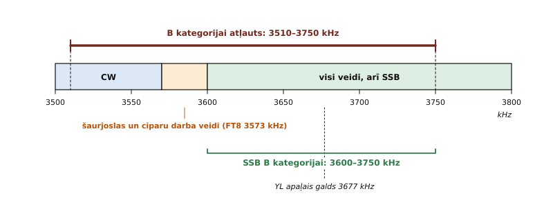
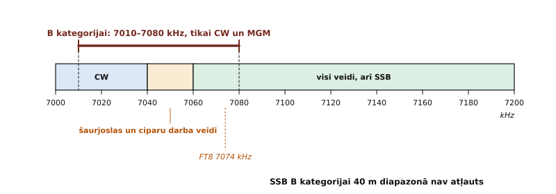
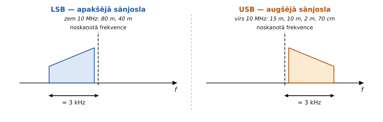
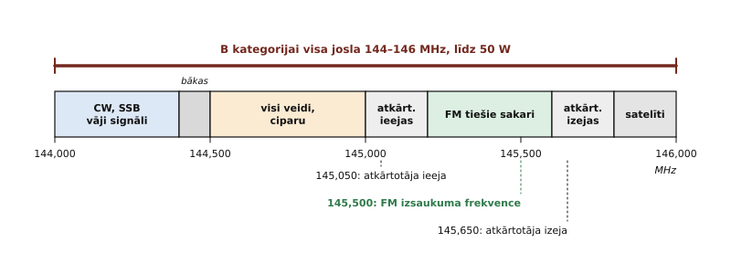

# 6. nodaļa. Joslu plāni un ētera kultūra

Šī nodaļa iemāca izvēlēties pareizo vietu diapazonā katram darba veidam un
uzvesties ēterā tā, lai ar tevi gribētu runāt.

**Video lekcija:** LRAL bezmaksas kurss, 2., 4. un 10. nodarbība (QR kodi).
**Eksāmena programma:** darba noteikumi un procedūras; IARU joslu plāni.
**Mācību laiks:** ap 2 stundām.

## Pēc šīs nodaļas tu pratīsi

- paskaidrot, kas ir joslu plāns un kāpēc tas jāievēro;
- atrast diapazonā vietu telegrāfam, ciparu darba veidiem un balsij;
- izvēlēties pareizo sānjoslu SSB sakaram;
- nosaukt ētikas pamatprincipus;
- pareizi uzvesties, kad vienu staciju sauc daudzi.

## 6.1. Kas ir joslu plāns

MK noteikumi pasaka, **kurās joslās** drīkst raidīt (4. nodaļa). **Joslu
plāns** pasaka, **kur joslas iekšpusē** strādā katrs darba veids. Bez tā
platjoslas balss signāls nosegtu desmitiem vāju telegrāfa un ciparu
signālu.

Joslu plānus izstrādā IARU, katram reģionam savu; Latvijā lieto IARU
1. reģiona plānu [2]. Pati IARU plānu uzspiest nevar, taču Latvijā MK
noteikumu 53. punkts prasa IARU joslu plānus ievērot [1]. Latvijas
radioamatierim joslu plāns tātad ir pienākums, nevis tikai pieklājība.

Plāns balstās uz diviem principiem:

- **šaurie signāli apakšā, platie augšā** — katra diapazona sākumā ir
  telegrāfs, tad ciparu darba veidi, tad balss;
- **katram segmentam ir lielākais joslas platums** — piemēram, 200 Hz,
  500 Hz vai 2700 Hz; platāku signālu tajā neraida.

## 6.2. B kategorijas diapazoni joslu plānā

Tabulā ir vienkāršots IARU 1. reģiona HF joslu plāns tām joslām, kas atļautas
B kategorijai [3]. Pilns plāns ir D pielikumā.

| Diapazons | Telegrāfs (CW) | Šaurjoslas un ciparu darba veidi | Visi veidi, arī SSB | B kategorijas robežas |
| --- | --- | --- | --- | --- |
| 80 m | 3500–3570 kHz | 3570–3600 kHz | 3600–3800 kHz | 3510–3750 kHz |
| 40 m | 7000–7040 kHz | 7040–7060 kHz | 7060–7200 kHz | 7010–7080 kHz, tikai CW un MGM |
| 15 m | 21 000–21 070 kHz | 21 070–21 149 kHz | 21 151–21 450 kHz | visa josla |
| 10 m | 28 000–28 070 kHz | 28 070–28 190 kHz | 28 225–29 700 kHz | visa josla |

Starp ciparu darba veidu un balss segmentiem 15 m un 10 m diapazonā ir šaurs
segments **radiobākām**. Tajā neraida: bākas rāda, vai diapazons ir atvērts.

> **Piemērs.** Tu gribi nodibināt SSB sakaru 80 m diapazonā. Kur drīksti
> strādāt?
>
> 1. B kategorijai atļauts 3510–3750 kHz (4. nodaļa).
> 2. Joslu plānā SSB vieta ir no 3600 kHz uz augšu.
> 3. Abi nosacījumi kopā: 3600–3750 kHz. LSB signāls stiepjas 3 kHz uz leju,
>    tāpēc noskaņojies ne zemāk par 3603 kHz.

Ciparu darba veidiem ir vispārpieņemtas frekvences, kur satiekas visi.
FT8 frekvences B kategorijas diapazonos ir 3,573 MHz, 7,074 MHz, 21,074 MHz
un 28,074 MHz.

## 6.3. SSB sānjoslas izvēle

SSB signālam ir divi varianti, un visi lieto vienu un to pašu, lai
saprastos:

| Diapazons | Sānjosla |
| --- | --- |
| Zem 10 MHz (80 m, 40 m) | LSB — apakšējā |
| Virs 10 MHz (15 m, 10 m, VHF un UHF) | USB — augšējā |

Ja balss skan kā nesaprotama murmulēšana, visticamāk, esi izvēlējies nepareizo
sānjoslu.

**2 m diapazonā** jāatceras trīs lietas [4]:

- 145,500 MHz ir FM izsaukuma frekvence: tajā izsauc un pāriet uz citu;
- atkārtotāju frekvences nelieto tiešiem sakariem;
- diapazona apakšējā daļa ir vāju signālu sakariem (CW, SSB), tur FM neraida.

## 6.4. Ētikas pamatprincipi

Noteikumi prasa ievērot IARU ētikas principus un vispārpieņemtās uzvedības
normas (52. punkts) [1]. Praksē tie ir daži vienkārši likumi [4]:

- **Klausies, pirms raidi.** Vienmēr.
- **Netraucē.** Neraidi virsū notiekošam sakaram, neregulē raidītāju aizņemtā
  frekvencē.
- **Lieto mazāko vajadzīgo jaudu.** To prasa arī 53. punkts.
- **Esi pieklājīgs.** Arī tad, ja otrs nav.
- **Nosauc sevi.** Bez izsaukuma signāla neraida.
- **Saudzē privātumu.** Ēterā teikto dzird visi; neizpaud personisku
  informāciju ne par sevi, ne par citiem.
- **Izvairies no strīdīgām tēmām.** Politiku, reliģiju un komercdarījumus
  ēterā neapspriež.
- **Runā patiesību.** Nepatiesas vai maldinošas ziņas raidīt aizliegts
  (46. punkts) [1].

> **Atceries:** ētikas pamatlikums vienā teikumā — nedari ēterā neko tādu,
> kas citam traucētu pabeigt iesāktu sakaru.

Radioamatierisms ir starptautisks hobijs. Sarunu biedrs var būt no valsts ar
citām paražām un valodu; angļu valoda bieži ir vienīgā kopīgā. Runā lēni,
vienkāršiem vārdiem, un nebrīnies par akcentu — arī tavējais ir dzirdams.

## 6.5. Kā uzvesties pile-up

Kad retu staciju vienlaikus sauc daudzi, veidojas **pile-up**. Tā ir vieta,
kur ētera kultūra tiek pārbaudīta visvairāk. Starptautiski pazīstams ieteikumu
kopums šādām situācijām ir DX uzvedības kodekss [5]. Tā būtība ir pieci
paradumi:

1. **Klausies ilgi.** Noskaidro DX stacijas izsaukuma signālu pats, nepaļaujies
   uz klasteri. Saproti, vai tā strādā split režīmā un kur klausās.
2. **Sauc tikai tad, kad dzirdi.** Ja DX staciju nedzirdi pietiekami labi,
   lai saprastu atbildi, saukšana tikai traucē citiem.
3. **Sauc īsi un pareizajā brīdī.** Vienreiz pilns izsaukuma signāls pēc tam,
   kad iepriekšējais sakars beidzies, tad klausies.
4. **Klusē, kad nesauc tevi.** Ja DX atbild citam vai sauc citu reģionu
   (piemēram, "only North America"), neraidi.
5. **Nekad neraidi DX frekvencē split režīmā** un nenoskaņo tur antenu.

Kad sakars izdevies, pasaki paldies un atbrīvo frekvenci. Kad neizdodas,
neļaunojies: retā stacija būs ēterā arī rīt.

> **Praktisks padoms.** Pile-up vienmēr atradīsies kāds, kurš raida nepareizā
> frekvencē vai traucē tīši. Neatbildi viņam un nelabo viņu ēterā: katrs
> "tu traucē!" ir vēl viens traucējums. Labākā atbilde tīšam traucētājam ir
> klusums.

## 6.6. Biežākās iesācēju kļūdas

| Kļūda | Kā pareizi |
| --- | --- |
| CQ bez klausīšanās | Paklausies un pajautā, vai frekvence brīva |
| Raidīšana DX frekvencē split režīmā | Ieslēdz SPLIT un pārbaudi raidīšanas frekvenci pirms pirmā izsaukuma |
| Antenas noskaņošana aizņemtā frekvencē | Noskaņo brīvā frekvencē blakus, ar mazāko jaudu |
| Pārāk gari izsaukumi | Īss CQ, tad klausies; atkārto pēc pauzes |
| Nepareiza sānjosla | LSB zem 10 MHz, USB virs |
| SSB joslas malā | Turies 3 kHz no malas |
| Pārskaļota mikrofona ieeja | Seko ALC rādījumam; izkropļots signāls aizņem platāku joslu |
| Aizmirsts izsaukuma signāls garā sarunā | Nosauc to katras pārraides beigās |
| "59" visiem | Dod īstu ziņojumu pēc S metra un dzirdes |
| Balss sakars ciparu darba veidu segmentā | Ieskaties joslu plānā pirms raidīšanas |

## Eksāmenā jāzina

- Joslu plānus izstrādā IARU; Latvija ir 1. reģionā.
- MK noteikumu 53. punkts prasa IARU joslu plānus ievērot.
- Diapazona apakšā telegrāfs, tad ciparu darba veidi, augšā balss.
- LSB lieto zem 10 MHz, USB virs 10 MHz.
- Radiobāku segmentos neraida.
- Pirms raidīšanas jāpārliecinās, ka frekvence ir brīva.
- Aizliegts raidīt nepatiesu vai maldinošu informāciju.
- Split režīmā neraida DX stacijas raidīšanas frekvencē.

## Pamēģini pats

**1. Atrodi segmentus ar ausīm (20 minūtes).** Atver WebSDR un lēnām
pārskati 80 m diapazonu no 3500 līdz 3800 kHz. Atzīmē uz lapas:

- [ ] kur dzirdi telegrāfu;
- [ ] kur ir ciparu darba veidu signāli (raksturīga čirkstēšana ap 3573 kHz);
- [ ] kur sākas balss sakari.

Salīdzini ar 6.2. tabulu.

**2. Noklausies pile-up (15 minūtes).** DX klasterī (piemēram, meklējot
"DX cluster") atrodi retu staciju un paklausies, kā to sauc. Pieraksti vienu
labu un vienu sliktu uzvedības piemēru.

## Kopsavilkums

- Joslu plāns sadala diapazonu pa darba veidiem; Latvijā tā ievērošana ir
  noteikumu prasība.
- Šaurie signāli ir diapazona apakšā, balss — augšā.
- B kategorijai jāievēro abas robežas uzreiz: atļautā josla un joslu plāns.
- LSB zem 10 MHz, USB virs.
- Ētikas kodols: klausies, netraucē, esi pieklājīgs, nosauc sevi.
- Pile-up: klausies ilgi, sauc īsi, klusē, kad nesauc tevi.
- Tīšam traucētājam neatbild.

## Paškontroles jautājumi

1. Kas izstrādā radioamatieru joslu plānus?
    - A. ITU
    - B. SIA "Elektroniskie sakari"
    - C. IARU
    - D. Katrs radioamatieris pats
2. Kāpēc Latvijas radioamatierim IARU joslu plāns ir obligāts?
    - A. To prasa MK noteikumi Nr. 257
    - B. Tāpēc, ka IARU var atņemt atļauju
    - C. Tas nav obligāts
    - D. To prasa transīveru ražotāji
3. Kurā diapazona daļā pēc joslu plāna parasti atrodas telegrāfa (CW) segments?
    - A. Diapazona augšējā daļā
    - B. Diapazona vidū
    - C. Telegrāfam nav sava segmenta
    - D. Diapazona apakšējā daļā
4. Kuru sānjoslu lieto SSB sakaros 80 m diapazonā?
    - A. USB
    - B. LSB
    - C. Abas vienlaikus
    - D. Jebkuru
5. Kuru sānjoslu lieto SSB sakaros 15 m diapazonā?
    - A. LSB
    - B. Jebkuru
    - C. USB
    - D. Abas vienlaikus
6. Kur B kategorijas stacija drīkst strādāt SSB 80 m diapazonā, ievērojot gan atļauto joslu, gan joslu plānu?
    - A. 3500–3800 kHz
    - B. 3510–3600 kHz
    - C. 3750–3800 kHz
    - D. 3600–3750 kHz
7. Ko dari, ja diapazonā uzej radiobāku segmentu?
    - A. Tajā neraidi
    - B. Raidi CQ, jo tur ir kluss
    - C. Noskaņo tur antenu
    - D. Raidi tikai ar mazu jaudu
8. DX stacija saka "only Japan". Tu esi Latvijā. Ko dari?
    - A. Sauc, bet tikai vienreiz
    - B. Neraidi un gaidi, kamēr DX sauks Eiropu
    - C. Sauc ar lielāku jaudu
    - D. Pasaki ēterā, ka tas ir negodīgi
9. Kāds raida mūziku un lamājas tavā sakara frekvencē. Kā rīkojies?
    - A. Atbildi viņam tādā pašā tonī
    - B. Raidi nesēju virsū, lai viņu noslāpētu
    - C. Neatbildi; ja vajag, kopā ar korespondentu pārej uz citu frekvenci
    - D. Pieprasi viņa izsaukuma signālu, līdz viņš to nosauc
10. Kuru no šīm tēmām radioamatieru sakaros nav pieņemts apspriest?
    - A. Antenas uzbūvi
    - B. Laikapstākļus
    - C. Signāla kvalitāti
    - D. Politiku

**Atvērtie jautājumi**

11. Paskaidro, kāpēc telegrāfa un ciparu darba veidu segmenti ir atdalīti no
    balss segmenta.
12. Apraksti soli pa solim, ko darīsi, pirms pirmo reizi sauksi retu DX
    staciju, kas strādā split režīmā.

## Atbildes

| Nr. | Atbilde | Skaidrojums |
| --- | --- | --- |
| 1 | C | IARU, katram reģionam savu plānu. |
| 2 | A | 53. punkts prasa ievērot IARU joslu plānus. |
| 3 | D | Šaurie signāli ir apakšā, platie augšā. |
| 4 | B | Zem 10 MHz lieto LSB. |
| 5 | C | Virs 10 MHz lieto USB. |
| 6 | D | B kategorijai līdz 3750 kHz; SSB pēc joslu plāna no 3600 kHz. |
| 7 | A | Bākas rāda izplatīšanās apstākļus; raidīšana tās nosedz. |
| 8 | B | Raidīšana, kad sauc citu reģionu, tikai palēnina visu pile-up. |
| 9 | C | Jebkura atbilde tīšam traucētājam ir tas, ko viņš grib. |
| 10 | D | Politiku, reliģiju un komercdarījumus ēterā neapspriež. |

Atvērtie jautājumi: vienpadsmitajā jāpiemin, ka balss signāls ir daudzkārt
platāks un stiprāks par vājiem šaurjoslas signāliem un tos nosegtu.
Divpadsmitajā jābūt: klausīšanās, izsaukuma signāla un split virziena
noskaidrošana, SPLIT ieslēgšana un raidīšanas frekvences pārbaude, īss
izsaukums pareizajā brīdī.

## Padziļināti

- **Joslu plāns mainās.** IARU 1. reģions plānu ik pa laikam pārskata.
  Pirms eksāmena un pirms pirmā sakara ieskaties aktuālajā versijā.
- **VHF/UHF joslu plāns.** 2 m un 70 cm diapazoniem ir atsevišķs, sīkāks plāns ar
  segmentiem satelītiem, atkārtotājiem un vāju signālu sakariem.
- **Ētikas rokasgrāmata.** Pilns apraksts latviešu valodā ir LRAL
  tīmekļvietnē [6].

## Nodaļas avoti

1. Ministru kabineta 2023. gada 23. maija noteikumi Nr. 257, 46., 52. un
   53. punkts. <https://likumi.lv/ta/id/342127> (skatīts 2026-11-12).
2. LRAL bezmaksas kurss 2026, 2. nodarbība "Juridiskie jautājumi". lral.lv.
3. IARU 1. reģiona HF joslu plāns. Izmantots tikai kā faktu avots; tabula
   sastādīta no jauna un jāpārbauda pret aktuālo plānu.
4. LRAL bezmaksas kurss 2026, 4. nodarbība "Amatieru radiosakaru prakse".
   lral.lv.
5. DX uzvedības kodekss (DX Code of Conduct). Izmantots tikai kā norāde;
   teksts nav pārņemts.
6. Radioamatieru ētika un ētera procedūras. J. Devoldere ON4UN, M. Demeuleneere ON4WW; tulkojis J. O. Vanags YL3AD. 3. izdevums, 2009. lral.lv/oldwww/files/ETIKA_latb-YL.pdf.
   Izmantots tikai kā norāde tālākai lasīšanai.
