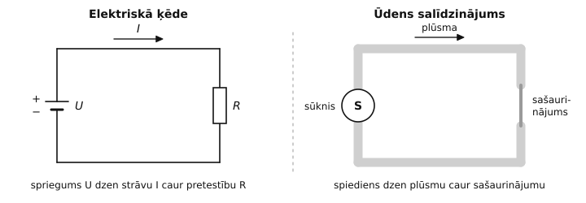
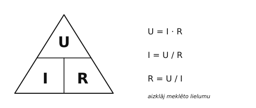
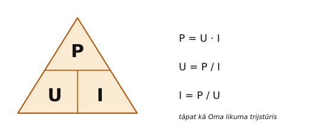
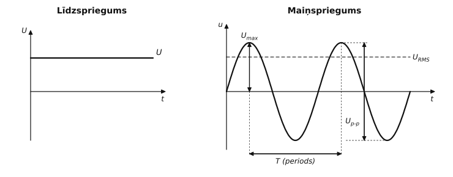

# 7. nodaļa. Elektronikas pamati

Šī nodaļa iemāca trīs lielumus, uz kuriem balstās visa radiotehnika, — strāvu,
spriegumu un pretestību — un divas formulas, ar kurām atrisināma liela daļa
eksāmena aprēķinu uzdevumu.

**Video lekcija:** LRAL bezmaksas kurss, 5. nodarbība (QR kods).
**Eksāmena programma:** elektriskā, elektromagnētiskā lauka un radio teorija.
**Mācību laiks:** ap 4 stundām.

## Pēc šīs nodaļas tu pratīsi

- izskaidrot, kas ir strāva, spriegums, pretestība un jauda, un nosaukt to
  mērvienības;
- ar Oma likumu aprēķināt jebkuru no trim lielumiem, ja zināmi divi pārējie;
- aprēķināt jaudu trijos veidos;
- pārvērst mērvienības ar metriskajiem prefiksiem no piko līdz giga;
- atšķirt līdzstrāvu no maiņstrāvas un aprēķināt efektīvo vērtību.

## 7.1. Strāva, spriegums un pretestība

Elektrību vieglāk saprast, salīdzinot ar ūdeni caurulē.

| Lielums | Apzīmējums | Mērvienība | Ūdens salīdzinājums |
| --- | --- | --- | --- |
| **Spriegums** | U | volts (V) | Spiediens, kas ūdeni dzen pa cauruli |
| **Strāva** | I | ampērs (A) | Cik daudz ūdens izplūst sekundē |
| **Pretestība** | R | oms (Ω) | Cik šaura ir caurule |

**Strāva** ir elektrisko lādiņu plūsma vadītājā. **Spriegums** ir potenciālu
starpība starp diviem punktiem, piemēram, starp akumulatora spailēm; tā liek
lādiņiem plūst. **Pretestība** rāda, cik stipri vadītājs vai detaļa
strāvai pretojas [1].

No salīdzinājuma uzreiz redzams galvenais: lielāks spiediens dod lielāku
plūsmu, šaurāka caurule — mazāku. Tieši to saka Oma likums.

## 7.2. Oma likums

Strāva ķēdē ir tieši proporcionāla spriegumam un apgriezti proporcionāla
pretestībai [1]:

$$I = \frac{U}{R} \qquad U = I \cdot R \qquad R = \frac{U}{I}$$

Tās ir viena un tā pati formula trīs pierakstos. Iegaumē vienu, pārējās
izsaki pats.

> **Atceries!** Trijstūris. Uzzīmē trijstūri, augšā ieraksti U, apakšā I un R.
> Aizklāj meklējamo lielumu: ja pārējie divi ir blakus, tos reizina; ja viens
> virs otra, dala.

> **Piemērs.** Rezistors ar pretestību 60 Ω pieslēgts 12 V akumulatoram. Cik
> liela strāva plūst?
>
> 1. Zināms: U = 12 V, R = 60 Ω. Meklējam I.
> 2. I = U / R = 12 / 60 = 0,2 A.
> 3. Atbilde: 0,2 A jeb 200 mA.

> **Piemērs.** Caur 50 Ω slodzi plūst 2 A strāva. Kāds ir spriegums uz
> slodzes?
>
> 1. Zināms: I = 2 A, R = 50 Ω. Meklējam U.
> 2. U = I · R = 2 · 50 = 100 V.
> 3. Atbilde: 100 V.

> **Uzmanību!** Formulā liec tikai pamatvienības: voltus, ampērus un omus.
> Ja dots 100 mA, vispirms pārvērt par 0,1 A. Nepārvērsti prefiksi ir
> biežākais kļūdu cēlonis aprēķinu uzdevumos.

## 7.3. Jauda

**Jauda** rāda, cik daudz enerģijas ierīce patērē vai atdod vienā sekundē.
To mēra vatos (W). Elektriskā jauda ir sprieguma un strāvas reizinājums [1]:

$$P = U \cdot I$$

Ja Oma likumu ieliek šajā formulā, iegūst vēl divus pierakstus, kas noder,
kad zināma pretestība:

$$P = I^2 \cdot R \qquad P = \frac{U^2}{R}$$

| Zināms | Formula |
| --- | --- |
| Spriegums un strāva | P = U · I |
| Strāva un pretestība | P = I² · R |
| Spriegums un pretestība | P = U² / R |

> **Piemērs.** Transīvers raidīšanas laikā no 13,8 V barošanas bloka patērē
> 20 A. Cik lielu jaudu tas patērē?
>
> 1. P = U · I = 13,8 · 20 = 276 W.
> 2. Ja izejas jauda ir 100 W, atlikušie 176 W pārvēršas siltumā. Tāpēc
>    transīveram ir radiators un ventilators.

> **Piemērs.** Raidītājs atdod 100 W jaudu 50 Ω antenai. Kāds ir spriegums
> antenas pieslēgvietā?
>
> 1. Zināms: P = 100 W, R = 50 Ω. No P = U² / R izsakām U² = P · R.
> 2. U² = 100 · 50 = 5000; U = √5000 ≈ 70,7 V.
> 3. Atbilde: ap 71 V (efektīvā vērtība).

> **Praktisks padoms.** Barošanas bloku izvēlies ar rezervi. 100 W transīvers
> patērē 20–25 A, nevis 100 / 13,8 ≈ 7 A, jo neviens raidītājs nepārvērš visu
> patērēto jaudu radioviļņos.

**Enerģija** ir jauda, reizināta ar laiku. Akumulatora ietilpību norāda
ampērstundās (Ah): 20 Ah akumulators teorētiski var dot 2 A strāvu 10
stundas. Tas noder, plānojot darbu ārpus mājas.

## 7.4. Metriskie prefiksi

Radiotehnikā skaitļi atšķiras miljardiem reižu: frekvences ir gigahercos,
kapacitātes — pikofaradās. Lai nerakstītu garas nuļļu rindas,
lieto prefiksus [1].

| Prefikss | Apzīmējums | Reizinātājs | Piemērs radio pasaulē |
| --- | --- | --- | --- |
| giga | G | 10⁹ = 1 000 000 000 | 1,2 GHz — 23 cm diapazons |
| mega | M | 10⁶ = 1 000 000 | 145 MHz — 2 m diapazons |
| kilo | k | 10³ = 1000 | 3,5 kΩ; 600 kHz nobīde |
| — | — | 1 | 50 Ω; 13,8 V |
| mili | m | 10⁻³ = 0,001 | 100 mA; 10 mH |
| mikro | µ | 10⁻⁶ = 0,000 001 | 10 µF; 1 µV uztvērēja ieejā |
| nano | n | 10⁻⁹ | 100 nF |
| piko | p | 10⁻¹² | 100 pF |

Blakus esošie prefiksi atšķiras 1000 reizes. Pārvēršot uz mazāku vienību,
skaitli reizina ar 1000; uz lielāku — dala.

> **Piemērs.** Pārvērt 145,500 MHz kilohercos un hercos.
>
> 1. No MHz uz kHz ir viens solis uz mazāku vienību: × 1000.
>    145,500 MHz = 145 500 kHz.
> 2. Vēl viens solis: × 1000. 145 500 kHz = 145 500 000 Hz.

> **Piemērs.** Cik nanofaradu ir 4700 pF?
>
> 1. No pF uz nF ir viens solis uz lielāku vienību: ÷ 1000.
> 2. 4700 pF = 4,7 nF.

> **Uzmanību!** Lielais M ir mega (miljons), mazais m ir mili (tūkstošdaļa).
> 1 MΩ un 1 mΩ atšķiras miljards reižu.

## 7.5. Vadītāji, izolatori un pusvadītāji

Materiāli atšķiras ar to, cik labi vada strāvu. Šo īpašību sauc par
**vadītspēju**; tā ir pretestības apgrieztais lielums, un to mēra sīmensos
(S) [1].

| Grupa | Īpašība | Piemēri | Kur lieto |
| --- | --- | --- | --- |
| Vadītāji | Vada strāvu labi | Sudrabs, varš, alumīnijs, dzelzs | Vadi, antenas, kabeļi |
| Pusvadītāji | Vadītspēju var mainīt | Silīcijs, germānijs | Diodes, tranzistori |
| Izolatori | Strāvu praktiski nevada | Stikls, gumija, keramika, plastmasa | Vadu apvalki, antenu izolatori |

Labākais vadītājs ir sudrabs, tūlīt aiz tā varš, kas ir daudz lētāks; tāpēc
vadus un antenas taisa no vara. Alumīnijs vada sliktāk, bet ir vieglāks, tāpēc no tā būvē
lielas antenas.

## 7.6. Līdzstrāva un maiņstrāva

**Līdzstrāva** (DC) plūst vienā virzienā; avotam ir plus un mīnus spaile.
To dod baterijas, akumulatori un barošanas bloki, un ar to darbojas visa
elektronika transīvera iekšpusē [1].

**Maiņstrāva** (AC) periodiski maina virzienu un lielumu. Tāda ir strāva
elektrotīklā (230 V, 50 Hz), un tāds ir arī radiofrekvences signāls kabelī
un antenā [1].

Maiņspriegumu apraksta četri lielumi [2]:

| Lielums | Apzīmējums | Ko nozīmē |
| --- | --- | --- |
| Amplitūda | U_max | Lielākā momentānā vērtība |
| Spriegums no smailes līdz smailei | U_p-p | Attālums starp pozitīvo un negatīvo maksimumu; 2 · U_max |
| Efektīvā vērtība | U_RMS | Līdzsprieguma vērtība, kas rezistorā dotu tādu pašu jaudu |
| Frekvence | f | Cik pilnu svārstību notiek sekundē; herci (Hz) |

Sinusoidālam spriegumam efektīvā vērtība un amplitūda ir saistītas šādi [2]:

$$U_{RMS} = \frac{U_{max}}{\sqrt{2}} \approx 0{,}707 \cdot U_{max} \qquad U_{max} \approx 1{,}414 \cdot U_{RMS}$$

Kad saka "tīklā ir 230 V", domā efektīvo vērtību. Arī multimetrs
maiņsprieguma režīmā rāda efektīvo vērtību.

> **Piemērs.** Tīkla spriegums ir 230 V. Kāda ir tā amplitūda?
>
> 1. 230 V ir efektīvā vērtība.
> 2. U_max = 1,414 · 230 ≈ 325 V.
> 3. Spriegums rozetē 50 reizes sekundē sasniedz +325 V un −325 V.

> **Uzmanību!** Tīkla spriegums ir bīstams dzīvībai. Par drošu darbu ar
> elektrību stāsta 17. nodaļa; izlasi to, pirms atver jebkuru no tīkla
> barotu iekārtu.

Par frekvenci, periodu un viļņa garumu stāsta 8. nodaļa.

## Eksāmenā jāzina

- Mērvienības: strāva — A, spriegums — V, pretestība — Ω, jauda — W,
  frekvence — Hz, vadītspēja — S.
- Oma likums: U = I · R.
- Jauda: P = U · I = I² · R = U² / R.
- Prefiksi: G = 10⁹, M = 10⁶, k = 10³, m = 10⁻³, µ = 10⁻⁶, n = 10⁻⁹,
  p = 10⁻¹².
- Labi vadītāji: sudrabs, varš, alumīnijs. Izolatori: stikls, gumija.
- Efektīvā vērtība: U_RMS ≈ 0,707 · U_max; U_max ≈ 1,414 · U_RMS;
  U_p-p = 2 · U_max.
- Tīklā: 230 V (efektīvā vērtība), 50 Hz.

## Pamēģini pats

**1. Izmēri bateriju (10 minūtes).** Ar multimetru līdzsprieguma režīmā
izmēri AA baterijas un 9 V baterijas spriegumu. Pieraksti:

- [ ] ko rāda jauna baterija;
- [ ] ko rāda lietota baterija;
- [ ] kas notiek ar rādījumu, ja samaina taustus vietām.

**2. Aprēķini savu staciju (10 minūtes).** Atrodi internetā jebkura 100 W
transīvera datus: barošanas spriegumu un strāvu raidīšanas laikā. Aprēķini
patērēto jaudu un to, cik procentu no tās kļūst par izejas jaudu.

**3. Simulators (15 minūtes).** Atver falstad.com/circuit, uzbūvē ķēdi no
baterijas un rezistora un pārbaudi Oma likumu: maini pretestību un vēro
strāvu.

## Kopsavilkums

- Spriegums dzen, strāva plūst, pretestība bremzē.
- Oma likums U = I · R saista visus trīs lielumus.
- Jauda P = U · I; ar pretestību arī I² · R un U² / R.
- Pirms rēķināšanas pārvērt visu pamatvienībās.
- Prefiksi iet pa 1000: p, n, µ, m, —, k, M, G.
- Līdzstrāva plūst vienā virzienā; maiņstrāva periodiski mainās.
- Maiņspriegumam parasti norāda efektīvo vērtību; amplitūda ir 1,414
  reizes lielāka.

## Paškontroles jautājumi

1. Kādās mērvienībās mēra elektrisko strāvu?
    - A. Voltos
    - B. Omos
    - C. Ampēros
    - D. Vatos
2. Rezistors ar pretestību 60 Ω pieslēgts 12 V avotam. Cik liela strāva plūst caur to?
    - A. 0,2 A
    - B. 5 A
    - C. 72 A
    - D. 0,5 A
3. Caur 50 Ω rezistoru plūst 2 A strāva. Kāds ir spriegums uz rezistora?
    - A. 25 V
    - B. 52 V
    - C. 48 V
    - D. 100 V
4. Ierīce no 13,8 V avota patērē 10 A. Cik lielu jaudu tā patērē?
    - A. 1,38 W
    - B. 138 W
    - C. 23,8 W
    - D. 1380 W
5. Caur rezistoru plūst 100 mA strāva, un spriegums uz tā ir 5 V. Kāda ir rezistora pretestība?
    - A. 0,05 Ω
    - B. 500 Ω
    - C. 50 Ω
    - D. 20 Ω
6. Caur 50 Ω slodzi plūst 2 A strāva. Cik liela jauda izdalās slodzē?
    - A. 200 W
    - B. 100 W
    - C. 25 W
    - D. 2500 W
7. Cik omu ir 2,2 kΩ?
    - A. 22 Ω
    - B. 220 Ω
    - C. 22 000 Ω
    - D. 2200 Ω
8. Cik nanofaradu ir 100 pF?
    - A. 100 000 nF
    - B. 0,1 nF
    - C. 10 nF
    - D. 1 nF
9. Cik kilohercu ir 3,650 MHz?
    - A. 365 kHz
    - B. 36 500 kHz
    - C. 3650 kHz
    - D. 0,00365 kHz
10. Kurš no šiem materiāliem ir izolators?
    - A. Stikls
    - B. Varš
    - C. Alumīnijs
    - D. Sudrabs
11. Kas raksturo maiņstrāvu?
    - A. Tā vienmēr plūst vienā virzienā
    - B. Tā periodiski maina virzienu un lielumu
    - C. Tai nav frekvences
    - D. To dod tikai akumulatori
12. Sinusoidāla sprieguma amplitūda ir 10 V. Kāda ir tā efektīvā vērtība?
    - A. 14,1 V
    - B. 5 V
    - C. 20 V
    - D. 7,07 V
13. Tīkla sprieguma efektīvā vērtība ir 230 V. Kāda aptuveni ir tā amplitūda?
    - A. 325 V
    - B. 163 V
    - C. 230 V
    - D. 460 V
14. Akumulatora ietilpība ir 20 Ah. Cik ilgi tas teorētiski var dot 4 A strāvu?
    - A. 80 stundas
    - B. 16 stundas
    - C. 5 stundas
    - D. 24 stundas

**Atvērtie jautājumi**

15. Raidītāja izejas jauda ir 50 W, slodze — 50 Ω. Aprēķini spriegumu uz
    slodzes un strāvu caur to. Parādi aprēķinu.
16. Paskaidro saviem vārdiem, kāpēc 100 W transīveram vajag barošanas bloku,
    kas spēj dot ap 25 A, nevis 7 A.

## Atbildes

| Nr. | Atbilde | Skaidrojums |
| --- | --- | --- |
| 1 | C | Volti ir spriegumam, omi pretestībai, vati jaudai. |
| 2 | A | I = U / R = 12 / 60 = 0,2 A. |
| 3 | D | U = I · R = 2 · 50 = 100 V. |
| 4 | B | P = U · I = 13,8 · 10 = 138 W. |
| 5 | C | 100 mA = 0,1 A; R = U / I = 5 / 0,1 = 50 Ω. |
| 6 | A | P = I² · R = 4 · 50 = 200 W. |
| 7 | D | Kilo ir 1000: 2,2 · 1000 = 2200 Ω. |
| 8 | B | No pF uz nF dala ar 1000: 100 / 1000 = 0,1 nF. |
| 9 | C | No MHz uz kHz reizina ar 1000: 3,650 · 1000 = 3650 kHz. |
| 10 | A | Varš, alumīnijs un sudrabs ir vadītāji. |
| 11 | B | Līdzstrāva plūst vienā virzienā; maiņstrāva periodiski mainās. |
| 12 | D | U_RMS = 0,707 · 10 = 7,07 V. |
| 13 | A | U_max = 1,414 · 230 ≈ 325 V. |
| 14 | C | 20 Ah / 4 A = 5 h. |

Atvērtie jautājumi: 15. jautājumā U = √(P · R) = √(50 · 50) = 50 V un
I = U / R = 50 / 50 = 1 A; pārbaude: P = U · I = 50 W. 16. jautājumā jāpiemin,
ka raidītājs tikai daļu patērētās jaudas pārvērš izejas jaudā, pārējā kļūst
par siltumu.

## Padziļināti

- **Kirhofa likumi.** Mezglā ieplūstošo strāvu summa ir vienāda ar
  izplūstošo strāvu summu; noslēgtā kontūrā sprieguma kritumu summa ir
  vienāda ar avota spriegumu. Tos lietosim 9. nodaļā, rēķinot rezistoru
  slēgumus.
- **Lietderības koeficients.** Izejas jaudas attiecība pret patērēto jaudu.
  Tipiskam 100 W transīveram tā ir ap 30–40 %.
- **Kāpēc tieši 0,707?** Tas ir 1/√2. Jauda ir proporcionāla sprieguma
  kvadrātam, un sinusoīdas kvadrāta vidējā vērtība ir puse no maksimuma
  kvadrāta.

## Nodaļas avoti

1. LRAL bezmaksas kurss 2026, 5. nodarbība "Elektriskā, elektromagnētiskā
   lauka un radio teorija", prezentācija un video lekcija. lral.lv.
2. Radioamatieru formulu lapa. Matīss YL3RZ, 2026. Izmantota kā formulu
   pārbaudes avots; teksts un zīmējumi nav pārņemti.
