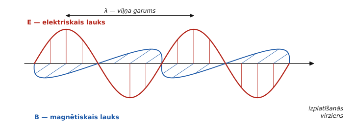
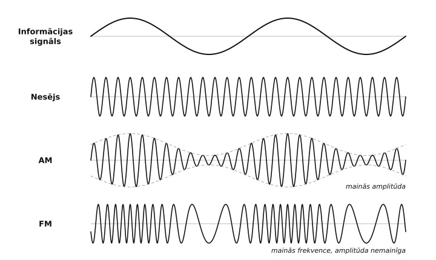
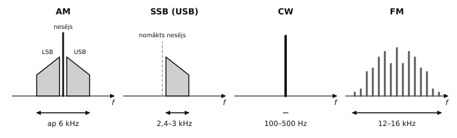

# 8. nodaļa. Radioviļņi, signāli un modulācija

Šī nodaļa izskaidro, kas ir radiovilnis, kā frekvence saistīta ar viļņa
garumu, kā uz viļņa "uzliek" balsi vai datus un kā ar decibeliem salīdzina
jaudas.

**Video lekcija:** LRAL bezmaksas kurss, 5. nodarbība (QR kods).
**Eksāmena programma:** elektriskā, elektromagnētiskā lauka un radio teorija.
**Mācību laiks:** ap 4 stundām.

## Pēc šīs nodaļas tu pratīsi

- aprakstīt radiovilni un tā polarizāciju;
- pārrēķināt frekvenci viļņa garumā un otrādi, kā arī periodu frekvencē;
- izskaidrot, ar ko atšķiras AM, FM, SSB un CW;
- salīdzināt šo darba veidu joslas platumu;
- rēķināt ar decibeliem un S vienībām.

## 8.1. Kas ir radiovilnis

**Radiovilnis** ir elektromagnētisks vilnis: elektriskā lauka (E) un
magnētiskā lauka (B) svārstības, kas izplatās telpā. Abi lauki ir
perpendikulāri viens otram un abi — viļņa izplatīšanās virzienam [1].

Radioviļņiem nav vajadzīga vide: tie izplatās arī vakuumā. To ātrums ir
gaismas ātrums [1]:

$$c \approx 300\,000\,000\ \text{m/s} = 300\,000\ \text{km/s}$$

Radiovilnis apskrien Zemi septiņas reizes sekundē. Sakarā ar Austrāliju
aizkavēšanos nepamanīsi.

## 8.2. Frekvence un periods

**Frekvence** (f) ir svārstību skaits vienā sekundē; mērvienība ir hercs
(Hz). **Periods** (T) ir vienas pilnas svārstības ilgums sekundēs. Tie ir
viens otra apgrieztie lielumi [1]:

$$f = \frac{1}{T} \qquad T = \frac{1}{f}$$

> **Piemērs.** Signāla periods ir 1 ms. Kāda ir tā frekvence?
>
> 1. 1 ms = 0,001 s.
> 2. f = 1 / T = 1 / 0,001 = 1000 Hz = 1 kHz.

> **Piemērs.** Kāds ir tīkla sprieguma (50 Hz) periods?
>
> 1. T = 1 / f = 1 / 50 = 0,02 s.
> 2. Atbilde: 20 ms.

Ja signāls nav tīra sinusoīda, tajā bez pamatfrekvences ir arī
**harmonikas** — frekvences, kas ir 2, 3, 4 un vairāk reižu augstākas.
7 MHz signāla otrā harmonika ir 14 MHz, trešā — 21 MHz. Harmonikas ir
galvenais iemesls, kāpēc raidītājs var traucēt citās joslās (16. nodaļa).

## 8.3. Viļņa garums

**Viļņa garums** (λ, "lambda") ir attālums, ko vilnis noiet viena perioda
laikā, jeb attālums starp diviem blakus maksimumiem. Jo augstāka frekvence,
jo īsāks vilnis [1]:

$$\lambda = \frac{c}{f}$$

Radioamatieri lieto ērtāku pierakstu, kurā frekvence ir megahercos un
viļņa garums metros [2]:

$$\lambda\,[\text{m}] = \frac{300}{f\,[\text{MHz}]} \qquad f\,[\text{MHz}] = \frac{300}{\lambda\,[\text{m}]}$$

> **Piemērs.** Kāds ir viļņa garums frekvencē 3,7 MHz?
>
> 1. λ = 300 / 3,7 ≈ 81 m.
> 2. Tāpēc šo diapazonu sauc par 80 m diapazonu.

> **Piemērs.** Kādai frekvencei atbilst 2 m viļņa garums?
>
> 1. f = 300 / 2 = 150 MHz.
> 2. Radioamatieru 2 m diapazons ir 144–146 MHz, tātad tuvu aprēķinātajam.

Diapazonu nosaukumi ir noapaļoti viļņa garumi:

| Diapazons | Frekvence | Aprēķinātais viļņa garums |
| --- | --- | --- |
| 80 m | 3,5 MHz | 86 m |
| 40 m | 7 MHz | 43 m |
| 15 m | 21 MHz | 14 m |
| 10 m | 28 MHz | 10,7 m |
| 2 m | 145 MHz | 2,07 m |
| 70 cm | 435 MHz | 0,69 m |

> **Praktisks padoms.** Viļņa garums nosaka antenas izmēru. Vienkāršākā
> antena, pusviļņa dipols, ir apmēram puse no viļņa garuma: 80 m diapazonam
> ap 40 m, 2 m diapazonam ap 1 m. Tāpēc īsviļņu antenai vajag pagalmu, bet
> UKV antena ietilpst uz balkona. Vairāk 13. nodaļā.

## 8.4. Polarizācija

**Polarizācija** ir virziens, kādā svārstās viļņa elektriskais lauks. To
nosaka raidošās antenas novietojums [1].

| Polarizācija | Elektriskais lauks | Antena |
| --- | --- | --- |
| Vertikāla | Vertikāls | Stāv vertikāli, piemēram, automašīnas vai rokas stacijas antena |
| Horizontāla | Horizontāls | Novietota horizontāli, piemēram, dipols starp diviem mastiem |

UKV sakaros abām stacijām vajag vienādu polarizāciju; ja viena antena ir
vertikāla un otra horizontāla, signāls ir daudzkārt vājāks. FM sakaros un
atkārtotājos lieto vertikālu polarizāciju. Īsviļņos, atstarojoties no
jonosfēras, polarizācija mainās, tāpēc tur tai ir mazāka nozīme.

## 8.5. Analogie un ciparu signāli

| | Analogs signāls | Ciparu signāls |
| --- | --- | --- |
| Vērtības | Mainās nepārtraukti, var būt jebkuras | Tikai noteikti līmeņi, vienkāršākajā gadījumā 0 un 1 |
| Noturība pret traucējumiem | Traucējums sajaucas ar signālu | Uztvērējs atpazīst līmeni arī troksnī |
| Piemēri | Balss SSB un FM sakaros | FT8, PSK31, RTTY |

Telegrāfs (CW) ir senākais ciparu signāls: nesējs ir vai nu ieslēgts, vai
izslēgts [1].

## 8.6. Modulācija

Balss frekvences ir no dažiem simtiem līdz dažiem tūkstošiem hercu. Tik
zemas frekvences izstarot nevar: antenai būtu jābūt simtiem kilometru garai.
Tāpēc lieto augstas frekvences **nesēju** un ar informācijas signālu maina
kādu tā īpašību. Šo procesu sauc par **modulāciju** [1].

| Veids | Ko maina nesējā | Joslas platums | Kur lieto |
| --- | --- | --- | --- |
| CW | Nesēju ieslēdz un izslēdz Morzes koda ritmā | ap 100–500 Hz | Visos diapazonos |
| AM | Amplitūdu | ap 6 kHz | Radioamatieru sakaros reti; apraide, aviācija |
| SSB | Amplitūdu; raida tikai vienu sānjoslu, nesējs nomākts | 2,4–3 kHz | Balss sakari īsviļņos |
| FM | Frekvenci; amplitūda nemainās | ap 12–16 kHz | Balss sakari UKV, atkārtotāji |

**AM — amplitūdas modulācija.** Nesēja frekvence nemainās, bet tā stiprums
seko balsij. Spektrā AM signālam ir nesējs un divas vienādas sānjoslas, pa
vienai katrā pusē. Nesējs informāciju nenes, bet patērē lielāko daļu
jaudas [1].

**SSB — vienas sānjoslas modulācija.** Ja AM signālam noņem nesēju un vienu
sānjoslu, paliek viss vajadzīgais. Visa raidītāja jauda aiziet informācijā,
un signāls aizņem uz pusi šaurāku joslu. Tāpēc ar SSB pie tās pašas jaudas
var sazināties tālāk [1]. Atlikusī sānjosla ir vai nu augšējā (**USB**), vai
apakšējā (**LSB**); kuru lietot, pasaka 6. nodaļa.

**FM — frekvences modulācija.** Balss maina nesēja frekvenci, amplitūda
paliek nemainīga. Tā kā lielākā daļa traucējumu ietekmē tieši amplitūdu, FM
skan tīri. Cena ir joslas platums: no radioamatieru balss veidiem FM
aizņem visplatāko joslu [1].

**CW — nepārtraukts vilnis.** Tīrs nesējs, ko ieslēdz un izslēdz. Signāls ir
ļoti šaurs, tāpēc uztvērējs var izmantot šauru filtru un sadzirdēt to arī
tad, kad balss sen pazudusi troksnī.

> **Atceries:** jo šaurāks signāls, jo tālāk tas aiziet ar to pašu jaudu.
> CW — šaurākais, SSB — vidū, FM — platākais.

> **Uzmanību!** Pārāk skaļš mikrofona signāls SSB raidītājā izkropļo balsi
> un paplašina signālu ārpus tam paredzētās joslas. Citi to dzird kā
> sprakšķus blakus frekvencēs. Seko transīvera ALC rādījumam.

## 8.7. Decibeli

Jaudas radiotehnikā atšķiras miljoniem reižu: raidītājs atdod 100 W, bet
uztvērēja ieejā nonāk miljardā daļa vata. Lai ar tādiem skaitļiem būtu ērti
rēķināt, attiecības izsaka **decibelos** (dB) [1], [2]:

$$P_{dB} = 10 \cdot \lg\frac{P}{P_{ref}} \qquad U_{dB} = 20 \cdot \lg\frac{U}{U_{ref}}$$

Decibeli nav mērvienība, bet attiecība: tie pasaka, cik reižu viens lielums
ir lielāks par otru. Eksāmenam pietiek ar četrām vērtībām:

| dB | Jauda mainās | Kā iegaumēt |
| --- | --- | --- |
| 3 dB | 2 reizes | Dubultošana |
| 6 dB | 4 reizes | Divas dubultošanas |
| 10 dB | 10 reizes | Viena nulle klāt |
| 20 dB | 100 reizes | Divas nulles klāt |

Ar mīnusa zīmi jauda tikpat reižu samazinās: −3 dB ir puse, −10 dB ir
desmitā daļa.

Decibelu ērtība ir tā, ka reizināšanas vietā saskaita. Jaudas attiecību
sadala reizinātājos 2 un 10 un saskaita to decibelus.

> **Piemērs.** Cik decibelu ir jaudas pieaugums no 5 W uz 100 W?
>
> 1. 100 / 5 = 20 reizes.
> 2. 20 = 10 · 2, tātad 10 dB + 3 dB.
> 3. Atbilde: 13 dB.

> **Piemērs.** Pastiprinātājam ir 10 dB pastiprinājums, kabelim aiz tā —
> 3 dB zudumi. Ieejā padod 10 W. Cik nonāk līdz antenai?
>
> 1. Kopā: +10 dB − 3 dB = +7 dB. Vieglāk rēķināt pa soļiem.
> 2. +10 dB: 10 W · 10 = 100 W.
> 3. −3 dB: 100 W / 2 = 50 W.

**S vienības.** Uztvērēja S metra viena vienība atbilst 6 dB, tātad jaudas
izmaiņai četras reizes [1].

> **Piemērs.** Tu raidi ar 20 W, un korespondents ziņo S7. Cik lielu jaudu
> vajag, lai viņš redzētu S8 un S9?
>
> 1. Viena S vienība ir 6 dB, tātad jauda × 4.
> 2. S8: 20 W · 4 = 80 W.
> 3. S9: 80 W · 4 = 320 W.

Secinājums ir svarīgāks par aprēķinu: liels jaudas pieaugums dod mazu
signāla pieaugumu. No 100 W uz 400 W ir tikai viena S vienība. Labāka antena
parasti dod vairāk nekā pastiprinātājs, un tā palīdz arī uztveršanā.

## Eksāmenā jāzina

- Radioviļņu ātrums: 300 000 km/s (3 · 10⁸ m/s).
- f = 1 / T; T = 1 / f.
- λ [m] = 300 / f [MHz].
- Polarizāciju nosaka elektriskā lauka virziens; vertikāla antena dod
  vertikālu polarizāciju.
- AM maina amplitūdu, FM — frekvenci, PM — fāzi.
- SSB: viena sānjosla, nesējs nomākts, joslas platums 2,4–3 kHz.
- FM aizņem visplatāko joslu; CW — visšaurāko.
- 3 dB = jauda × 2; 6 dB = × 4; 10 dB = × 10; 20 dB = × 100.
- Viena S vienība = 6 dB.
- Otrā harmonika ir divreiz augstāka frekvence par pamatfrekvenci.

## Pamēģini pats

**1. Aprēķini savus diapazonus (10 minūtes).** Katrai B kategorijas joslai
aprēķini viļņa garumu joslas apakšējā un augšējā malā. Cik garš būtu
pusviļņa dipols 21,2 MHz frekvencei?

**2. Ieraugi modulāciju (20 minūtes).** Atver WebSDR ar "ūdenskrituma"
(waterfall) attēlu un atrodi pa vienam signālam no katra veida. Salīdzini to
platumu:

- [ ] CW — šaura līnija;
- [ ] FT8 — vairākas šauras joslas blakus ap 3573 vai 7074 kHz;
- [ ] SSB — ap 3 kHz plats laukums ar asu malu vienā pusē;
- [ ] AM apraides stacija — simetrisks signāls ar spilgtu līniju vidū.

**3. Sānjoslas.** Noskaņojies uz SSB sakaru 80 m diapazonā un pārslēdz no
LSB uz USB. Pieraksti, kas notiek ar balsi.

## Kopsavilkums

- Radiovilnis ir elektriskā un magnētiskā lauka svārstības, kas izplatās ar
  gaismas ātrumu.
- Frekvence un periods ir apgriezti lielumi.
- Viļņa garums metros ir 300, dalīts ar frekvenci megahercos.
- Polarizāciju nosaka antenas novietojums.
- Modulācija uzliek informāciju uz nesēja: AM maina amplitūdu, FM frekvenci.
- SSB ir AM bez nesēja un vienas sānjoslas; tā ir efektīva un šaura.
- Decibeli izsaka attiecību: 3 dB dubulto jaudu, 10 dB to desmitkāršo.
- S vienība ir 6 dB; lai iegūtu vienu S vienību, jauda jāčetrkāršo.

## Paškontroles jautājumi

1. Ar kādu ātrumu radioviļņi izplatās vakuumā?
    - A. 300 km/s
    - B. 300 000 km/s
    - C. 340 m/s
    - D. 3000 km/s
2. Kāds ir viļņa garums frekvencē 7 MHz?
    - A. Ap 21 m
    - B. Ap 70 m
    - C. Ap 43 m
    - D. Ap 2100 m
3. Kādai frekvencei atbilst viļņa garums 10 m?
    - A. 30 MHz
    - B. 3 MHz
    - C. 300 MHz
    - D. 10 MHz
4. Signāla periods ir 0,5 ms. Kāda ir tā frekvence?
    - A. 500 Hz
    - B. 5 kHz
    - C. 200 Hz
    - D. 2 kHz
5. Kāds ir 50 Hz maiņsprieguma periods?
    - A. 20 ms
    - B. 50 ms
    - C. 2 ms
    - D. 0,5 s
6. Kāda polarizācija ir radiovilnim, ko izstaro vertikāli novietota antena?
    - A. Horizontāla
    - B. Apļveida
    - C. Vertikāla
    - D. Vilnim nav polarizācijas
7. Kuru nesēja īpašību maina amplitūdas modulācijā (AM)?
    - A. Frekvenci
    - B. Fāzi
    - C. Polarizāciju
    - D. Amplitūdu
8. Kas notiek ar nesēju frekvences modulācijā (FM)?
    - A. Mainās tā amplitūda, frekvence paliek nemainīga
    - B. Mainās tā frekvence, amplitūda paliek nemainīga
    - C. To ieslēdz un izslēdz
    - D. To nomāc
9. Kāds aptuveni ir SSB signāla joslas platums?
    - A. 100–500 Hz
    - B. 12–16 kHz
    - C. 2,4–3 kHz
    - D. 6 kHz
10. Kurš no šiem darba veidiem aizņem visplatāko joslu?
    - A. FM
    - B. SSB
    - C. CW
    - D. Visi vienādu
11. Kā informāciju pārraida telegrāfā (CW)?
    - A. Mainot nesēja frekvenci balss ritmā
    - B. Raidot abas sānjoslas bez nesēja
    - C. Mainot polarizāciju
    - D. Ieslēdzot un izslēdzot nesēju
12. Cik reižu palielinās jauda, ja tā pieaug par 3 dB?
    - A. 3 reizes
    - B. 2 reizes
    - C. 10 reizes
    - D. 1,5 reizes
13. Par cik decibeliem jauda pieaug, palielinot to no 10 W uz 100 W?
    - A. 3 dB
    - B. 6 dB
    - C. 10 dB
    - D. 90 dB
14. Tu raidi ar 25 W, un korespondents ziņo S7. Cik lielu jaudu vajag, lai signāls būtu S8?
    - A. 100 W
    - B. 50 W
    - C. 31 W
    - D. 250 W
15. Raidītājs strādā 7,050 MHz frekvencē. Kāda ir tā signāla trešā harmonika?
    - A. 14,100 MHz
    - B. 2,350 MHz
    - C. 28,200 MHz
    - D. 21,150 MHz

**Atvērtie jautājumi**

16. Paskaidro, kāpēc ar SSB pie tās pašas raidītāja jaudas var sazināties
    tālāk nekā ar AM.
17. Kabelim ir 3 dB zudumi, antenai — 6 dB pastiprinājums. Raidītājs atdod
    50 W. Kādai jaudai tas ir līdzvērtīgi antenas galvenajā virzienā?
    Parādi aprēķinu.

## Atbildes

| Nr. | Atbilde | Skaidrojums |
| --- | --- | --- |
| 1 | B | Gaismas ātrums, 3 · 10⁸ m/s. 340 m/s ir skaņas ātrums gaisā. |
| 2 | C | λ = 300 / 7 ≈ 42,9 m. |
| 3 | A | f = 300 / 10 = 30 MHz. |
| 4 | D | 0,5 ms = 0,0005 s; f = 1 / 0,0005 = 2000 Hz. |
| 5 | A | T = 1 / 50 = 0,02 s = 20 ms. |
| 6 | C | Polarizāciju nosaka elektriskā lauka virziens, un tas sakrīt ar antenas novietojumu. |
| 7 | D | AM — amplitūda, FM — frekvence, PM — fāze. |
| 8 | B | FM signāla amplitūda ir nemainīga, tāpēc tas ir noturīgs pret traucējumiem. |
| 9 | C | 100–500 Hz ir CW, ap 6 kHz ir AM, 12–16 kHz ir FM. |
| 10 | A | FM ir platākais, CW šaurākais. |
| 11 | D | CW ir ieslēgts vai izslēgts nesējs Morzes koda ritmā. |
| 12 | B | 3 dB ir dubultošana. |
| 13 | C | 100 / 10 = 10 reizes = 10 dB. |
| 14 | A | Viena S vienība ir 6 dB, tātad jauda × 4: 25 · 4 = 100 W. |
| 15 | D | Trešā harmonika: 3 · 7,050 = 21,150 MHz. Tā trāpa 15 m diapazonā. |

Atvērtie jautājumi: sešpadsmitajā jāpiemin, ka SSB neraida nesēju un otru
sānjoslu, tāpēc visa jauda ir informācijā un uztvērējs var lietot šaurāku
filtru. Septiņpadsmitajā: −3 dB + 6 dB = +3 dB, tātad 50 W · 2 = 100 W.

## Padziļināti

- **Fāzes modulācija (PM).** Informācija maina nesēja fāzi. Uztvērējā PM un
  FM izklausās līdzīgi, un daudzi "FM" raidītāji patiesībā lieto fāzes
  modulāciju.
- **dBm, dBi un dBd.** Ja atskaites līmenis ir noteikts, decibeli kļūst par
  absolūtu mēru: dBm ir pret 1 mW, dBi — pret izotropu antenu, dBd — pret
  dipolu. Antenu pastiprinājumu skaidro 13. nodaļa.
- **S9 kalibrēšana.** Pēc IARU ieteikuma S9 īsviļņos atbilst 50 µV uz
  uztvērēja 50 Ω ieejas. Daudzu transīveru S metri to ievēro tikai aptuveni.

## Nodaļas avoti

1. LRAL bezmaksas kurss 2026, 5. nodarbība "Elektriskā, elektromagnētiskā
   lauka un radio teorija", prezentācija un video lekcija. lral.lv.
2. Radioamatieru formulu lapa. Matīss YL3RZ, 2026. Izmantota kā formulu
   pārbaudes avots; teksts un zīmējumi nav pārņemti.
