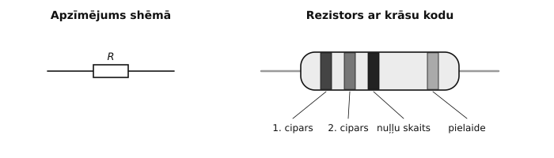
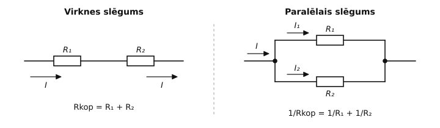
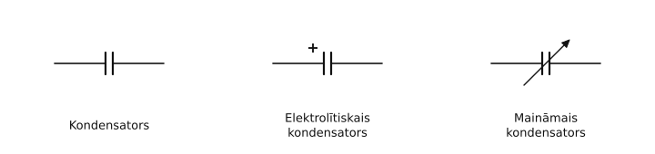
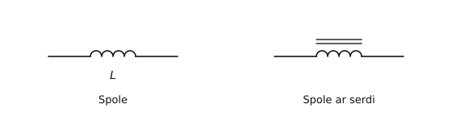
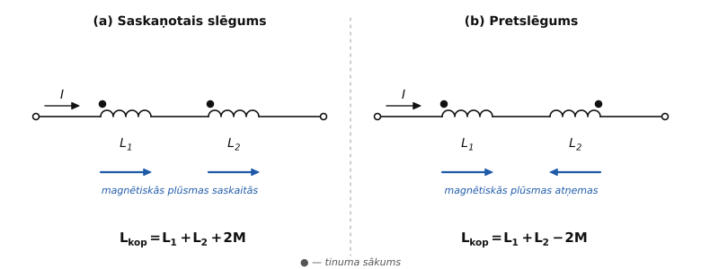
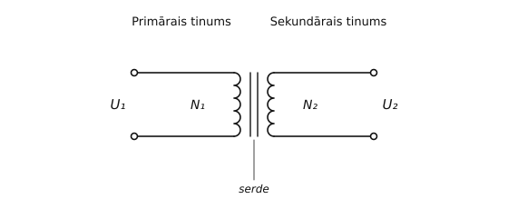
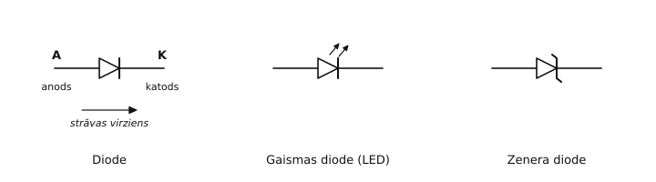
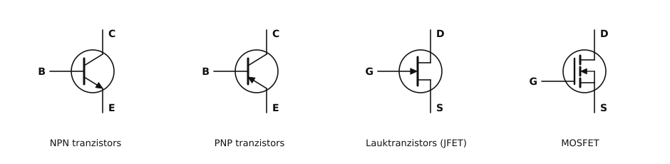

# 9. nodaļa. Elektronikas komponenti

Šī nodaļa iepazīstina ar sešām detaļām, no kurām uzbūvēta jebkura
radioiekārta, un iemāca aprēķināt to slēgumus.

**Video lekcija:** LRAL bezmaksas kurss, 6. nodarbība (QR kods).
**Eksāmena programma:** radioelementi.
**Mācību laiks:** ap 4 stundām.

## Pēc šīs nodaļas tu pratīsi

- pateikt, ko dara rezistors, kondensators, spole, transformators, diode un
  tranzistors, un atpazīt to apzīmējumus shēmā;
- aprēķināt rezistoru, kondensatoru un spoļu virknes un paralēlo slēgumu;
- aprēķināt divu tuvu esošu spoļu kopējo induktivitāti, ņemot vērā savstarpējo
  induktivitāti;
- nolasīt rezistora vērtību pēc krāsu koda tabulas;
- paskaidrot, kā kondensatora un spoles pretestība atkarīga no frekvences;
- aprēķināt transformatora izejas spriegumu.

## 9.1. Rezistors

**Rezistors** ierobežo strāvu un rada sprieguma kritumu. Tā galvenais
parametrs ir pretestība omos (Ω) [1].

Otrs svarīgais parametrs ir **izkliedes jauda**. Rezistors elektrisko
enerģiju pārvērš siltumā, P = I² · R, un katrs rezistors iztur tikai noteiktu
jaudu: parastie mazie 0,25 W, slodzes ekvivalenta rezistori — 100 W un
vairāk. Pārslogots rezistors sakarst un sadeg.

**Krāsu kods.** Mazajiem rezistoriem vērtību norāda ar krāsainām joslām.
Pirmās divas joslas ir cipari, trešā — nuļļu skaits, ceturtā — pielaide.

| Krāsa | Cipars | | Krāsa | Cipars |
| --- | --- | --- | --- | --- |
| Melna | 0 | | Zaļa | 5 |
| Brūna | 1 | | Zila | 6 |
| Sarkana | 2 | | Violeta | 7 |
| Oranža | 3 | | Pelēka | 8 |
| Dzeltena | 4 | | Balta | 9 |

Pielaides josla: zelta ±5 %, sudraba ±10 %.

> **Atceries:** krāsu kods nav jāmācās no galvas — ne eksāmenam, ne praksei.
> Lieto tabulu vai izmēri pretestību ar multimetru. Mērījums ir drošāks arī
> tāpēc, ka vecu rezistoru krāsas mēdz izbalēt.

> **Piemērs.** Rezistoram ir joslas: dzeltena, violeta, sarkana, zelta. Kāda
> ir tā pretestība?
>
> 1. Dzeltena = 4, violeta = 7: pirmie cipari ir 47.
> 2. Sarkana = 2: pieraksti klāt divas nulles — 4700.
> 3. Zelta: pielaide ±5 %.
> 4. Atbilde: 4700 Ω jeb 4,7 kΩ ±5 %.

**Potenciometrs** ir rezistors ar bīdāmu kontaktu; griežot asi, pretestība
mainās. Tāds ir, piemēram, skaļuma regulators.

## 9.2. Rezistoru slēgumi

**Virknes slēgumā** rezistori ir viens aiz otra, un caur visiem plūst viena
un tā pati strāva. Pretestības saskaita [1]:

$$R_{kop} = R_1 + R_2 + \dots + R_n$$

**Paralēlajā slēgumā** rezistori pieslēgti tiem pašiem diviem punktiem, un
uz visiem ir vienāds spriegums. Saskaita apgrieztās vērtības [1]:

$$\frac{1}{R_{kop}} = \frac{1}{R_1} + \frac{1}{R_2} + \dots + \frac{1}{R_n}$$

Diviem rezistoriem ir ērtāka formula [2]:

$$R_{kop} = \frac{R_1 \cdot R_2}{R_1 + R_2}$$

> **Atceries:** virknē kopējā pretestība ir lielāka par lielāko. Paralēli —
> mazāka par mazāko. Ja atbilde tam neatbilst, aprēķinā ir kļūda.

Divi īsceļi paralēlajam slēgumam:

- divi vienādi rezistori dod pusi: 100 Ω ∥ 100 Ω = 50 Ω;
- n vienādi rezistori dod R / n: četri 200 Ω paralēli ir 50 Ω.

> **Piemērs.** Rezistori 60 Ω un 30 Ω saslēgti paralēli. Kāda ir kopējā
> pretestība?
>
> 1. R = (60 · 30) / (60 + 30) = 1800 / 90.
> 2. Atbilde: 20 Ω. Pārbaude: 20 Ω ir mazāk par 30 Ω.

> **Piemērs.** 12 V avotam virknē pieslēgti R1 = 90 Ω un R2 = 30 Ω. Cik
> liela strāva plūst un kāds spriegums ir uz katra rezistora?
>
> 1. Kopējā pretestība: 90 + 30 = 120 Ω.
> 2. Strāva: I = U / R = 12 / 120 = 0,1 A.
> 3. Spriegums uz R1: 0,1 · 90 = 9 V. Uz R2: 0,1 · 30 = 3 V.
> 4. Pārbaude: 9 V + 3 V = 12 V. Sprieguma kritumu summa ir vienāda ar avota
>    spriegumu.

Otrais piemērs ir **sprieguma dalītājs**: divi rezistori virknē sadala
spriegumu proporcionāli savām pretestībām. Pārbaudes solis ir Kirhofa
spriegumu likums [2].

> **Praktisks padoms.** Slodzes ekvivalentu raidītāja pārbaudei var salikt
> pats: divdesmit 1 kΩ rezistori paralēli dod 50 Ω, un jauda sadalās uz
> visiem divdesmit. Rezistoriem jābūt bezinduktīviem (oglekļa vai metāla
> plēves), ne stieples.

## 9.3. Kondensators

**Kondensators** uzkrāj elektrisko lādiņu: divas vadošas plāksnes, starp
kurām ir izolators. Tā galvenais parametrs ir **kapacitāte** farados (F).
Farads ir ļoti liela vienība, tāpēc praksē sastopamas µF, nF un pF [1].

Kas jāzina par kondensatoru:

- **Līdzstrāvu nelaiž cauri**, maiņstrāvu laiž. Tāpēc to lieto, lai atdalītu
  maiņstrāvas signālu no līdzsprieguma.
- **Jo augstāka frekvence, jo mazāka pretestība.** Kondensatora pretestību
  maiņstrāvai sauc par kapacitatīvo reaktīvo pretestību [1]:

$$X_C = \frac{1}{2\pi f C}$$

- **Uzkrāj enerģiju** elektriskajā laukā [1]:

$$W = \frac{C \cdot U^2}{2}$$

- **Sprieguma noturība.** Uz korpusa norādīts lielākais pieļaujamais
  spriegums; to pārsniedzot, izolators tiek caursists.

Biežāk sastopamie veidi: keramiskie (mazas kapacitātes, augstām frekvencēm),
elektrolītiskie (lielas kapacitātes, barošanas blokos; tiem ir polaritāte)
un maiņkondensatori (antenu salāgotājos un kontūros).

> **Uzmanību!** Elektrolītiskajam kondensatoram ir plus un mīnus izvads.
> Pieslēgts otrādi, tas var uzsprāgt. Lieli kondensatori barošanas blokos
> saglabā lādiņu arī pēc izslēgšanas — pirms darba tie jāizlādē.

**Kondensatoru slēgumi** ir pretēji rezistoriem [1]:

$$\text{paralēli: } C_{kop} = C_1 + C_2 + \dots \qquad \text{virknē: } \frac{1}{C_{kop}} = \frac{1}{C_1} + \frac{1}{C_2} + \dots$$

> **Piemērs.** Divi 100 pF kondensatori. Kāda ir kopējā kapacitāte paralēli
> un virknē?
>
> 1. Paralēli saskaita: 100 + 100 = 200 pF.
> 2. Virknē divi vienādi dod pusi: 50 pF.

> **Piemērs.** Kāda ir 100 pF kondensatora reaktīvā pretestība 7 MHz
> frekvencē?
>
> 1. Pamatvienībās: f = 7 000 000 Hz, C = 0,000 000 000 1 F.
> 2. 2π · f · C = 6,28 · 7 · 10⁶ · 100 · 10⁻¹² ≈ 0,0044.
> 3. X_C = 1 / 0,0044 ≈ 227 Ω.

## 9.4. Spole

**Spole** ir vads, satīts vijumos. Kad caur to plūst strāva, ap spoli rodas
magnētiskais lauks, kurā uzkrājas enerģija. Spole pretojas strāvas
izmaiņām. Tās galvenais parametrs ir **induktivitāte** henrijos (H); praksē
mH un µH [1].

Spole uzvedas pretēji kondensatoram:

- **Līdzstrāvu laiž cauri** gandrīz bez pretestības.
- **Jo augstāka frekvence, jo lielāka pretestība.** Induktīvā reaktīvā
  pretestība [1]:

$$X_L = 2\pi f L$$

| | Līdzstrāva | Zema frekvence | Augsta frekvence |
| --- | --- | --- | --- |
| Kondensators | Nelaiž | Liela pretestība | Maza pretestība |
| Spole | Laiž | Maza pretestība | Liela pretestība |

Šī tabula ir visu filtru pamats (10. nodaļa).

**Spoļu slēgumi** ir tādi paši kā rezistoriem, ja spoles viena otru
neietekmē: virknē induktivitātes saskaita, paralēli saskaita apgrieztās
vērtības [1].

> **Piemērs.** Divas spoles, 12 mH un 9 mH, saslēgtas virknē. Kāda ir kopējā
> induktivitāte?
>
> 1. Virknē saskaita: 12 + 9 = 21 mH.

**Savstarpējā induktivitāte.** Ja spoles atrodas tuvu, vienas spoles
magnētiskais lauks šķērso otru. Šo saiti raksturo **savstarpējā
induktivitāte** M; to arī mēra henrijos. Virknes slēgumā [1]:

$$L_{kop} = L_1 + L_2 \pm 2M$$

Zīme atkarīga no tā, kā tinumi saslēgti (9.5. attēls). Shēmās tinuma sākumu
apzīmē ar **punktu**:

- strāva abās spolēs ieplūst pa punktoto galu — lauki pastiprina viens otru,
  **+2M**;
- vienā spolē pa punktoto, otrā pa nepunktoto galu — lauki vājina viens otru,
  **−2M**.

> **Piemērs.** Spoles 12 mH un 9 mH novietotas tuvu, M = 2 mH. Kāda ir kopējā
> induktivitāte?
>
> 1. Kā 9.5. attēlā (a): 12 + 9 + 2 · 2 = 25 mH.
> 2. Kā 9.5. attēlā (b): 12 + 9 − 2 · 2 = 17 mH.

Uz savstarpējās induktivitātes balstās transformators (9.5. apakšnodaļa).

> **Piemērs.** Kāda ir 10 µH spoles reaktīvā pretestība 7 MHz frekvencē?
>
> 1. X_L = 2π · f · L = 6,28 · 7 · 10⁶ · 10 · 10⁻⁶.
> 2. X_L ≈ 440 Ω.

## 9.5. Transformators

**Transformators** ir divas vai vairākas spoles (tinumi) uz kopīgas serdes.
Maiņstrāva primārajā tinumā rada mainīgu magnētisko lauku, kas inducē
spriegumu sekundārajā tinumā [1].

Spriegumu attiecība ir vienāda ar vijumu skaita attiecību; strāvām ir
otrādi [1]:

$$\frac{U_2}{U_1} = \frac{N_2}{N_1} \qquad \frac{I_2}{I_1} = \frac{N_1}{N_2}$$

Transformators nerada jaudu: ja spriegums samazinās, strāva tikpat reižu
pieaug.

> **Piemērs.** Transformatora primārajā tinumā ir 1000 vijumu, sekundārajā —
> 60. Primārajam pievada 230 V. Kāds ir sekundārais spriegums?
>
> 1. U2 = U1 · N2 / N1 = 230 · 60 / 1000.
> 2. Atbilde: 13,8 V.

> **Uzmanību!** Transformators darbojas tikai ar maiņstrāvu. Līdzstrāva
> magnētisko lauku nemaina, tāpēc sekundārajā tinumā nekas neinducējas.

Radiotehnikā transformatorus lieto ne tikai barošanā, bet arī pretestību
saskaņošanai — tādi ir antenu baluni un ununi (13. nodaļa).

## 9.6. Diode

**Diode** ir pusvadītāju elements, kas vada strāvu vienā virzienā un bloķē
pretējā. Tai ir divi izvadi: **anods** (A) un **katods** (K). Strāva plūst no
anoda uz katodu [1].

| Veids | Ko dara | Kur lieto |
| --- | --- | --- |
| Taisngrieža diode | Pārvērš maiņstrāvu līdzstrāvā | Barošanas bloki |
| Gaismas diode (LED) | Izstaro gaismu, kad plūst strāva | Indikatori |
| Zenera diode (stabilitrons) | Notur nemainīgu spriegumu | Sprieguma stabilizatori |

Diode nav ideāls slēdzis: vadošā virzienā uz silīcija diodes krīt ap 0,6–0,7 V.

## 9.7. Tranzistors

**Tranzistors** ir pusvadītāju elements ar trim izvadiem, kas ar mazu
signālu vada lielu strāvu. Tas dara divas lietas: **pastiprina** signālu vai
strādā kā **slēdzis** [1].

| Veids | Izvadi | Kā vada |
| --- | --- | --- |
| Bipolārais (NPN, PNP) | Bāze (B), kolektors (C), emiters (E) | Maza bāzes strāva vada lielu strāvu starp kolektoru un emiteru |
| Lauktranzistors (FET) | Aizvars (G), notece (D), izteka (S) | Spriegums uz aizvara vada strāvu starp noteci un izteku |

Lauktranzistori ir divu veidu: JFET un MOSFET. MOSFET aizvars ir izolēts no
kanāla, tāpēc tā ieejas pretestība ir ļoti liela; tādi tranzistori ir
mūsdienu transīveru jaudas pakāpēs.

NPN un PNP tranzistori atšķiras ar strāvas virzienu; shēmā tos atšķir pēc
emitera bultiņas virziena.

Tranzistori ir visur: uztvērēja pastiprinātājos, ģeneratoros, raidītāja
jaudas pakāpē. Miljoniem tranzistoru uz viena kristāla veido **integrālo
shēmu** (mikroshēmu).

## Eksāmenā jāzina

- Mērvienības: pretestība — Ω, kapacitāte — F, induktivitāte — H.
- Rezistori virknē: saskaita. Paralēli: saskaita apgrieztās vērtības.
- Kondensatori: paralēli saskaita, virknē — apgrieztās vērtības (pretēji
  rezistoriem).
- Spoles: kā rezistori. Tuvām spolēm virknē L_kop = L1 + L2 ± 2M: + ja strāva
  abās ieplūst pa punktoto galu, − ja pretēji.
- X_C = 1 / (2πfC) — frekvencei augot, samazinās.
- X_L = 2πfL — frekvencei augot, pieaug.
- Kondensators līdzstrāvu nelaiž; spole laiž.
- Transformators: U2 / U1 = N2 / N1; darbojas tikai ar maiņstrāvu.
- Diode vada no anoda uz katodu; Zenera diode stabilizē spriegumu.
- Bipolārā tranzistora izvadi: bāze, kolektors, emiters.

## Pamēģini pats

**1. Nolasi krāsu kodu (10 minūtes).** Sameklē mājās vecu elektronikas plati
vai nopērc dažus rezistorus. Nolasi trīs rezistoru vērtības pēc krāsām un
pārbaudi ar multimetru.

**2. Izmēri slēgumus (15 minūtes).** Ņem divus vienādus rezistorus un ar
multimetru izmēri:

- [ ] viena rezistora pretestību;
- [ ] abu pretestību virknē;
- [ ] abu pretestību paralēli.

Salīdzini ar aprēķinu.

**3. Simulators (15 minūtes).** Vietnē falstad.com/circuit pieslēdz
kondensatoru maiņsprieguma avotam un maini frekvenci. Vēro, kā mainās
strāva. Atkārto ar spoli.

## Kopsavilkums

- Rezistors ierobežo strāvu un silst; jāievēro tā izkliedes jauda.
- Kondensators uzkrāj lādiņu, bloķē līdzstrāvu un labāk laiž augstas
  frekvences.
- Spole uzkrāj enerģiju magnētiskajā laukā, laiž līdzstrāvu un bremzē
  augstas frekvences.
- Virknes un paralēlā slēguma formulas rezistoriem un spolēm ir vienādas,
  kondensatoriem — apgrieztas; tuvām spolēm jāņem vērā savstarpējā
  induktivitāte M (±2M).
- Transformators maina maiņspriegumu proporcionāli vijumu skaitam.
- Diode vada vienā virzienā; tranzistors pastiprina vai slēdz.

## Paškontroles jautājumi

1. Divi 100 Ω rezistori saslēgti virknē. Kāda ir kopējā pretestība?
    - A. 50 Ω
    - B. 200 Ω
    - C. 100 Ω
    - D. 10 000 Ω
2. Divi 100 Ω rezistori saslēgti paralēli. Kāda ir kopējā pretestība?
    - A. 50 Ω
    - B. 200 Ω
    - C. 100 Ω
    - D. 25 Ω
3. Rezistori 60 Ω un 30 Ω saslēgti paralēli. Kāda ir kopējā pretestība?
    - A. 90 Ω
    - B. 45 Ω
    - C. 20 Ω
    - D. 30 Ω
4. Trīs 300 pF kondensatori saslēgti paralēli. Kāda ir kopējā kapacitāte?
    - A. 100 pF
    - B. 300 pF
    - C. 600 pF
    - D. 900 pF
5. Divi 100 pF kondensatori saslēgti virknē. Kāda ir kopējā kapacitāte?
    - A. 200 pF
    - B. 50 pF
    - C. 100 pF
    - D. 25 pF
6. Divas spoles, 12 mH un 9 mH, saslēgtas virknē. Kāda ir kopējā induktivitāte?
    - A. 21 mH
    - B. 3 mH
    - C. 5,1 mH
    - D. 108 mH
7. Rezistoram ir joslas: sarkana, sarkana, brūna. Kāda ir tā pretestība? (Izmanto 9.1. attēla tabulu.)
    - A. 22 Ω
    - B. 2200 Ω
    - C. 221 Ω
    - D. 220 Ω
8. Kā kondensators uzvedas līdzstrāvas ķēdē pēc uzlādēšanās?
    - A. Laiž strāvu bez pretestības
    - B. Pastiprina strāvu
    - C. Nelaiž strāvu cauri
    - D. Maina strāvas virzienu
9. Kas notiek ar kondensatora reaktīvo pretestību, frekvencei pieaugot?
    - A. Tā pieaug
    - B. Tā samazinās
    - C. Tā nemainās
    - D. Tā kļūst negatīva
10. Kas notiek ar spoles reaktīvo pretestību, frekvencei pieaugot?
    - A. Tā pieaug
    - B. Tā samazinās
    - C. Tā nemainās
    - D. Tā kļūst vienāda ar nulli
11. Transformatora primārajā tinumā ir 2000 vijumu, sekundārajā — 200. Primārajam pievada 230 V. Kāds ir sekundārais spriegums?
    - A. 2300 V
    - B. 115 V
    - C. 46 V
    - D. 23 V
12. Kas notiek, ja transformatora primārajam tinumam pievada līdzspriegumu?
    - A. Sekundārajā tinumā ir tāds pats līdzspriegums
    - B. Sekundārajā tinumā ir maiņspriegums
    - C. Sekundārajā tinumā pastāvīga sprieguma nav
    - D. Transformators darbojas kā parasti
13. Kādā virzienā diode vada strāvu?
    - A. No katoda uz anodu
    - B. Abos virzienos vienādi
    - C. Nevienā virzienā
    - D. No anoda uz katodu
14. Kuru diodi lieto sprieguma stabilizēšanai?
    - A. Zenera diodi
    - B. Gaismas diodi
    - C. Taisngrieža diodi
    - D. Jebkuru
15. Kā sauc bipolārā tranzistora izvadus?
    - A. Anods, katods, režģis
    - B. Bāze, kolektors, emiters
    - C. Aizvars, notece, izteka
    - D. Plus, mīnus, zeme
16. 12 V avotam virknē pieslēgti rezistori 20 Ω un 40 Ω. Kāds ir spriegums uz 40 Ω rezistora?
    - A. 4 V
    - B. 6 V
    - C. 8 V
    - D. 12 V
17. Spoles 10 µH un 6 µH saslēgtas virknē kā 9.5. attēlā (a). Savstarpējā
    induktivitāte M = 2 µH. Kāda ir kopējā induktivitāte?
    - A. 16 µH
    - B. 20 µH
    - C. 12 µH
    - D. 18 µH

**Atvērtie jautājumi**

18. Tev vajag 50 Ω slodzi, bet ir tikai 100 Ω un 200 Ω rezistori. Piedāvā
    divus veidus, kā to salikt.
19. Paskaidro saviem vārdiem, kāpēc kondensatoru var lietot, lai atdalītu
    maiņstrāvas signālu no līdzsprieguma.

## Atbildes

| Nr. | Atbilde | Skaidrojums |
| --- | --- | --- |
| 1 | B | Virknē saskaita: 100 + 100 = 200 Ω. |
| 2 | A | Divi vienādi paralēli dod pusi. |
| 3 | C | (60 · 30) / (60 + 30) = 20 Ω. |
| 4 | D | Kondensatorus paralēli saskaita: 3 · 300 = 900 pF. |
| 5 | B | Kondensatori virknē uzvedas kā rezistori paralēli: puse. |
| 6 | A | Spoles virknē saskaita. |
| 7 | D | 2, 2 un viena nulle: 220 Ω. |
| 8 | C | Starp plāksnēm ir izolators; līdzstrāva caur to neplūst. |
| 9 | B | X_C = 1 / (2πfC): frekvence ir saucējā. |
| 10 | A | X_L = 2πfL: frekvence ir skaitītājā. |
| 11 | D | 230 · 200 / 2000 = 23 V. |
| 12 | C | Indukcijai vajag mainīgu magnētisko lauku; līdzstrāva to nedod. |
| 13 | D | No anoda uz katodu. |
| 14 | A | Zenera diode (stabilitrons) notur nemainīgu spriegumu. |
| 15 | B | Aizvars, notece un izteka ir lauktranzistoram. |
| 16 | C | I = 12 / 60 = 0,2 A; U = 0,2 · 40 = 8 V. |
| 17 | B | Strāva ieplūst abos punktotajos galos: 10 + 6 + 2 · 2 = 20 µH. (12 µH būtu pretējā slēgumā.) |

Atvērtie jautājumi: astoņpadsmitajā der divi 100 Ω paralēli vai četri
200 Ω paralēli; arī 100 Ω paralēli ar diviem 200 Ω. Deviņpadsmitajā jāpiemin,
ka kondensators līdzstrāvu nelaiž, bet maiņstrāvai tā pretestība ir maza.

## Padziļināti

- **Kvarca rezonators.** Kvarca kristāla plāksnīte, kas svārstās ļoti
  precīzā frekvencē. To lieto ģeneratoros un šauros filtros (10. un
  11. nodaļa).
- **Varikaps.** Diode, kuras kapacitāte mainās līdz ar pievadīto spriegumu;
  ar to elektroniski noskaņo kontūrus.

## Nodaļas avoti

1. LRAL bezmaksas kurss 2026, 6. nodarbība "Elektronikas komponenti",
   prezentācija un video lekcija. lral.lv.
2. Radioamatieru formulu lapa. Matīss YL3RZ, 2026. Izmantota kā formulu
   pārbaudes avots; teksts un zīmējumi nav pārņemti.
