# 10. nodaļa. Shēmas

Šī nodaļa parāda, kā no iepriekšējā nodaļā apgūtajām detaļām saliek
mezglus, no kuriem sastāv katrs uztvērējs un raidītājs: kontūrus, filtrus,
barošanas bloku, pastiprinātāju, ģeneratoru, jaucēju un loģiskos elementus.

**Video lekcija:** LRAL bezmaksas kurss, 7. nodarbība, 1. daļa (QR kods).
**Eksāmena programma:** shēmas.
**Mācību laiks:** ap 4 stundām.

## Pēc šīs nodaļas tu pratīsi

- aprēķināt svārstību kontūra rezonanses frekvenci;
- atšķirt četrus filtru veidus un pateikt, kur katru lieto;
- izskaidrot barošanas bloka uzbūvi no transformatora līdz stabilizatoram un
  atšķirt lineāro un impulsu barošanas bloku;
- pateikt, ko dara pastiprinātājs, ģenerators un jaucējs;
- aprēķināt jaucēja izejas frekvences;
- nosaukt loģisko elementu UN, VAI un NE darbību un pārvērst bināro skaitli
  decimālajā.

## 10.1. Svārstību kontūrs un rezonanse

Spole un kondensators kopā veido **svārstību kontūru**. Enerģija tajā
pārplūst no kondensatora elektriskā lauka uz spoles magnētisko lauku un
atpakaļ, līdzīgi kā šūpolēs augstums pārvēršas ātrumā un otrādi.

9. nodaļā redzējām, ka spoles reaktīvā pretestība ar frekvenci pieaug, bet
kondensatora — samazinās. Ir viena frekvence, kurā tās ir vienādas. To sauc
par **rezonanses frekvenci** [2]:

$$f = \frac{1}{2\pi\sqrt{LC}}$$

No formulas redzams: jo lielāka induktivitāte vai kapacitāte, jo zemāka
rezonanses frekvence. Griežot maiņkondensatoru, kontūru pārskaņo — tā
darbojās veco radiouztvērēju skaņošanas kloķis.

Kontūram ir divi slēgumi, un rezonansē tie uzvedas pretēji [1]:

| Kontūrs | Slēgums | Pretestība rezonansē | Ko dara |
| --- | --- | --- | --- |
| Virknes | L un C viens aiz otra | Minimāla | Rezonanses frekvenci laiž cauri |
| Paralēlais | L un C blakus | Maksimāla | Rezonanses frekvenci aiztur; uz tā veidojas lielākais spriegums |

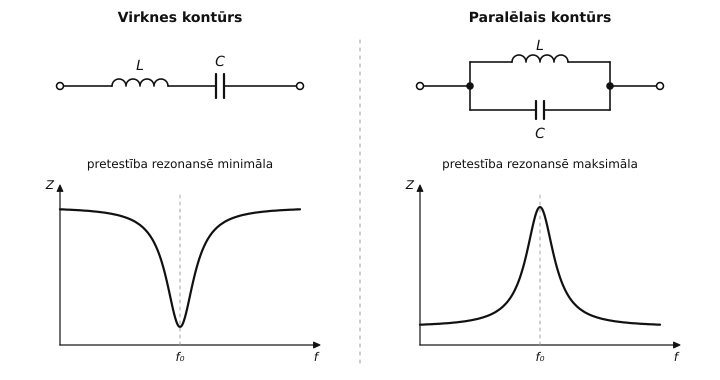

> **Piemērs.** Kontūrā ir spole L = 10 µH un kondensators C = 100 pF. Kāda ir
> rezonanses frekvence?
>
> 1. Pamatvienībās: L = 10 · 10⁻⁶ H, C = 100 · 10⁻¹² F.
> 2. L · C = 10⁻⁵ · 10⁻¹⁰ = 10⁻¹⁵.
> 3. √(10⁻¹⁵) ≈ 3,16 · 10⁻⁸.
> 4. 2π · 3,16 · 10⁻⁸ ≈ 1,99 · 10⁻⁷.
> 5. f = 1 / (1,99 · 10⁻⁷) ≈ 5 030 000 Hz ≈ 5 MHz.

> **Praktisks padoms.** Eksāmenā rezonanses uzdevumam parasti doti četri
> atbilžu varianti, kas atšķiras 10 reizes (piemēram, 1,59 kHz, 15,9 kHz,
> 159 kHz, 1,59 MHz). Cipari 159 nāk no 1 / (2π) ≈ 0,159. Tev jānosaka tikai
> kārta: rūpīgi seko desmit pakāpju kāpinātājiem (10⁻⁶, 10⁻¹² …).

## 10.2. Filtri

**Filtrs** vienas frekvences laiž cauri, citas aiztur. Visi filtri izmanto to,
ka kondensators labāk laiž augstas frekvences, bet spole — zemas [1].

| Filtrs | Saīsinājums | Laiž cauri | Aiztur |
| --- | --- | --- | --- |
| Zemo frekvenču filtrs | LPF (low pass) | Frekvences zem robežfrekvences | Augstākas |
| Augsto frekvenču filtrs | HPF (high pass) | Frekvences virs robežfrekvences | Zemākas |
| Joslas filtrs | BPF (band pass) | Noteiktu frekvenču joslu | Visu zem un virs tās |
| Sprostfiltrs | BSF (band stop) | Visu pārējo | Noteiktu frekvenču joslu |

Filtru uzbūve izriet no šīs īpašības [1]:

- **LPF:** spole signāla ceļā (zemas frekvences laiž, augstas aiztur) un
  kondensators pret zemi (augstās frekvences novada uz zemi).
- **HPF:** otrādi — kondensators signāla ceļā un spole pret zemi.
- **BPF:** kontūrs, noskaņots uz joslas vidu. Paralēlo kontūru liek pret
  zemi (rezonansē tam ir liela pretestība, un signāls netiek novadīts), virknes
  kontūru — signāla ceļā (rezonansē tam ir maza pretestība).
- **BSF:** tieši pretēji — virknes kontūrs pret zemi novada rezonanses
  frekvenci uz zemi, paralēlais kontūrs signāla ceļā to aiztur.

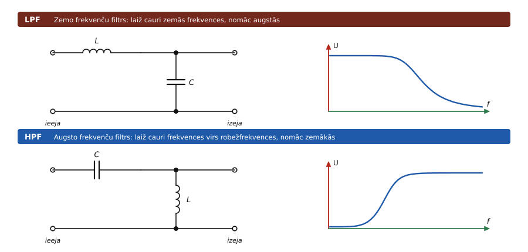

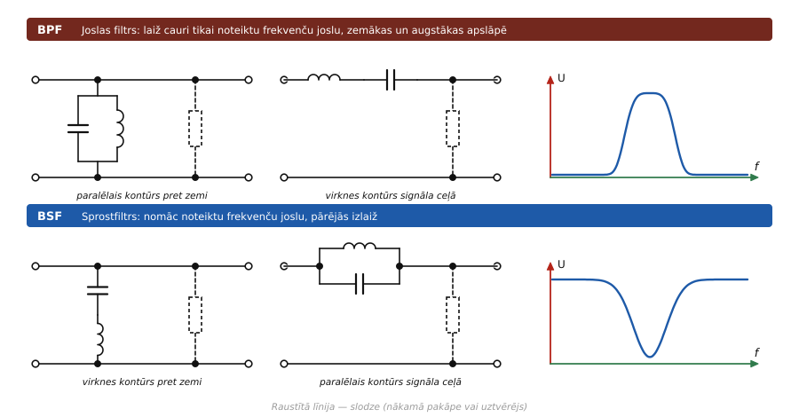

Raksturlīkne rāda, kāds spriegums U nonāk filtra izejā atkarībā no
frekvences f.

**Robežfrekvence** ir vieta, kur filtrs sāk aizturēt. Reāls filtrs nenogriež
asi: aiz robežfrekvences vājinājums pieaug pakāpeniski.

Kur katru filtru sastop radioamatiera stacijā:

- **LPF** — raidītāja izejā. Tas laiž cauri darba frekvenci un aiztur
  harmonikas, kas citādi traucētu augstākās joslās.
- **HPF** — televizora vai radio antenas ieejā, lai aizturētu spēcīgu
  īsviļņu raidītāja signālu.
- **BPF** — uztvērēja ieejā un starpfrekvences traktā; izdala vajadzīgo
  diapazonu vai vienu staciju.
- **BSF** — lai izgrieztu vienu traucējošu signālu; šauru sprostfiltru sauc
  arī par režektorfiltru (notch).

> **Atceries!** LPF pie raidītāja, HPF pie televizora. Abi sargā no tā paša:
> lai īsviļņu raidītājs netraucētu uztveršanu augstākās frekvencēs.

## 10.3. Barošanas bloks

Transīveram vajag 13,8 V līdzspriegumu, bet rozetē ir 230 V maiņspriegums.
Starp tiem ir barošanas bloks. Barošanas bloki ir divu tipu:

| Tips | Kā pazemina spriegumu | Īpašības |
| --- | --- | --- |
| Lineārais (ar tīkla transformatoru) | Ar transformatoru tīkla frekvencē, 50 Hz | Smags un liels; radiotraucējumus nerada |
| Impulsu | Tīkla spriegumu taisno, ar tranzistoru pārslēdz augstā frekvencē un pazemina ar mazu impulsu transformatoru | Viegls un mazs; slikti uzbūvēts rada radiotraucējumus (16. nodaļa) |

Lineārais barošanas bloks sastāv no četrām pakāpēm.

| Pakāpe | Ko dara | Galvenā detaļa |
| --- | --- | --- |
| 1. Transformators | Pazemina maiņspriegumu | Transformators |
| 2. Taisngriezis | Pārvērš maiņstrāvu pulsējošā līdzstrāvā | Diodes |
| 3. Gludināšanas filtrs | Samazina maiņstrāvas pulsācijas līdzstrāvā | Liels elektrolītiskais kondensators; dažreiz arī spole (droselis) |
| 4. Stabilizators | Notur nemainīgu izejas spriegumu | Zenera diode, tranzistors vai mikroshēma |

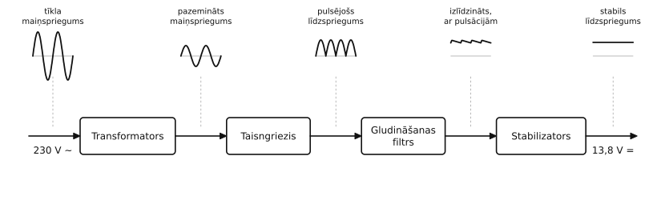

**Taisngriezis** izmanto diodes īpašību vadīt vienā virzienā. Viena diode
laiž cauri tikai pusi no maiņstrāvas perioda. Četras diodes, saslēgtas
**diožu tiltā**, izmanto abus pusperiodus, un pulsācijas ir mazākas [1].
Vienā pusperiodā strāva iet caur D1 un D4, otrā — caur D2 un D3, bet caur
slodzi tā vienmēr plūst vienā virzienā.

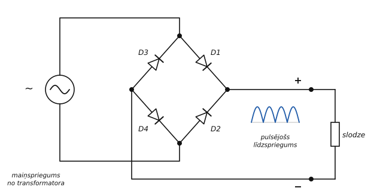

**Gludināšanas filtrs** būtībā ir zemo frekvenču filtrs (10.2.):
līdzspriegumu laiž cauri, pulsācijas aiztur. Tā galvenā detaļa ir liels
elektrolītiskais kondensators: tas uzlādējas sprieguma maksimumos un atdod
enerģiju starp tiem, tā aizpildot "bedres". Dažreiz ceļā liek arī spoli
(droseli), kas pulsācijas aiztur vēl labāk.

**Sprieguma stabilizators** nodrošina nemainīgu izejas spriegumu arī tad,
kad mainās ieejas spriegums vai slodze. Ieejas spriegumam jābūt lielākam par
izejas. Vienkāršākā stabilizatora galvenais elements ir Zenera diode
(stabilitrons) [1]. Tā caur rezistoru Rv tiek pieslēgta pretējā virzienā un
notur uz sevis nemainīgu spriegumu Uz. Ja slodzei vajag lielāku strāvu,
pievieno tranzistoru: Zenera diode nosaka tā bāzes spriegumu, un izejā ir
par aptuveni 0,7 V mazāk. Vienkāršākais stabilizators var būt arī bez
tranzistora.

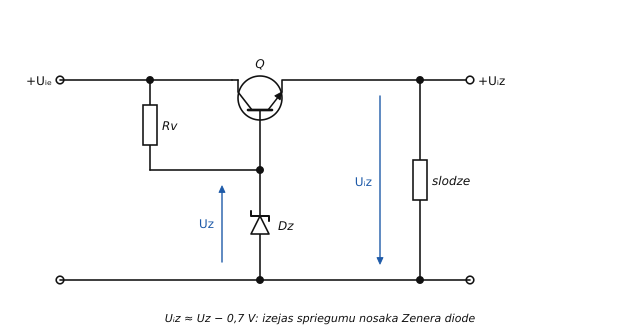

> **Uzmanību!** Barošanas blokā ir tīkla spriegums, un gludināšanas
> kondensatori saglabā lādiņu arī pēc atvienošanas no rozetes. Neatver
> barošanas bloku, ja neesi izlasījis 17. nodaļu.

**Impulsu barošanas bloks** (10.7. attēls) tīkla spriegumu vispirms taisno un
filtrē. Tad tranzistors to pārslēdz desmitiem līdz simtiem kilohercu
frekvencē, mazs impulsu transformators pazemina, un otrs taisngriezis ar
filtru dod izejas līdzspriegumu. Izejas spriegumu notur **atgriezeniskā
saite**: vadības shēma salīdzina izejas spriegumu ar etalonu un maina, cik
ilgi tranzistors ir atvērts.

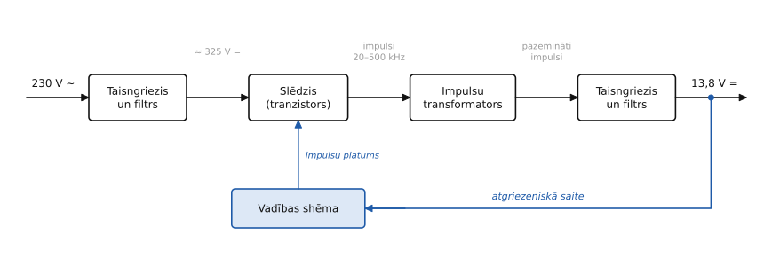

## 10.4. Pastiprinātājs

**Pastiprinātājs** ar barošanas avota enerģiju palielina signālu: izejā ir
tāds pats signāls kā ieejā, tikai lielāks. Cik reižu lielāks, pasaka
**pastiprinājums**, ko parasti izsaka decibelos [1].

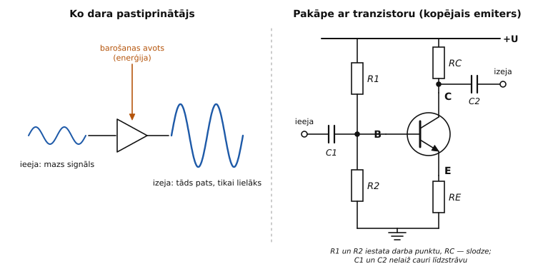

| Veids | Ko pastiprina | Kur lieto |
| --- | --- | --- |
| Platjoslas (aperiodiskais) | Plašu frekvenču joslu vienādi | Mērierīces, daudzdiapazonu iekārtas |
| Rezonanses (joslas) | Šauru joslu ap kontūra rezonanses frekvenci | Uztvērēja ieeja, raidītāja pakāpes |
| Zemfrekvences | Skaņas frekvences | Mikrofona un skaļruņa pastiprinātāji |
| Jaudas | Signālu līdz antenai vajadzīgajai jaudai | Raidītāja gala pakāpe |

Platjoslas un rezonanses pastiprinātājs atšķiras ar to, kas ir tranzistora
kolektora ķēdē: rezistors pastiprina visas frekvences vienādi, bet LC kontūrs —
tikai savu rezonanses frekvenci [1].

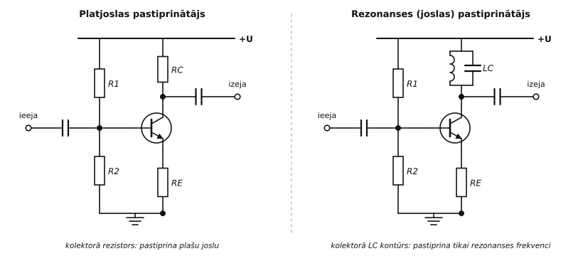

> **Piemērs.** Pastiprinātāja pastiprinājums ir 10 dB. Ieejā padod 5 W. Kāda
> ir izejas jauda?
>
> 1. 10 dB nozīmē jaudu × 10 (8. nodaļa).
> 2. 5 W · 10 = 50 W.

> **Piemērs.** Divi pastiprinātāji saslēgti viens aiz otra: pirmajam 10 dB,
> otrajam 3 dB. Kāds ir kopējais pastiprinājums?
>
> 1. Decibelus saskaita: 10 + 3 = 13 dB.
> 2. Tas ir 10 · 2 = 20 reizes.

**Frekvences reizinātājs.** Ja rezonanses pastiprinātāja izejas kontūru
noskaņo nevis uz ieejas frekvenci, bet uz tās otro vai trešo harmoniku,
izejā iegūst divreiz vai trīsreiz augstāku frekvenci [1].

## 10.5. Ģenerators

**Ģenerators** (oscilators) no līdzstrāvas rada maiņstrāvas signālu. Tas ir
pastiprinātājs, kura izejas signāla daļa padota atpakaļ uz ieeju, un
frekvenci nosaka kontūrs vai kvarca rezonators. Svarīgākie parametri ir
izejas frekvence un tās stabilitāte [1].

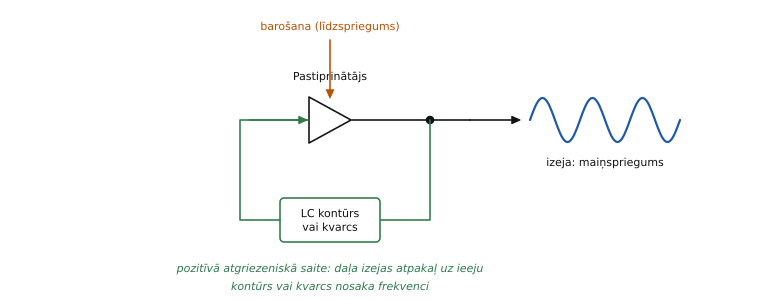

| Veids | Saīsinājums | Īpašība |
| --- | --- | --- |
| Maināmas frekvences ģenerators | VFO | Frekvenci var pārskaņot; mazāk stabils |
| Kvarca ģenerators | XO | Viena, ļoti stabila frekvence |
| Ar spriegumu vadāms ģenerators | VCO | Frekvenci maina ar spriegumu; lieto sintezatoros |
| Multivibrators | — | Ģenerē taisnstūra impulsus |

**Multivibrators** ir ģenerators bez kontūra. Divi tranzistori ar krustenisku
saiti caur kondensatoriem pārmaiņus atveras un aizveras, un izejā rodas
**taisnstūra impulsi**. Impulsu frekvenci nosaka kondensatori un bāzes
rezistori. Multivibratorus izmanto impulsu ģenerēšanai, piemēram, digitālajās
ierīcēs [1].

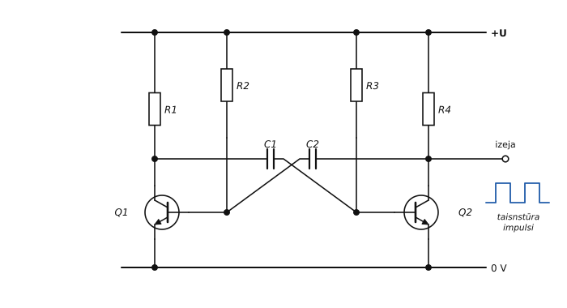

Raidītāja frekvences stabilitāte ir atkarīga no ģeneratora. Nestabils
ģenerators "peld": signāls lēnām aizslīd prom, un korespondentam jāskaņojas
līdzi.

## 10.6. Jaucējs

**Jaucējs** (mixer) ir shēma ar nelineāru elementu — diodi vai tranzistoru.
Ja tam padod divas frekvences, izejā parādās arī to summa un starpība [1]:

$$f_{izejā} = f_1 + f_2 \quad \text{un} \quad f_1 - f_2$$

Aiz jaucēja liek joslas filtru, kas izvēlas vienu no abām.

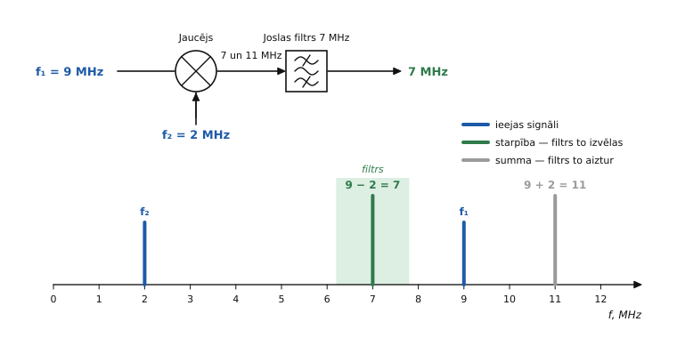

> **Piemērs.** Jaucējam padod 9 MHz un 2 MHz signālus. Kādas frekvences ir
> izejā?
>
> 1. Summa: 9 + 2 = 11 MHz.
> 2. Starpība: 9 − 2 = 7 MHz.
> 3. Ja aiz jaucēja ir 7 MHz joslas filtrs, tālāk iet tikai 7 MHz.

Jaucējs ļauj pārnest signālu no vienas frekvences uz citu, nemainot tā
saturu. Uz tā balstās superheterodīna uztvērējs (11. nodaļa) un SSB
raidītājs (12. nodaļa).

**Modulators** ir shēma, kas ar informācijas signālu maina nesēja īpašības;
**demodulators** (detektors) uztvērējā dara pretējo — atdala informāciju no
nesēja [1].

## 10.7. Loģiskie elementi

Ciparu tehnikā signālam ir tikai divi stāvokļi: 0 un 1. **Loģiskie elementi**
no vienas vai divām ieejām veido izeju pēc noteikta likuma [2].

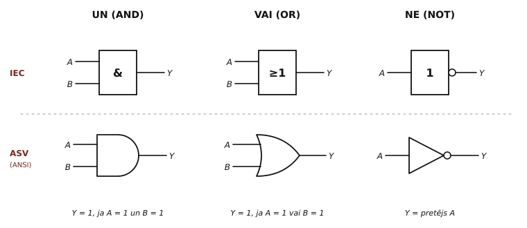

| A | B | UN (AND) | VAI (OR) |
| --- | --- | --- | --- |
| 0 | 0 | 0 | 0 |
| 0 | 1 | 0 | 1 |
| 1 | 0 | 0 | 1 |
| 1 | 1 | 1 | 1 |

- **UN** izejā ir 1 tikai tad, ja abās ieejās ir 1.
- **VAI** izejā ir 1, ja vismaz vienā ieejā ir 1.
- **NE** (NOT) ir viena ieeja; izeja ir pretēja: 0 kļūst par 1, 1 par 0.

**Binārā sistēma** skaitļus pieraksta ar nullēm un vieniniekiem. Katra
pozīcija no labās puses ir divnieka pakāpe: 1, 2, 4, 8, 16 un tā tālāk [2].

> **Piemērs.** Cik decimālajā sistēmā ir binārais skaitlis 1011?
>
> 1. Pozīciju vērtības no kreisās: 8, 4, 2, 1.
> 2. Saskaita tās, kur ir 1: 8 + 0 + 2 + 1.
> 3. Atbilde: 11.

Pārveidošanu abos virzienos — binārais skaitlis uz decimālo un decimālais uz
bināro (dalot ar 2) — vari atrast arī A pielikuma 10. sadaļā "Binārā sistēma",
kopā ar divnieka pakāpju tabulu.

## Eksāmenā jāzina

- Rezonanses frekvence: f = 1 / (2π√LC). Palielinot L vai C, frekvence
  samazinās.
- Virknes kontūram rezonansē pretestība ir minimāla, paralēlajam —
  maksimāla.
- LPF laiž zemās frekvences, HPF — augstās, BPF — joslu, BSF nomāc joslu.
- Taisngriezis pārvērš maiņstrāvu līdzstrāvā; diožu tiltā ir četras diodes.
- Stabilizatora galvenais elements ir Zenera diode.
- Pastiprinājumu izsaka decibelos; virknē slēgtu pakāpju decibelus saskaita.
- Ģeneratoru veidi: VFO, kvarca, VCO; multivibrators dod taisnstūra
  impulsus.
- Jaucēja izejā ir ieejas frekvenču summa un starpība.
- UN: 1 tikai tad, ja abas ieejas ir 1. VAI: 1, ja vismaz viena ieeja ir 1.

## Pamēģini pats

**1. Uzbūvē filtru simulatorā (20 minūtes).** Vietnē falstad.com/circuit
atver gatavu piemēru (Circuits → Passive Filters) vai uzbūvē pats: rezistors
virknē, kondensators uz zemi. Maini avota frekvenci un atzīmē:

- [ ] kādā frekvencē izejas signāls ir tāds pats kā ieejas;
- [ ] kādā frekvencē tas ir aptuveni 0,7 no ieejas (robežfrekvence, −3 dB);
- [ ] kas notiek, ja rezistoru un kondensatoru samaina vietām.

**2. Atrodi rezonansi (15 minūtes).** Tajā pašā simulatorā saslēdz spoli un
kondensatoru paralēli un atrodi frekvenci, kurā spriegums uz kontūra ir
lielākais. Salīdzini ar aprēķinu pēc formulas.

**3. Apskati barošanas bloku.** Atrodi internetā jebkura lineārā 13,8 V
barošanas bloka shēmu un sameklē tajā četras pakāpes no 10.3. apakšnodaļas tabulas.

## Kopsavilkums

- Spole un kondensators kopā veido kontūru ar noteiktu rezonanses
  frekvenci.
- Filtri izmanto to, ka spole un kondensators dažādi laiž dažādas
  frekvences.
- Raidītāja izejā liek zemo frekvenču filtru harmoniku aizturēšanai.
- Lineārais barošanas bloks: transformators, taisngriezis, gludināšanas
  filtrs, stabilizators. Impulsu bloks spriegumu pazemina augstā frekvencē un
  stabilizē ar atgriezenisko saiti.
- Pastiprinātājs palielina signālu; ģenerators to rada; jaucējs pārceļ uz
  citu frekvenci.
- Jaucēja izejā ir summa un starpība; vajadzīgo izvēlas ar filtru.
- Loģiskie elementi: UN dod 1, ja abas ieejas ir 1; VAI — ja vismaz viena;
  NE dod pretējo.

## Paškontroles jautājumi

1. Kuras frekvences laiž cauri zemo frekvenču filtrs (LPF)?
    - A. Frekvences zem robežfrekvences
    - B. Frekvences virs robežfrekvences
    - C. Tikai vienu šauru joslu
    - D. Visas, izņemot vienu joslu
2. Kuru filtru liek raidītāja izejā, lai aizturētu harmonikas?
    - A. Augsto frekvenču filtru
    - B. Sprostfiltru
    - C. Zemo frekvenču filtru
    - D. Nekādu
3. Kurš filtrs laiž cauri tikai noteiktu frekvenču joslu un aiztur visu zem un virs tās?
    - A. LPF
    - B. HPF
    - C. BSF
    - D. BPF
4. Ko dara sprostfiltrs (BSF)?
    - A. Laiž cauri tikai vienu joslu
    - B. Nomāc noteiktu frekvenču joslu, pārējo laiž cauri
    - C. Pastiprina vienu joslu
    - D. Laiž cauri tikai līdzstrāvu
5. Kāda ir paralēlā svārstību kontūra pretestība rezonanses frekvencē?
    - A. Minimāla
    - B. Vienāda ar nulli
    - C. Maksimāla
    - D. Nav atkarīga no frekvences
6. Kāda ir virknes svārstību kontūra pretestība rezonanses frekvencē?
    - A. Minimāla
    - B. Maksimāla
    - C. Bezgalīga
    - D. Nav atkarīga no frekvences
7. Kas notiek ar kontūra rezonanses frekvenci, ja palielina kondensatora kapacitāti?
    - A. Tā pieaug
    - B. Tā nemainās
    - C. Kontūrs pārstāj rezonēt
    - D. Tā samazinās
8. Ko dara taisngriezis?
    - A. Pastiprina signālu
    - B. Pārvērš maiņstrāvu līdzstrāvā
    - C. Pārvērš līdzstrāvu maiņstrāvā
    - D. Stabilizē frekvenci
9. Cik diožu ir diožu tiltā?
    - A. Viena
    - B. Divas
    - C. Trīs
    - D. Četras
10. Kāds ir gludināšanas kondensatora uzdevums barošanas blokā?
    - A. Samazināt sprieguma pulsācijas pēc taisngrieža
    - B. Pazemināt tīkla spriegumu
    - C. Pārvērst maiņstrāvu līdzstrāvā
    - D. Aizsargāt no īsslēguma
11. Kurš elements ir vienkāršākā sprieguma stabilizatora pamatā?
    - A. Spole
    - B. Transformators
    - C. Zenera diode
    - D. Rezistors
12. Jaucējam padod 9 MHz un 2 MHz signālus. Kuras frekvences ir tā izejā?
    - A. Tikai 9 MHz
    - B. 7 MHz un 11 MHz
    - C. 18 MHz un 4 MHz
    - D. 4,5 MHz
13. Kāda ir kvarca ģeneratora galvenā priekšrocība?
    - A. To var pārskaņot plašā diapazonā
    - B. Tas dod lielu jaudu
    - C. Tam nevajag barošanu
    - D. Tā frekvence ir ļoti stabila
14. Kādas formas signālu ģenerē multivibrators?
    - A. Taisnstūra impulsus
    - B. Tīru sinusoīdu
    - C. Līdzspriegumu
    - D. Troksni
15. Frekvences reizinātāja ieejā ir 7 MHz, un tā izejas kontūrs noskaņots uz trešo harmoniku. Kāda ir izejas frekvence?
    - A. 14 MHz
    - B. 10 MHz
    - C. 21 MHz
    - D. 2,33 MHz
16. Kad loģiskā elementa UN (AND) izejā ir 1?
    - A. Ja vismaz vienā ieejā ir 1
    - B. Ja abās ieejās ir 0
    - C. Vienmēr
    - D. Tikai tad, ja abās ieejās ir 1
17. Cik decimālajā sistēmā ir binārais skaitlis 1010?
    - A. 5
    - B. 10
    - C. 12
    - D. 1010

**Atvērtie jautājumi**

18. Uzzīmē lineārā barošanas bloka blokshēmu ar četrām pakāpēm un pie katras
    pieraksti, kāds spriegums ir tās izejā (forma un aptuvenā vērtība).
19. Kontūrā L = 1 µH un C = 100 pF. Aprēķini rezonanses frekvenci. Parādi
    visus soļus.

## Atbildes

| Nr. | Atbilde | Skaidrojums |
| --- | --- | --- |
| 1 | A | "Low pass" — laiž zemās. |
| 2 | C | Harmonikas ir augstākas par darba frekvenci, tāpēc tās aiztur LPF. |
| 3 | D | BPF — joslas filtrs. |
| 4 | B | BSF nomāc joslu; BPF to laiž cauri. |
| 5 | C | Paralēlais kontūrs rezonansē — maksimāla pretestība. |
| 6 | A | Virknes kontūrs rezonansē — minimāla pretestība. |
| 7 | D | C ir formulas saucējā zem saknes: lielāks C, zemāka frekvence. |
| 8 | B | Taisngriezis izmanto diodes vienvirziena vadītspēju. |
| 9 | D | Četras diodes izmanto abus pusperiodus. |
| 10 | A | Kondensators uzlādējas maksimumos un atdod enerģiju starp tiem. |
| 11 | C | Zenera diode (stabilitrons) notur nemainīgu spriegumu. |
| 12 | B | Summa 11 MHz un starpība 7 MHz. |
| 13 | D | Kvarca rezonators svārstās ļoti precīzā frekvencē. |
| 14 | A | Multivibrators pārslēdzas starp diviem stāvokļiem. |
| 15 | C | 3 · 7 = 21 MHz. |
| 16 | D | VAI (OR) dod 1, ja vismaz vienā ieejā ir 1. |
| 17 | B | 8 + 0 + 2 + 0 = 10. |

Atvērtie jautājumi: 18. jautājumā: transformators — pazemināts
maiņspriegums; taisngriezis — pulsējošs līdzspriegums; gludināšanas filtrs —
izlīdzināts līdzspriegums ar nelielām pulsācijām; stabilizators — stabils
13,8 V. 19. jautājumā L · C = 10⁻⁶ · 10⁻¹⁰ = 10⁻¹⁶;
√(10⁻¹⁶) = 10⁻⁸; 2π · 10⁻⁸ ≈ 6,28 · 10⁻⁸; f ≈ 15,9 MHz.

## Padziļināti

- **Kontūra labums (Q).** Rāda, cik šaura ir kontūra rezonanses līkne. Jo
  augstāks labums, jo selektīvāks filtrs un jo mazāki zudumi.
- **Pastiprinātāju klases.** A klases pastiprinātājs ir lineārs, bet
  neekonomisks; C klase ir ekonomiska, bet kropļo signālu un der tikai CW un
  FM. SSB raidītāja gala pakāpe strādā AB klasē.
- **Kvarca filtrs.** Vairāki kvarca rezonatori veido ļoti šauru joslas
  filtru; ar to SSB raidītājā nogriež nevajadzīgo sānjoslu.
- **Simulatori.** falstad.com/circuit, circuitlab.com un everycircuit.com
  ļauj izmēģināt shēmas bez lodāmura.

## Nodaļas avoti

1. LRAL bezmaksas kurss 2026, 7. nodarbība "Shēmas, uztvērēji un raidītāji",
   prezentācija un video lekcija. lral.lv.
2. Radioamatieru formulu lapa. Matīss YL3RZ, 2026. Izmantota kā formulu un
   patiesumtabulu pārbaudes avots; teksts un zīmējumi nav pārņemti.
