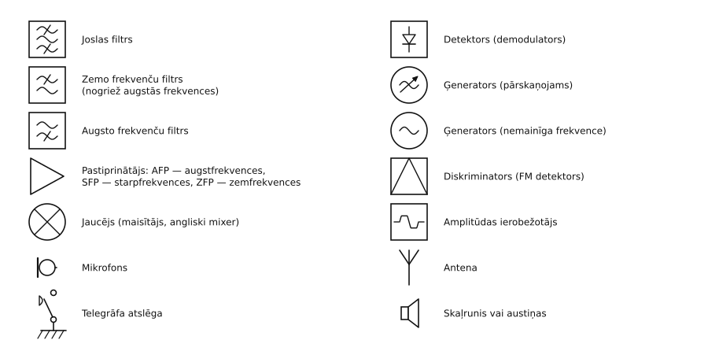
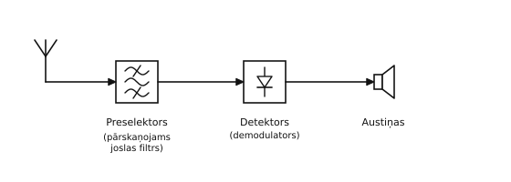
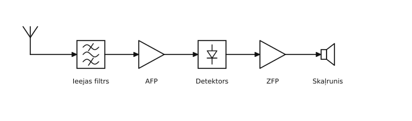
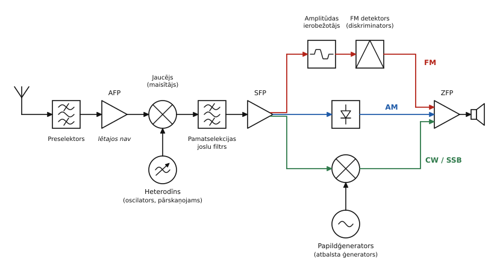
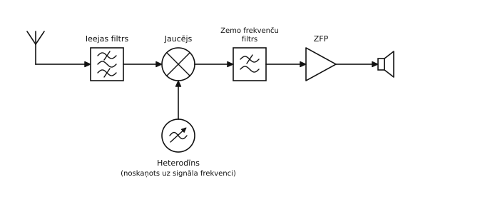
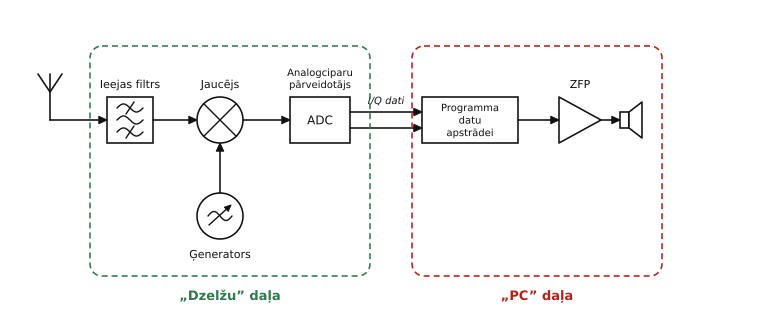

# 11. nodaļa. Uztvērēji

Šī nodaļa parāda, kā no antenas mikrovoltiem top skaņa skaļrunī, un iemāca
izlasīt piecu uztvērēju veidu blokshēmas.

**Video lekcija:** LRAL bezmaksas kurss, 7. nodarbība, 2. daļa (QR kods).
**Eksāmena programma:** uztvērēji.
**Mācību laiks:** ap 3 stundām.

## Pēc šīs nodaļas tu pratīsi

- nosaukt uztvērēja trīs uzdevumus un galvenos parametrus;
- izskaidrot detektoruztvērēja un tiešā pastiprinājuma uztvērēja darbību;
- nosaukt superheterodīna blokus pareizā secībā un pateikt, ko katrs dara;
- aprēķināt heterodīna un spoguļkanāla frekvenci;
- paskaidrot, ar ko atšķiras tiešās pārveidošanas uztvērējs un SDR.

## 11.1. Ko dara uztvērējs

Antenā vienlaikus ir tūkstošiem signālu, un vajadzīgais starp tiem var būt
miljonā daļa volta. Uztvērējam ar to jāizdara trīs lietas:

1. **izvēlēties** vienu signālu no visiem pārējiem;
2. **pastiprināt** to miljoniem reižu;
3. **demodulēt** — atdalīt informāciju (skaņu) no nesēja.

Cik labi uztvērējs to dara, raksturo četri parametri:

| Parametrs | Ko nozīmē | Kas to nosaka |
| --- | --- | --- |
| **Jutība** | Vājākais signāls, ko vēl var uztvert | Pirmo pakāpju trokšņi |
| **Selektivitāte** | Spēja atdalīt vajadzīgo signālu no blakus esošajiem | Filtri |
| **Stabilitāte** | Spēja noturēt noskaņoto frekvenci | Ģeneratori |
| **Dinamiskais diapazons** | Spēja uztvert vāju signālu, kad blakus ir ļoti spēcīgs | Jaucēja un pastiprinātāju lineārums |

Blokshēmās lietosim šādus saīsinājumus [1]:

| Saīsinājums | Nosaukums | Angliski |
| --- | --- | --- |
| AFP | Augstfrekvences pastiprinātājs | RF amplifier |
| SFP | Starpfrekvences pastiprinātājs | IF amplifier |
| ZFP | Zemfrekvences pastiprinātājs | AF amplifier |
| — | Heterodīns (vietējais ģenerators) | Local oscillator, LO |
| — | Jaucējs | Mixer |
| — | Detektors (demodulators) | Detector |

Apzīmējumi ir tie paši, kas LRAL kursa 7. nodarbības slaidos; tos lieto gan
uztvērēju, gan raidītāju (12. nodaļa) blokshēmās.

## 11.2. Detektoruztvērējs

Vienkāršākais iespējamais uztvērējs sastāv no četrām detaļām [1].

| Bloks | Ko dara |
| --- | --- |
| Antena | Uztver radioviļņus |
| Preselektors (pārskaņojams joslas filtrs) | Izvēlas vienu frekvenci |
| Detektors (diode) | Atdala skaņu no AM signāla nesēja |
| Austiņas | Pārvērš strāvu skaņā |

Tam nav ne pastiprinātāja, ne barošanas: visa enerģija nāk no paša
radioviļņa. Tāpēc dzirdamas tikai tuvas un spēcīgas AM stacijas, un
selektivitāte ir vāja — preselektors viens pats blakus stacijas neatdala.

## 11.3. Tiešā pastiprinājuma uztvērējs

Ja detektoruztvērējam pirms detektora pieliek augstfrekvences pastiprinātāju
un aiz tā — zemfrekvences pastiprinātāju, iegūst **tiešā pastiprinājuma
uztvērēju** [1].

Signāls visu ceļu līdz detektoram paliek savā sākotnējā frekvencē.
Jutība ir labāka, bet paliek divas problēmas: visi kontūri jāpārskaņo reizē,
un augstās frekvencēs ir grūti uzbūvēt šaurus filtrus. Šīs problēmas atrisina
superheterodīns.

## 11.4. Superheterodīns

**Superheterodīna** ideja: jebkuru uztveramo signālu vispirms pārnes uz
vienu nemainīgu frekvenci — **starpfrekvenci** — un galveno pastiprināšanu
un filtrēšanu veic tur. Tā uzbūvēta lielākā daļa transīveru [1].

| Nr. | Bloks | Ko dara |
| --- | --- | --- |
| 1 | Preselektors un AFP | Izdala diapazonu un pastiprina vājo signālu; lētos uztvērējos AFP var nebūt |
| 2 | Heterodīns | Ģenerē pārskaņojamu frekvenci; ar to noskaņo uztvērēju |
| 3 | Jaucējs | No signāla un heterodīna frekvences veido starpfrekvenci |
| 4 | Pamatselekcijas (starpfrekvences) filtrs | Nosaka uztvērēja selektivitāti |
| 5 | SFP | Dod galveno pastiprinājumu |
| 6 | Detektors | Atdala skaņu no starpfrekvences signāla |
| 7 | ZFP | Pastiprina skaņu līdz skaļrunim |

Aiz SFP signāls atkarībā no darba veida iet pa vienu no trim zariem
(11.4. attēls): AM signālu demodulē detektors (zilais zars), FM signālu —
amplitūdas ierobežotājs un diskriminators (sarkanais zars), CW un SSB
signālu — jaucējs ar papildģeneratoru (zaļais zars).

10. nodaļā redzējām, ka jaucēja izejā ir ieejas frekvenču summa un
starpība. Superheterodīnā izmanto vienu no tām:

$$f_{SF} = |f_{sign} - f_{het}|$$

Noskaņošanās nozīmē mainīt heterodīna frekvenci tā, lai vajadzīgais signāls
trāpītu tieši starpfrekvences filtrā.

> **Piemērs.** Uztvērēja starpfrekvence ir 9 MHz. Uz kādu frekvenci
> jānoskaņo heterodīns, lai uztvertu 21,2 MHz signālu?
>
> 1. Vajag, lai starpība būtu 9 MHz.
> 2. Viens variants: 21,2 − 9 = 12,2 MHz.
> 3. Otrs variants: 21,2 + 9 = 30,2 MHz. Der abi; kuru lieto, nosaka
>    uztvērēja konstrukcija.

**SSB un CW uztveršana.** Šiem signāliem nesēja nav, tāpēc parasts detektors
dotu nesaprotamu skaņu. Uztvērējā ir otrs ģenerators ar nemainīgu frekvenci —
**papildģenerators** (atbalsta ģenerators), kas nesēju atjauno;
detektors tad ir vēl viens jaucējs, kura izejā ir skaņas frekvence. CW
signālam tā rodas dzirdams tonis.

**Spoguļkanāls.** Jaucējs neatšķir, vai signāls ir par starpfrekvenci
augstāk vai zemāk par heterodīnu. Tāpēc katram heterodīna stāvoklim ir divas
frekvences, kas nonāk starpfrekvencē: vajadzīgā un **spoguļkanāls**. Tās
atšķiras par divām starpfrekvencēm:

$$f_{spog} = f_{sign} \pm 2 \cdot f_{SF}$$

> **Piemērs.** Uztvērējs ar 9 MHz starpfrekvenci noskaņots uz 21,2 MHz, un
> heterodīns strādā 12,2 MHz. Kur ir spoguļkanāls?
>
> 1. Starpfrekvencē nonāk arī signāls, kas ir 9 MHz zem heterodīna.
> 2. 12,2 − 9 = 3,2 MHz.
> 3. Pārbaude: 21,2 − 2 · 9 = 3,2 MHz.

Spoguļkanālu aiztur ieejas filtrs pirms jaucēja. Jo augstāka starpfrekvence,
jo tālāk spoguļkanāls ir no vajadzīgā signāla un jo vieglāk to nofiltrēt.

> **Atceries!** Selektivitāti nosaka starpfrekvences filtrs; aizsardzību no
> spoguļkanāla — ieejas filtrs.

## 11.5. Tiešās pārveidošanas uztvērējs

**Tiešās pārveidošanas uztvērējā** (direct conversion) heterodīnu noskaņo
tieši uz signāla frekvenci. Jaucēja izejā starpība uzreiz ir skaņas
frekvencē, un starpfrekvences nav vispār [1].

| Priekšrocības | Trūkumi |
| --- | --- |
| Ļoti vienkārša shēma | Dzird abas sānjoslas reizē |
| Labi der CW un SSB uztveršanai | Viss pastiprinājums ir zemfrekvencē; jutīgs pret fonu |
| Iecienīts pašbūves projekts | Selektivitāte ir vājāka nekā superheterodīnam |

Daudzi vienkāršie pašbūves komplekti iesācējiem ir tieši šādi.

## 11.6. SDR — programmvadāms radio

**SDR** (software defined radio) lielāko daļu darba veic ar programmu.
Signālu no antenas pārvērš skaitļu virknē, un filtrēšanu, demodulāciju un
pastiprināšanu veic dators vai procesors [1].

| Daļa | Kas tajā ir |
| --- | --- |
| Aparatūra | Ieejas filtrs, jaucējs ar ģeneratoru, analogciparu pārveidotājs (ADC) |
| Programma | Filtri, demodulators, trokšņu slāpēšana, spektra attēls |

Ko tas dod praksē:

- **spektra un "ūdenskrituma" attēls** — redzi visu diapazonu uzreiz;
- **jebkura platuma filtri** bez papildu detaļām;
- **jauni darba veidi** ar programmas atjauninājumu.

WebSDR, ko lietoji iepriekšējo nodaļu uzdevumos, ir tieši SDR uztvērējs, kas
pieslēgts internetam. Arī lielākā daļa mūsdienu transīveru iekšpusē ir SDR.

## 11.7. Uztvērēja vadības elementi

Šie apzīmējumi ir uz katra transīvera priekšējā paneļa.

| Apzīmējums | Nosaukums | Ko dara |
| --- | --- | --- |
| AGC | Automātiskā pastiprinājuma regulēšana | Izlīdzina skaļumu starp stipriem un vājiem signāliem |
| RF GAIN | Augstfrekvences pastiprinājums | Samazina pastiprinājumu, kad signāli ir pārāk spēcīgi |
| ATT | Vājinātājs | Vājina visus signālus ieejā; palīdz pret pārslodzi |
| FIL, WIDTH | Filtra platums | Šaurāks filtrs — mazāk traucējumu, bet arī mazāk skaņas joslas |
| NB, NR | Trokšņu slāpētāji | Samazina impulsu traucējumus un fona troksni |
| RIT | Uztvērēja frekvences pieskaņošana | Nedaudz pārbīda uztveršanas frekvenci, nemainot raidīšanas |
| SQL | Trokšņu slēdzis (squelch) | FM režīmā izslēdz skaļruni, kad signāla nav |
| S metrs | Signāla stipruma mērītājs | Rāda signāla līmeni S vienībās |

> **Praktisks padoms.** Ja diapazonā ir daudz spēcīgu staciju un viss skan
> izkropļoti, ieslēdz vājinātāju (ATT) vai samazini RF GAIN. Uztvērējs ir
> pārslogots, un mazāks pastiprinājums šajā gadījumā dod labāku dzirdamību.

> **Uzmanību!** Šaurāks filtrs ne vienmēr ir labāks. SSB balsij vajag ap
> 2,4 kHz; ar 500 Hz filtru tā kļūst nesaprotama. Šaurie filtri ir
> telegrāfam un ciparu darba veidiem.

## Eksāmenā jāzina

- Uztvērēja parametri: jutība, selektivitāte, stabilitāte, dinamiskais
  diapazons.
- Detektoruztvērējs: antena, preselektors, detektors, austiņas; bez pastiprinātāja un
  barošanas; AM signāliem.
- Tiešā pastiprinājuma uztvērējs: AFP, detektors, ZFP.
- Superheterodīna bloki secībā: preselektors un AFP, jaucējs ar heterodīnu,
  starpfrekvences filtrs, SFP, detektors, ZFP.
- Starpfrekvence ir signāla un heterodīna frekvenču starpība; tā ir
  nemainīga.
- Selektivitāti nosaka starpfrekvences filtrs.
- Spoguļkanāls atrodas divu starpfrekvenču attālumā no vajadzīgā signāla.
- Tiešās pārveidošanas uztvērējs: heterodīns uz signāla frekvences; CW un
  SSB uztveršanai.
- SDR: signālu apstrādā programma.

## Pamēģini pats

**1. Uzzīmē no galvas (10 minūtes).** Aizver grāmatu un uzzīmē
superheterodīna blokshēmu ar visiem septiņiem blokiem. Pie katra pieraksti
vienu vārdu, ko tas dara. Salīdzini ar 11.4. apakšnodaļas tabulu.

**2. Izmēģini filtrus (15 minūtes).** WebSDR uztvērējā noskaņojies uz SSB
sakaru un maini filtra platumu:

- [ ] pie kāda platuma balss kļūst grūti saprotama;
- [ ] kas notiek ar blakus stacijas traucējumiem, filtru sašaurinot;
- [ ] kā skan CW signāls ar 2,4 kHz un ar 500 Hz filtru.

**3. Aprēķini.** Uztvērēja starpfrekvence ir 455 kHz, un tas noskaņots uz
3650 kHz ar heterodīnu virs signāla. Aprēķini heterodīna un spoguļkanāla
frekvenci.

## Kopsavilkums

- Uztvērējs izvēlas, pastiprina un demodulē.
- Detektoruztvērējs ir vienkāršākais: antena, preselektors, detektors (diode),
  austiņas.
- Superheterodīns pārnes signālu uz nemainīgu starpfrekvenci, kur to
  filtrē un pastiprina.
- Uztvērēju noskaņo, mainot heterodīna frekvenci.
- Spoguļkanāls ir superheterodīna blakusefekts; to aiztur ieejas filtrs.
- Tiešās pārveidošanas uztvērējā starpfrekvences nav.
- SDR aizstāj lielāko daļu shēmas ar programmu.

## Paškontroles jautājumi

1. Kurš parametrs raksturo uztvērēja spēju atdalīt vajadzīgo signālu no blakus esošajiem?
    - A. Jutība
    - B. Selektivitāte
    - C. Stabilitāte
    - D. Izejas jauda
2. Kurš parametrs raksturo vājāko signālu, ko uztvērējs vēl spēj uztvert?
    - A. Jutība
    - B. Selektivitāte
    - C. Dinamiskais diapazons
    - D. Starpfrekvence
3. No kādiem blokiem sastāv detektoruztvērējs?
    - A. AFP, jaucējs, heterodīns, ZFP
    - B. Heterodīns, jaucējs, skaļrunis
    - C. Preselektors, detektors, austiņas
    - D. Analogciparu pārveidotājs un dators
4. Kādu signālu uztveršanai paredzēts detektoruztvērējs?
    - A. SSB
    - B. FM
    - C. FT8
    - D. AM
5. Kurš bloks superheterodīna uztvērējā veido starpfrekvenci?
    - A. Jaucējs
    - B. Detektors
    - C. ZFP
    - D. Ieejas filtrs
6. Ar kuru bloku superheterodīna uztvērēju noskaņo uz vajadzīgo staciju?
    - A. Ar starpfrekvences filtru
    - B. Ar zemfrekvences pastiprinātāju
    - C. Ar heterodīnu
    - D. Ar detektoru
7. Kurš bloks galvenokārt nosaka superheterodīna selektivitāti?
    - A. Antena
    - B. Starpfrekvences filtrs
    - C. Skaļrunis
    - D. Zemfrekvences pastiprinātājs
8. Uztvērēja starpfrekvence ir 9 MHz, heterodīns strādā zem signāla. Uz kādu frekvenci jānoskaņo heterodīns, lai uztvertu 28,5 MHz?
    - A. 37,5 MHz
    - B. 9 MHz
    - C. 28,5 MHz
    - D. 19,5 MHz
9. Uztvērēja starpfrekvence ir 455 kHz, heterodīns ir 4105 kHz un strādā virs signāla. Kādu frekvenci uztvērējs uztver?
    - A. 3650 kHz
    - B. 4560 kHz
    - C. 4105 kHz
    - D. 455 kHz
10. Kas ir spoguļkanāls?
    - A. Tā pati stacija, uztverta ar otru antenu
    - B. Raidītāja otrā harmonika
    - C. Otra frekvence, kas pie tā paša heterodīna stāvokļa arī nonāk starpfrekvencē
    - D. Atstarots signāls no jonosfēras
11. Kurš bloks superheterodīnā aizsargā no spoguļkanāla?
    - A. Ieejas filtrs pirms jaucēja
    - B. Starpfrekvences filtrs
    - C. Detektors
    - D. Zemfrekvences pastiprinātājs
12. Uz kādu frekvenci noskaņo heterodīnu tiešās pārveidošanas uztvērējā?
    - A. Uz starpfrekvenci
    - B. Uz signāla frekvenci
    - C. Uz divkāršu signāla frekvenci
    - D. Heterodīna tajā nav
13. Kas raksturīgs SDR uztvērējam?
    - A. Tam nav antenas
    - B. Tas uztver tikai AM
    - C. Tam nav vajadzīga barošana
    - D. Signāla filtrēšanu un demodulāciju veic programma
14. Ko dara automātiskā pastiprinājuma regulēšana (AGC)?
    - A. Izlīdzina skaļumu starp stipriem un vājiem signāliem
    - B. Noskaņo uztvērēju uz staciju
    - C. Palielina raidītāja jaudu
    - D. Maina sānjoslu

**Atvērtie jautājumi**

15. Paskaidro saviem vārdiem, kāpēc superheterodīnā signālu pārnes uz
    starpfrekvenci, nevis pastiprina un filtrē sākotnējā frekvencē.
16. Uztvērēja starpfrekvence ir 9 MHz, tas noskaņots uz 7,05 MHz, heterodīns
    strādā virs signāla. Aprēķini heterodīna un spoguļkanāla frekvenci.

## Atbildes

| Nr. | Atbilde | Skaidrojums |
| --- | --- | --- |
| 1 | B | Selektivitāte — spēja izvēlēties. |
| 2 | A | Jutība — vājākais uztveramais signāls. |
| 3 | C | Tam nav ne pastiprinātāju, ne heterodīna. |
| 4 | D | Diode atdala skaņu no AM signāla nesēja; SSB un FM tā nedemodulē. |
| 5 | A | Jaucēja izejā ir signāla un heterodīna frekvenču starpība. |
| 6 | C | Mainot heterodīna frekvenci, starpfrekvencē nonāk cita stacija. |
| 7 | B | Starpfrekvence ir nemainīga, tāpēc tur var likt šauru, kvalitatīvu filtru. |
| 8 | D | 28,5 − 9 = 19,5 MHz. |
| 9 | A | 4105 − 455 = 3650 kHz. |
| 10 | C | Jaucējs neatšķir signālu virs un zem heterodīna. |
| 11 | A | Spoguļkanāls jāaiztur, pirms tas nonāk jaucējā. |
| 12 | B | Starpība tad uzreiz ir skaņas frekvencē. |
| 13 | D | Aparatūra tikai pārvērš signālu skaitļos. |
| 14 | A | AGC samazina pastiprinājumu stipriem signāliem. |

Atvērtie jautājumi: 15. jautājumā jāpiemin, ka nemainīgā frekvencē var
lietot vienu šauru, kvalitatīvu filtru un stabilu pastiprinājumu visiem
diapazoniem. 16. jautājumā heterodīns ir 7,05 + 9 = 16,05 MHz; spoguļkanāls
ir 16,05 + 9 = 25,05 MHz (pārbaude: 7,05 + 2 · 9 = 25,05 MHz).

## Padziļināti

- **Divkāršā pārveidošana.** Daudzos uztvērējos ir divas starpfrekvences:
  augsta pirmā (laba aizsardzība no spoguļkanāla) un zema otrā (šauri
  filtri).
- **FM uztvērējs.** Starpfrekvences traktā ir ierobežotājs, kas nogriež
  amplitūdas izmaiņas, un frekvences detektors (diskriminators). Tāpēc FM
  ir noturīgs pret impulsu traucējumiem.
- **Trokšņu koeficients.** Skaitlis, kas rāda, cik daudz paša uztvērēja
  trokšņu pievienojas signālam. Īsviļņos tas ir mazsvarīgs, jo atmosfēras
  troksnis ir lielāks; VHF un UHF diapazonos un augstāk tas nosaka jutību.

## Nodaļas avoti

1. LRAL bezmaksas kurss 2026, 7. nodarbība "Shēmas, uztvērēji un raidītāji",
   prezentācija un video lekcija. lral.lv.
