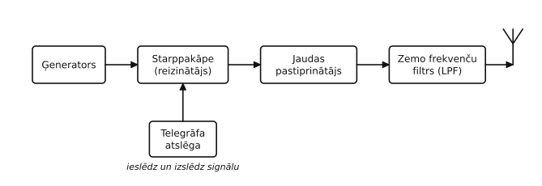
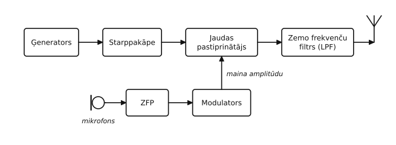
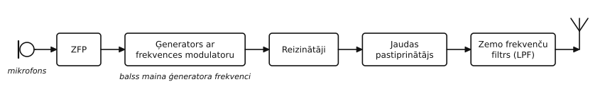
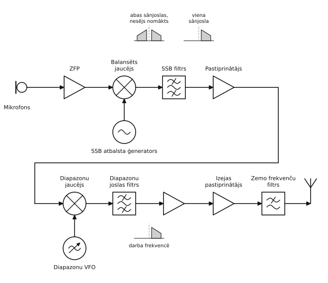

# 12. nodaļa. Raidītāji

Šī nodaļa parāda, kā uzbūvēti CW, AM, FM un SSB raidītāji, un izskaidro, kas
jādara, lai tavs signāls būtu tīrs un paliktu savā joslā.

**Video lekcija:** LRAL bezmaksas kurss, 7. nodarbība, 2. daļa (QR kods).
**Eksāmena programma:** raidītāji.
**Mācību laiks:** ap 3 stundām.

## Pēc šīs nodaļas tu pratīsi

- nosaukt raidītāja galvenos parametrus;
- izlasīt CW, AM, FM un SSB raidītāja blokshēmu un pateikt, ko dara katrs
  bloks;
- aprēķināt raidītāja harmoniku frekvences;
- paskaidrot, kāpēc raidītāja izejā ir zemo frekvenču filtrs;
- atpazīt pārmodulācijas pazīmes un tās novērst.

## 12.1. Ko dara raidītājs

Raidītājs rada augstfrekvences signālu, uzliek tam informāciju un pastiprina
līdz jaudai, ko pievada antenai. To raksturo četri parametri:

| Parametrs | Ko nozīmē | Kāpēc svarīgi |
| --- | --- | --- |
| **Frekvences stabilitāte** | Cik precīzi raidītājs turas uz iestatītās frekvences | Nestabils signāls "aizpeld" un var izslīdēt no joslas |
| **Izejas jauda** | Jauda, ko raidītājs atdod antenai | Nedrīkst pārsniegt kategorijai atļauto |
| **Joslas platums** | Cik platu joslu aizņem signāls | Platāks signāls traucē blakus frekvencēs |
| **Blakusizstarojumi** | Nevēlami signāli ārpus darba frekvences | Traucē citiem dienestiem; noteikumi tos ierobežo |

Visiem raidītājiem ir trīs kopīgi mezgli: **ģenerators**, kas rada
frekvenci, **modulators**, kas uzliek informāciju, un **jaudas
pastiprinātājs**, aiz kura ir **izejas filtrs**. Atšķiras tas, kurā vietā un
kā notiek modulācija.

## 12.2. CW raidītājs

Telegrāfa raidītājs ir vienkāršākais: nesējs nav jāmodulē, tas tikai
jāieslēdz un jāizslēdz [1].

| Bloks | Ko dara |
| --- | --- |
| Ģenerators | Rada stabilu nesēja frekvenci |
| Atdalošais (bufer) pastiprinātājs | Atdala ģeneratoru no nākamajām pakāpēm, lai slodze neietekmētu frekvenci |
| Manipulējamais pastiprinātājs | To ieslēdz un izslēdz telegrāfa atslēga Morzes koda ritmā |
| Pastiprinātājs | Pastiprina signālu; var būt arī frekvences reizinātājs |
| Izejas pastiprinātājs | Pastiprina signālu līdz izejas jaudai |
| Zemo frekvenču filtrs | Aiztur harmonikas |

Pastiprinātājs var darboties kā **frekvences reizinātājs**: ja tā kontūru
noskaņo uz otro vai trešo harmoniku, no 7 MHz ģeneratora iegūst 14 vai
21 MHz [1].

Atslēga ieslēdz un izslēdz manipulējamo pastiprinātāju, nevis ģeneratoru, lai
ģenerators strādātu nepārtraukti un frekvence nemainītos katrā zīmē.

> **Uzmanību!** Ja signālu ieslēdz un izslēdz pārāk strauji, katras zīmes
> sākumā un beigās rodas plats traucējums — "klikšķi", ko dzird vairākus
> kilohercus uz abām pusēm. Labi uzbūvēts raidītājs zīmes malas noapaļo.

## 12.3. AM raidītājs

AM raidītājā balss maina nesēja amplitūdu. Mikrofona signālu pastiprina
zemfrekvences pastiprinātājs (ZFP), un ar to vada izejas pastiprinātāja
pastiprinājumu. Izejas pastiprinātājs tādējādi ir arī modulators [1].

Radioamatieri AM lieto reti: nesējs un otra sānjosla patērē jaudu un joslu,
neko nedodot. Tomēr blokshēma jāzina, jo no AM izriet SSB.

## 12.4. FM raidītājs

FM raidītājā mikrofona signāls maina paša ģeneratora frekvenci. Modulācija
notiek pašā sākumā, mazā jaudā [1].

| Bloks | Ko dara |
| --- | --- |
| Mikrofons un ZFP | Pārvērš balsi elektriskā signālā un pastiprina to |
| Ģenerators ar modulatoru | Balss signāls maina ģeneratora frekvenci |
| Starppastiprinātāji | Pastiprina signālu; var būt arī reizinātāji, kas paceļ frekvenci līdz darba diapazonam un reizē palielina frekvences novirzi |
| Izejas pastiprinātājs | Pastiprina līdz izejas jaudai |
| Zemo frekvenču filtrs | Aiztur harmonikas |

Cik tālu frekvence novirzās no vidējās vērtības, sauc par **deviāciju**. Jo
skaļāk runā, jo lielāka deviācija un jo platāks signāls.

Tā kā FM signāla amplitūda nemainās, jaudas pastiprinātājam nav jābūt
lineāram. Tas var strādāt ekonomiskā režīmā, un FM raidītāji ir vienkārši un
lēti.

> **Praktisks padoms.** FM stacijā runā pāri mikrofonam, nevis tieši tajā,
> un nekliedz. Pārāk liela deviācija nozīmē, ka signāls neietilpst
> korespondenta uztvērēja filtrā: skaņa kļūst izkropļota un "raustās", lai
> gan S metrs rāda pilnu skalu.

## 12.5. SSB raidītājs

SSB raidītājs ir sarežģītākais, jo jāatbrīvojas no nesēja un vienas
sānjoslas. To dara ar filtra metodi [1].

| Nr. | Bloks | Kas ir tā izejā |
| --- | --- | --- |
| 1 | Mikrofons un ZFP | Balss signāls |
| 2 | SSB atbalsta ģenerators | Nemainīga frekvence, piemēram, 9 MHz |
| 3 | Balansēts jaucējs (balansa modulators) | Abas sānjoslas, nesējs nomākts |
| 4 | SSB filtrs | Viena sānjosla; otru filtrs aiztur |
| 5 | Diapazonu jaucējs ar diapazonu VFO | SSB signāls, pārnests uz darba frekvenci |
| 6 | Diapazonu joslas filtri | Tikai vajadzīgā jaucēja izejas frekvence |
| 7 | Pastiprinātāji un lineārais izejas pastiprinātājs | Tas pats signāls ar pilnu jaudu |
| 8 | Zemo frekvenču filtrs | Signāls bez harmonikām |

Divi bloki ir jauni:

- **Balansēts jaucējs** jeb balansa modulators ir jaucējs, kas uzbūvēts tā, lai nesējs izejā
  savstarpēji dzēstos. Paliek tikai abas sānjoslas.
- **SSB filtrs** ir ļoti šaurs, parasti kvarca filtrs, ap 2,4 kHz plats. Tas
  laiž cauri vienu sānjoslu.

SSB signālu veido vienā nemainīgā frekvencē, jo tik šauru filtru nevar
pārskaņot. Uz darba frekvenci to pārnes jaucējs — tāpat kā superheterodīna
uztvērējā, tikai pretējā virzienā.

> **Piemērs.** SSB signāls veidots 9 MHz frekvencē. Uz kādu frekvenci
> jānoskaņo VFO, lai raidītu 3,7 MHz?
>
> 1. Jaucēja izejā ir summa un starpība.
> 2. Vajag 3,7 MHz: 9 − 5,3 = 3,7 MHz. VFO jābūt 5,3 MHz.
> 3. Jaucēja izejā ir arī summa, 9 + 5,3 = 14,3 MHz. To aiztur joslas filtrs.

> **Uzmanību!** SSB signāla amplitūda visu laiku mainās, tāpēc jaudas
> pastiprinātājam jābūt **lineāram**: izejai precīzi jāatkārto ieejas forma.
> Pārslogots pastiprinātājs signālu kropļo, un kropļojumi parādās kā
> traucējumi blakus frekvencēs.

## 12.6. Transīvers

**Transīvers** (raiduztvērējs) ir uztvērējs un raidītājs vienā korpusā. Tie
nav divi atsevišķi aparāti: ģeneratori, filtri un jaucēji ir kopīgi, tikai
signāls caur tiem iet pretējā virzienā. Tāpēc raidīšanas un uztveršanas
frekvence sakrīt pati no sevis.

| Apzīmējums | Nosaukums | Ko dara |
| --- | --- | --- |
| PTT | Raidīšanas taustiņš (push to talk) | Pārslēdz no uztveršanas uz raidīšanu |
| VOX | Balss vadīta pārslēgšana | Ieslēdz raidīšanu, kad sāc runāt |
| MIC GAIN | Mikrofona pastiprinājums | Nosaka modulācijas dziļumu |
| ALC | Automātiskā līmeņa regulēšana | Rāda un ierobežo pārmodulāciju |
| PWR | Izejas jauda | Iestata raidīšanas jaudu |
| SPLIT, XIT | Dalītās frekvences | Ļauj raidīt citā frekvencē nekā uztver |

## 12.7. Izejas jauda

MK noteikumos B kategorijas jaudas ir norādītas kā raidītāja **galotnes
jauda** (apzīmējums pX; angliski PEP — peak envelope power) [2]. Tā ir jauda
signāla maksimumos.

| Darba veids | Kā jauda mainās laikā |
| --- | --- |
| FM, CW ar nospiestu atslēgu | Nemainīga; vidējā jauda ir vienāda ar galotnes jaudu |
| SSB | Seko balsij; vidējā jauda ir daudz mazāka par galotnes jaudu |

Tāpēc parasts jaudas mērītājs SSB režīmā rāda mazāk par iestatītajiem
100 W, lai gan maksimumos tie tiek sasniegti. Galotnes jaudas mērīšanai
vajag mērītāju ar PEP režīmu (15. nodaļa).

Ja raidītājs spēj dot vairāk, nekā tev atļauts, tam jābūt izejas jaudas
mērītājam [2].

> **Praktisks padoms.** Raidītāju regulē un pārbauda uz **slodzes
> ekvivalenta** — 50 Ω rezistora, kas jaudu pārvērš siltumā un neko
> neizstaro. Uz antenas regulē tikai īsi, ar mazāko jaudu un brīvā
> frekvencē.

## 12.8. Nevēlamie izstarojumi

Neviens raidītājs neizstaro tikai to, ko vajag. Noteikumi prasa, lai
ārpusjoslas izstarojumu kopējā jauda nepārsniegtu 1 % no izstarotās
jaudas [2]. Ir četri galvenie nevēlamo izstarojumu veidi.

| Veids | Kā izpaužas | Cēlonis | Kā novērst |
| --- | --- | --- | --- |
| Harmonikas | Signāls 2, 3, 4 reizes augstākā frekvencē | Pastiprinātājs nav ideāli lineārs | Zemo frekvenču filtrs izejā |
| Pārmodulācija (splatter) | Sprakšķi blakus frekvencēs SSB režīmā | Pārāk liels mikrofona pastiprinājums, pārslogota gala pakāpe | Samazināt MIC GAIN, sekot ALC |
| Pārāk liela deviācija | Plats, izkropļots FM signāls | Pārāk skaļš mikrofona signāls | Runāt klusāk, tālāk no mikrofona |
| Atslēgas klikšķi | Klikšķi ap CW signālu | Pārāk straujas zīmju malas | Raidītāja regulēšana |

**Harmonikas** ir bīstamākās, jo tās var trāpīt citu dienestu joslās.

> **Piemērs.** Raidītājs strādā 28,5 MHz. Kur ir tā otrā un trešā
> harmonika?
>
> 1. Otrā: 2 · 28,5 = 57 MHz.
> 2. Trešā: 3 · 28,5 = 85,5 MHz.
> 3. Abas ir ārpus radioamatieru joslām. Tāpēc izejā ir zemo frekvenču
>    filtrs, kas laiž cauri 28,5 MHz un aiztur visu augstāko.

> **Piemērs.** Raidītājs strādā 145,2 MHz. Kur ir trešā harmonika?
>
> 1. 3 · 145,2 = 435,6 MHz.
> 2. Tā ir 70 cm radioamatieru diapazonā, kur var traucēt citiem
>    radioamatieriem un atkārtotājiem.

> **Atceries:** ALC ir tavs draugs. Ja SSB režīmā ALC rādītājs pastāvīgi ir
> ārpus atzīmētās zonas, samazini mikrofona pastiprinājumu. Tavs signāls
> kļūs šaurāks, tīrāks un labāk saprotams, bet ne vājāks.

Kā nevēlamos izstarojumus atrast un ko darīt, ja traucē kaimiņa tehnikai,
stāsta 16. nodaļa.

## Eksāmenā jāzina

- CW raidītājs: ģenerators, atdalošais pastiprinātājs, manipulējamais
  pastiprinātājs ar telegrāfa atslēgu, pastiprinātāji (var būt reizinātāji),
  izejas pastiprinātājs, zemo frekvenču filtrs.
- AM raidītājs: mikrofons un ZFP; zemfrekvence modulē izejas pastiprinātāju,
  kas maina nesēja amplitūdu.
- FM raidītājs: zemfrekvences signāls maina ģeneratora frekvenci.
- SSB raidītājs: balansēts jaucējs nomāc nesēju, SSB filtrs — vienu
  sānjoslu; jaucējs pārnes signālu uz darba frekvenci.
- Frekvences reizinātājs: kontūrs noskaņots uz 2. vai 3. harmoniku.
- Harmonikas ir pamatfrekvences daudzkārtņi; tās aiztur zemo frekvenču
  filtrs raidītāja izejā.
- SSB signālam vajag lineāru jaudas pastiprinātāju.
- Jaudu noteikumos norāda kā galotnes jaudu (pX).
- Ārpusjoslas izstarojumi: ne vairāk kā 1 % no izstarotās jaudas.

## Pamēģini pats

**1. Saliec blokshēmu (15 minūtes).** Uz atsevišķām lapiņām uzraksti SSB
raidītāja astoņus blokus, sajauc un saliec pareizā secībā. Tad pie katra
pasaki skaļi, kas ir tā izejā.

**2. Ieraugi pārmodulāciju (15 minūtes).** WebSDR ūdenskrituma attēlā
noskaņojies uz aizņemtu SSB diapazonu sacensību laikā un atrodi:

- [ ] signālu ar skaidrām, asām malām;
- [ ] signālu, no kura uz abām pusēm stiepjas "bārda";
- [ ] kā abi izklausās, ja noskaņojas 3 kHz blakus tiem.

**3. Aprēķini harmonikas.** Katrai B kategorijas HF joslai aprēķini otro un
trešo harmoniku joslas vidum. Kuras no tām trāpa citā radioamatieru
diapazonā?

## Kopsavilkums

- Katrā raidītājā ir ģenerators, modulators, jaudas pastiprinātājs un
  izejas filtrs.
- CW raidītājā nesēju ieslēdz un izslēdz; FM raidītājā modulē pašu
  ģeneratoru; SSB signālu veido ar balansa modulatoru un filtru.
- SSB signālu veido nemainīgā frekvencē un uz darba frekvenci pārnes ar
  jaucēju.
- SSB vajag lineāru pastiprinātāju; FM un CW — ne.
- Harmonikas aiztur zemo frekvenču filtrs.
- Pārmodulācija paplašina signālu; to novērš ar mikrofona pastiprinājumu,
  nevis ar jaudu.
- Raidītāju regulē uz slodzes ekvivalenta.

## Paškontroles jautājumi

1. Kā CW raidītājā pārraida informāciju?
    - A. Mainot nesēja frekvenci balss ritmā
    - B. Ieslēdzot un izslēdzot nesēju ar telegrāfa atslēgu
    - C. Mainot nesēja amplitūdu balss ritmā
    - D. Nomācot vienu sānjoslu
2. Kurš bloks raidītājā rada nesēja frekvenci?
    - A. Ģenerators
    - B. Zemo frekvenču filtrs
    - C. Mikrofona pastiprinātājs
    - D. Antena
3. Ko FM raidītājā dara mikrofona signāls?
    - A. Maina jaudas pastiprinātāja pastiprinājumu
    - B. Ieslēdz un izslēdz nesēju
    - C. Maina ģeneratora frekvenci
    - D. Nomāc nesēju
4. Kurš bloks SSB raidītājā nomāc nesēju?
    - A. SSB filtrs
    - B. Jaudas pastiprinātājs
    - C. Zemo frekvenču filtrs
    - D. Balansa modulators
5. Kas ir balansa modulatora izejā?
    - A. Abas sānjoslas bez nesēja
    - B. Nesējs bez sānjoslām
    - C. Viena sānjosla ar nesēju
    - D. Balss signāls
6. Kāds ir SSB filtra uzdevums raidītājā?
    - A. Aizturēt harmonikas
    - B. Laist cauri vienu sānjoslu un aizturēt otru
    - C. Pastiprināt mikrofona signālu
    - D. Stabilizēt frekvenci
7. Kāpēc SSB raidītāja jaudas pastiprinātājam jābūt lineāram?
    - A. Lai tas patērētu mazāk strāvas
    - B. Lai palielinātu izejas jaudu
    - C. Lai nekropļotu signālu, kura amplitūda mainās
    - D. Lai nomāktu nesēju
8. Raidītājs strādā 7,05 MHz frekvencē. Kāda ir tā otrā harmonika?
    - A. 3,525 MHz
    - B. 21,15 MHz
    - C. 9,05 MHz
    - D. 14,1 MHz
9. Kuru filtru liek raidītāja izejā harmoniku aizturēšanai?
    - A. Zemo frekvenču filtru
    - B. Augsto frekvenču filtru
    - C. SSB filtru
    - D. Starpfrekvences filtru
10. Frekvences reizinātāja ieejā ir 7 MHz, un tā kontūrs noskaņots uz otro harmoniku. Kāda ir izejas frekvence?
    - A. 3,5 MHz
    - B. 21 MHz
    - C. 14 MHz
    - D. 49 MHz
11. SSB signāls veidots 9 MHz, VFO strādā 12,2 MHz, un joslas filtrs laiž cauri summu. Kāda ir raidīšanas frekvence?
    - A. 3,2 MHz
    - B. 9 MHz
    - C. 12,2 MHz
    - D. 21,2 MHz
12. Korespondents ziņo, ka tavs SSB signāls ir plats un traucē blakus frekvencēs. Ko dari vispirms?
    - A. Palielini izejas jaudu
    - B. Samazini mikrofona pastiprinājumu un pārbaudi ALC
    - C. Pārej uz otru sānjoslu
    - D. Noskaņo antenu no jauna
13. Uz kā jāregulē un jāpārbauda raidītājs?
    - A. Uz antenas ar pilnu jaudu
    - B. Bez slodzes
    - C. Uz slodzes ekvivalenta
    - D. Uz kaimiņa antenas
14. Kāda jauda norādīta MK noteikumu tabulā par B kategorijas joslām?
    - A. Vidējā jauda stundā
    - B. No tīkla patērētā jauda
    - C. Antenas izstarotā jauda galvenajā virzienā
    - D. Raidītāja galotnes jauda

**Atvērtie jautājumi**

15. Nosauc SSB raidītāja blokus pareizā secībā un pie katra pasaki, kas ir tā
    izejā.
16. Raidītājs strādā 3,6 MHz. Aprēķini otro, trešo un sesto harmoniku un
    pasaki, kuras no tām trāpa B kategorijas radioamatieru joslās.

## Atbildes

| Nr. | Atbilde | Skaidrojums |
| --- | --- | --- |
| 1 | B | CW ir ieslēgts vai izslēgts nesējs. |
| 2 | A | Ģenerators no līdzstrāvas rada augstfrekvences svārstības. |
| 3 | C | FM — mainās frekvence, amplitūda paliek nemainīga. |
| 4 | D | Balansa modulatorā nesējs savstarpēji dzēšas. |
| 5 | A | Abas sānjoslas; nesējs nomākts. |
| 6 | B | Šaurs filtrs laiž cauri tikai vienu sānjoslu. |
| 7 | C | Nelineārs pastiprinātājs kropļo signālu un rada traucējumus blakus frekvencēs. |
| 8 | D | 2 · 7,05 = 14,1 MHz. |
| 9 | A | Harmonikas ir augstākas par darba frekvenci. |
| 10 | C | 2 · 7 = 14 MHz. |
| 11 | D | 9 + 12,2 = 21,2 MHz. |
| 12 | B | Plats signāls ir pārmodulācijas pazīme; jauda to tikai pasliktinātu. |
| 13 | C | Slodzes ekvivalents neko neizstaro un nevienam netraucē. |
| 14 | D | Galotnes jauda, pX. |

Atvērtie jautājumi: sešpadsmitajā otrā harmonika ir 7,2 MHz, trešā —
10,8 MHz, sestā — 21,6 MHz. Neviena netrāpa B kategorijas joslās (7,2 MHz ir
virs 7080 kHz, 21,6 MHz ir virs 21 450 kHz), tātad visas ir jāaiztur.

## Padziļināti

- **Fāzes metode.** SSB signālu var iegūt arī bez šaura filtra, izmantojot
  fāzes nobīdi. Tā strādā lielākā daļa SDR transīveru: sānjoslu "aprēķina"
  programma.
- **Runas procesors.** Kompresors, kas paaugstina vidējo runas līmeni,
  nepārsniedzot maksimumus. Pareizi iestatīts, tas palīdz pile-up; pārāk
  stiprs padara balsi nesaprotamu.
- **Lietderības koeficients.** FM un CW gala pakāpes var strādāt ar
  60–70 % lietderību, lineārās SSB pakāpes — ap 40–50 %. Pārējais ir
  siltums, tāpēc transīveram ir radiators.

## Nodaļas avoti

1. LRAL bezmaksas kurss 2026, 7. nodarbība "Shēmas, uztvērēji un raidītāji",
   prezentācija un video lekcija. lral.lv.
2. Ministru kabineta 2023. gada 23. maija noteikumi Nr. 257, 54. un
   57. punkts, 2. pielikums. <https://likumi.lv/ta/id/342127>
   (skatīts 2026-11-12).
