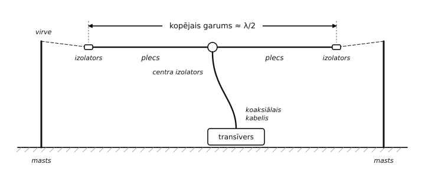
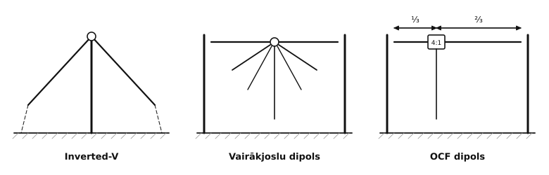
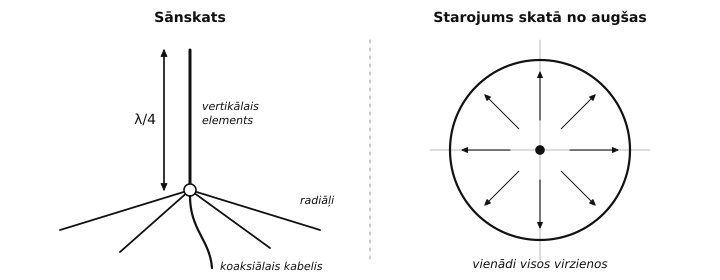
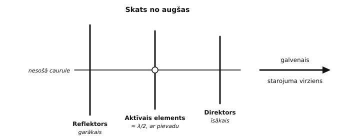
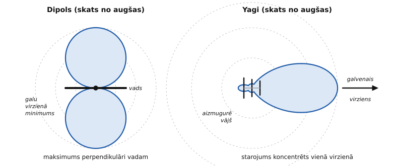
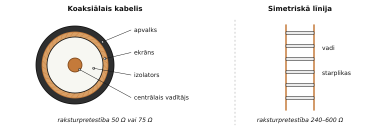
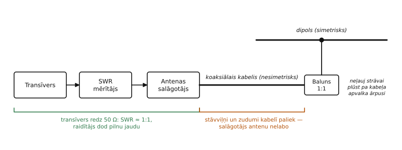

# 13. nodaļa. Antenas un pārvades līnijas

Šī nodaļa iemāca aprēķināt un izvēlēties pirmo antenu, pievadīt tai signālu
bez liekiem zudumiem un saprast, ko rāda SWR mērītājs.

**Video lekcija:** LRAL bezmaksas kurss, 8. nodarbība (QR kods).
**Eksāmena programma:** antenas un pārvades līnijas.
**Mācību laiks:** ap 4 stundām.

## Pēc šīs nodaļas tu pratīsi

- izskaidrot, kas ir antenas pastiprinājums un ko nozīmē dBi un dBd;
- aprēķināt pusviļņa dipola un ceturtdaļviļņa vertikālās antenas garumu;
- salīdzināt dipolu, vertikālo antenu un Yagi;
- izvēlēties pārvades līniju un pateikt, no kā atkarīgi tās zudumi;
- izskaidrot, kas ir SWR, un novērtēt, vai rādījums ir pieņemams;
- pateikt, kad vajag balunu, ununu un antenas skaņotāju.

## 13.1. Ko dara antena

**Antena** pārvērš augstfrekvences strāvu radioviļņos un radioviļņus —
atpakaļ strāvā. Tā pati antena kalpo gan raidīšanai, gan uztveršanai, un tās
īpašības abos virzienos ir vienādas.

Antena ir stacijas svarīgākā daļa. Laba antena uzlabo gan tavu signālu, gan
to, ko tu dzirdi; pastiprinātājs palīdz tikai raidīšanā.

| Parametrs | Ko nozīmē |
| --- | --- |
| **Rezonanses frekvence** | Frekvence, kurā antenas ieejas pretestība ir tīri aktīva (reaktīvās daļas nav). Vienkāršām antenām tas ir tad, kad garums atbilst viļņa garumam: dipolam — ap pusi, vertikālajai antenai — ap ceturtdaļu viļņa garuma |
| **Ieejas pretestība** | Pretestība, ko antena rāda pievada pieslēgvietā |
| **Virziendarbība** | Kuros virzienos antena izstaro vairāk, kuros mazāk |
| **Pastiprinājums** | Cik reižu spēcīgāk antena izstaro galvenajā virzienā, salīdzinot ar atskaites antenu |
| **Polarizācija** | Elektriskā lauka virziens; to nosaka antenas novietojums (8. nodaļa) |

> **Atceries:** antena jaudu nerada. "Pastiprinājums" nozīmē tikai to, ka
> jauda tiek koncentrēta vienā virzienā uz citu virzienu rēķina.

## 13.2. Izotropā antena un decibeli

**Izotropā antena** ir iedomāta antena, kas izstaro pilnīgi vienādi uz visām
pusēm; tās starojuma diagramma ir lode. Īstenībā tāda neeksistē, bet tā ir
ērts atskaites punkts, ar ko salīdzina visas pārējās [1].

Antenas pastiprinājumu izsaka decibelos pret vienu no divām atskaites
antenām:

| Apzīmējums | Pret ko salīdzina | Saistība |
| --- | --- | --- |
| **dBi** | Pret izotropo antenu | Izotropajai antenai 0 dBi |
| **dBd** | Pret pusviļņa dipolu | Dipolam 0 dBd = 2,15 dBi |

Pārrēķins ir vienkāršs: dBi = dBd + 2,15.

> **Uzmanību!** Antenu reklāmās pastiprinājumu mēdz norādīt dBi, jo skaitlis
> ir par 2,15 lielāks. Salīdzinot divas antenas, pārliecinies, ka abām
> lietota viena un tā pati mērvienība.

## 13.3. Pusviļņa dipols

**Dipols** ir divi vienāda garuma vadi, kam pievads pieslēgts vidū. Dipola
elektriskais garums ir puse viļņa garuma (λ/2); vads ir nedaudz īsāks. Tā
ir vienkāršākā rezonanses antena un lieliska pirmā antena [1].

| Īpašība | Vērtība |
| --- | --- |
| Garums | λ/2, praksē ap 5 % īsāks |
| Ieejas pretestība | ap 73 Ω brīvā telpā |
| Pastiprinājums | 2,15 dBi (0 dBd) |
| Starojums | Vislielākais perpendikulāri vadam; galu virzienā gandrīz nekāds |
| Polarizācija | Horizontāla, ja dipols karājas horizontāli |

**Garuma aprēķins.** Vada resnuma un galu kapacitātes dēļ īsts dipols
rezonē, būdams nedaudz īsāks par pusi no viļņa garuma. To ņem vērā ar
**saīsināšanas koeficientu** 0,95 [1]:

$$L = \frac{\lambda}{2} \cdot 0{,}95 = \frac{300}{2 \cdot f} \cdot 0{,}95 \qquad L\,[\text{m}] \approx \frac{142{,}5}{f\,[\text{MHz}]}$$

> **Piemērs.** Aprēķini dipolu 80 m diapazonam, frekvencei 3,7 MHz.
>
> 1. Viļņa garums: λ = 300 / 3,7 ≈ 81 m.
> 2. Dipola garums: L = (81 / 2) · 0,95 ≈ 38,5 m.
> 3. Viens plecs: 38,5 / 2 ≈ 19,25 m.

> **Piemērs.** Aprēķini dipolu 15 m diapazonam, frekvencei 21,2 MHz.
>
> 1. L = 142,5 / 21,2 ≈ 6,72 m.
> 2. Viens plecs: 3,36 m.

> **Praktisks padoms.** Nogriez vadus dažus procentus garākus par aprēķinu un
> saīsini pakāpeniski, mērot SWR. Ja zemākais SWR ir zem vajadzīgās
> frekvences, antena ir par garu. Nogriezt var vienmēr, pielikt klāt ir
> grūtāk. Un jo augstāk dipols uzkārts, jo labāk: ideālā gadījumā pusi viļņa
> garuma virs zemes.

## 13.4. Dipola varianti

Ja pilnam dipolam nav vietas vai vajag vairākus diapazonus, lieto tā
variantus [1].

| Antena | Kā uzbūvēta | Kad izvēlēties |
| --- | --- | --- |
| **Inverted-V** | Dipols ar vienu mastu vidū; pleci nolaisti slīpi uz leju | Ir tikai viens augsts atbalsta punkts |
| **Vairākjoslu dipols (fan dipole)** | Vairāki dažāda garuma dipoli uz viena pievada | Vajag vairākus diapazonus bez skaņotāja |
| **OCF dipols** | Pievads nav vidū; pieslēgts caur 4:1 vai 6:1 transformatoru | Viena antena vairākiem diapazoniem |

**Gala barotā pusviļņa antena (EFHW)** arī ir pusviļņa vads, bet pievads
pieslēgts tā galā, nevis vidū. Vada galā pretestība ir ļoti augsta, tāpēc
starp kabeli un vadu liek 49:1 transformatoru (ununu) [1].

| EFHW priekšrocības | Jāņem vērā |
| --- | --- |
| Vajag tikai vienu augstu punktu | Transformatoram jāiztur raidītāja jauda |
| Kabelis nāk no gala, nevis no vidus | Kabeļa apvalks kļūst par antenas daļu; palīdz īss pretsvars vai drosele |
| Ērta izbraukumiem | |

## 13.5. Vertikālā antena

**Ceturtdaļviļņa vertikālā antena** ir vertikāls vads vai stienis, kas ir
ceturtdaļu viļņa garš. Dipola "otro pusi" tai aizstāj zeme vai **radiāļi** —
vadi, kas no antenas pamatnes iet uz sāniem [1].

$$L\,[\text{m}] \approx \frac{71{,}25}{f\,[\text{MHz}]}$$

| Priekšrocības | Trūkumi |
| --- | --- |
| Aizņem maz vietas | Vajag radiāļus; bez tiem zudumi ir lieli |
| Izstaro vienādi visos virzienos horizontālā plaknē | Jutīgāka pret vietējiem traucējumiem |
| Zems izstarošanas leņķis — labi tālajiem sakariem | Atkarīga no zemes īpašībām |
| Vertikāla polarizācija — der VHF/UHF FM sakariem | |

> **Piemērs.** Cik gara ir ceturtdaļviļņa antena 145 MHz frekvencei?
>
> 1. L = 71,25 / 145 ≈ 0,49 m.
> 2. Atbilde: ap 49 cm. Tāda ir tipiska automašīnas antena 2 m diapazonam.

## 13.6. Yagi antena

**Yagi** ir virziena antena: tā izstaro galvenokārt vienā virzienā. To veido
vairāki paralēli elementi uz kopīgas nesošās caurules [1].

| Elements | Garums | Uzdevums |
| --- | --- | --- |
| **Reflektors** | Nedaudz garāks par aktīvo | Atstaro signālu uz priekšu |
| **Aktīvais elements** | Pusviļņa dipols | Vienīgais, kam pieslēgts pievads |
| **Direktori** | Nedaudz īsāki par aktīvo; viens vai vairāki | Virza signālu uz priekšu |

Signāls ir visstiprākais direktoru virzienā. Kas jāzina par Yagi [1]:

- pastiprinājums aug ar elementu skaitu; garām VHF/UHF antenām tas var sasniegt
  20 dBi;
- dubultojot elementu skaitu vai saslēdzot kopā divas vienādas Yagi,
  pastiprinājums pieaug apmēram par 3 dB;
- antena vāji uztver no aizmugures un sāniem, tāpēc samazina traucējumus;
- to vajag griezt pret korespondentu, tāpēc vajadzīgs rotors.

> **Atceries:** reflektors — garākais un aizmugurē. Direktori — īsākie un
> priekšā. Signāls iet no garā uz īso.

## 13.7. Citas antenas

Antenu veidu ir simtiem; izvēli nosaka diapazons, vieta un mērķis [1].

| Antena | Īss raksturojums |
| --- | --- |
| Magnētiskā cilpa | Maza cilpa ar maināmu kondensatoru; der balkonam; ļoti šaura josla |
| Delta Loop | Trijstūra formas pilna viļņa cilpa |
| Hexbeam | Kompakta virziena antena vairākiem HF diapazoniem |
| Paraboliskā antena | "Šķīvis" ar ļoti lielu pastiprinājumu; GHz diapazoniem |
| Nejauša garuma vads | Jebkura garuma vads ar 9:1 ununu un skaņotāju |

## 13.8. Pārvades līnijas

**Pārvades līnija** jeb **fīders** nogādā jaudu no raidītāja līdz antenai un
uztverto signālu atpakaļ. Tai jādara divas lietas: pēc iespējas maz zaudēt
un pašai neizstarot [1].

| | Koaksiālais kabelis | Simetriskā līnija |
| --- | --- | --- |
| Uzbūve | Centrālais vadītājs, izolators, ekrāns, apvalks | Divi paralēli vadi ar starplikām |
| Raksturpretestība | 50 Ω vai 75 Ω | 240–600 Ω |
| Zudumi | Lielāki, aug ar frekvenci | Ļoti mazi |
| Montāža | Vienkārša; var likt gar metālu un caur sienām | Jātur atstatu no metāla priekšmetiem |
| Veids | Nesimetriska | Simetriska |

**Raksturpretestība** ir līnijas īpašība, ko nosaka tās izmēri un izolators,
nevis garums. Radioamatieru tehnikā standarts ir 50 Ω: tāda ir transīvera
izeja, kabelis un lielākā daļa antenu.

**Zudumi** kabelī pārvērš daļu jaudas siltumā. Tie ir atkarīgi no trim
lietām:

- **garuma** — divreiz garāks kabelis, divreiz lielāki zudumi decibelos;
- **frekvences** — jo augstāka, jo lielāki zudumi;
- **kabeļa kvalitātes** — resnāks kabelis ar labāku izolatoru zaudē mazāk.

> **Praktisks padoms.** Īsviļņos un īsos gabalos der arī tievais RG58.
> 2 m un 70 cm diapazonā tas pats kabelis 20 metros var apēst pusi jaudas
> un vairāk; tur lieto RG213 vai vēl labāku kabeli. Kabelis strādā abos
> virzienos: zudumi vājina arī uztverto signālu.

## 13.9. Salāgošana un SWR

Jauda no līnijas pilnībā pāriet antenā tikai tad, ja antenas ieejas
pretestība ir vienāda ar līnijas raksturpretestību. Ja tās atšķiras, daļa
jaudas atstarojas un atgriežas uz raidītāju. Tiešais un atstarotais vilnis
līnijā summējas un veido **stāvviļņus** [1].

**SWR** (stāvviļņa koeficients) rāda, cik laba ir salāgošana.

| SWR | Novērtējums | Atstarotā jauda |
| --- | --- | --- |
| 1:1 | Ideāla salāgošana | 0 % |
| līdz 1,5:1 | Ļoti laba | līdz 4 % |
| 2:1 | Pieļaujama | ap 11 % |
| 3:1 | Pieļaujama robeža | 25 % |
| virs 3:1 | Nevēlama; var bojāt raidītāju | vairāk nekā 25 % |

Ja slodze ir tīri aktīva pretestība, SWR ir lielākās un mazākās pretestības
attiecība.

> **Piemērs.** 50 Ω kabelim pieslēgta 100 Ω slodze. Kāds ir SWR?
>
> 1. SWR = 100 / 50 = 2.
> 2. Atbilde: 2:1. Tas pats būtu ar 25 Ω slodzi: 50 / 25 = 2.

Kāpēc SWR ir augsts: nepareizs antenas garums, antena par tuvu zemei vai
metāla priekšmetiem, bojāts kabelis vai savienotājs, mitrums savienojumā [1].

> **Uzmanību!** Mūsdienu transīveri pie augsta SWR paši samazina jaudu, lai
> pasargātu gala pakāpi. Ja pēkšņi "nav jaudas", vispirms pārbaudi SWR.
> Nekad neraidi bez pieslēgtas antenas vai slodzes ekvivalenta.

**Simetrija.** Dipols ir simetriska antena, koaksiālais kabelis —
nesimetrisks. Ja tos savieno tieši, strāva plūst arī pa kabeļa apvalka
ārpusi: kabelis sāk izstarot, starojuma diagramma izkropļojas, un rodas
traucējumi mājas tehnikā. To novērš ar balunu [1].

| Ierīce | Nosaukuma izcelsme | Attiecība | Kur lieto |
| --- | --- | --- | --- |
| **Baluns** | balanced–unbalanced | 1:1 | Dipols ar koaksiālo kabeli; nodrošina simetriju |
| | | 4:1 | Pretestības transformācija, piemēram, OCF dipolam |
| **Ununs** | unbalanced–unbalanced | 9:1 | Nejauša garuma vada antenas |
| | | 49:1 | Gala barotās pusviļņa antenas (EFHW) |

**Antenas skaņotājs** (tūneris, ATU) ir regulējama spoļu un kondensatoru
shēma starp transīveru un antenas sistēmu. Tas pārveido pretestību tā, lai
transīvers redzētu 50 Ω.

> **Atceries:** skaņotājs nepadara antenu labāku. Tas tikai ļauj raidītājam
> strādāt ar pilnu jaudu. Stāvviļņi un zudumi kabelī starp skaņotāju un
> antenu paliek.

## 13.10. Izstarotā jauda

Cik spēcīgs ir tavs signāls, nosaka ne tikai raidītājs. Decibelos viss
vienkārši saskaitās: raidītāja jauda, mīnus kabeļa zudumi, plus antenas
pastiprinājums. Rezultātu sauc par **efektīvo izstaroto jaudu** (ERP, ja
pastiprinājums ir dBd).

> **Piemērs.** Raidītājs atdod 50 W. Kabeļa zudumi ir 3 dB, antenas
> pastiprinājums — 6 dBd. Kāda ir efektīvā izstarotā jauda?
>
> 1. Kopā: −3 dB + 6 dB = +3 dB.
> 2. +3 dB nozīmē jaudu × 2.
> 3. ERP = 50 W · 2 = 100 W.

Tas pats piemērs otrādi: ar sliktu kabeli (6 dB zudumi) un dipolu (0 dBd)
no 50 W ēterā nonāk 12,5 W. Starp abām stacijām ir 9 dB jeb pusotra
S vienība, lai gan transīveri ir vienādi.

## Eksāmenā jāzina

- Izotropā antena: teorētiska, izstaro vienādi visos virzienos, 0 dBi.
- Dipols: garums λ/2, pastiprinājums 2,15 dBi = 0 dBd, pretestība ap 73 Ω,
  starojuma maksimums perpendikulāri vadam.
- Dipola garums: L [m] ≈ 142,5 / f [MHz] (saīsināšanas koeficients 0,95).
- Vertikālā antena: λ/4, vajag radiāļus, izstaro vienādi visos virzienos
  horizontālā plaknē.
- Yagi: reflektors garāks, direktori īsāki par aktīvo elementu; signāls
  direktoru virzienā; elementu dubultošana dod ap 3 dB.
- Koaksiālā kabeļa raksturpretestība: 50 Ω vai 75 Ω; simetriskās līnijas —
  240–600 Ω.
- SWR 1:1 ir ideāls; līdz 1,5:1 ļoti labs; virs 3:1 nevēlams.
- Baluns savieno simetrisku antenu ar nesimetrisku kabeli; 49:1 ununs —
  EFHW; 9:1 ununs — nejauša garuma vads.
- Kabeļa zudumi aug ar garumu un frekvenci.

## Pamēģini pats

**1. Aprēķini savu pirmo antenu (15 minūtes).** Izvēlies vienu B kategorijas
HF diapazonu un frekvenci tajā. Aprēķini dipola kopējo garumu un viena pleca
garumu. Izmēri savu pagalmu, balkonu vai bēniņus:

- [ ] vai dipols ietilpst taisnā līnijā;
- [ ] vai ietilpst kā Inverted-V;
- [ ] cik garš kabelis vajadzīgs līdz stacijai.

**2. Apskati starojuma diagrammas (15 minūtes).** Meklētājā atrodi "dipole
radiation pattern" un "3 element yagi radiation pattern". Salīdzini abas un
atrodi, kurā virzienā dipols neizstaro gandrīz neko.

**3. Uzbūvē 2 m antenu.** Ceturtdaļviļņa antenu 145 MHz frekvencei var
uzbūvēt no piecu vadu gabaliem un viena savienotāja stundas laikā. Aprēķini
stieņa un radiāļu garumu.

## Kopsavilkums

- Antena ir stacijas svarīgākā daļa; tā strādā gan raidot, gan uztverot.
- Pastiprinājums ir jaudas koncentrēšana vienā virzienā; dBi ir pret
  izotropo antenu, dBd — pret dipolu.
- Dipols ir pusi viļņa garš; garumu metros dod 142,5, dalīts ar frekvenci
  megahercos.
- Vertikālā antena ir ceturtdaļu viļņa gara un prasa radiāļus.
- Yagi koncentrē signālu vienā virzienā ar reflektoru un direktoriem.
- Kabelis zaudē jaudu: jo garāks un jo augstāka frekvence, jo vairāk.
- SWR rāda salāgošanu; zem 1,5:1 ir ļoti labi, virs 3:1 — bīstami
  raidītājam.
- Baluns novērš strāvu uz kabeļa apvalka; skaņotājs salāgo, bet antenu
  nelabo.

## Paškontroles jautājumi

1. Kāds ir izotropās antenas pastiprinājums?
    - A. 2,15 dBi
    - B. 0 dBi
    - C. 3 dBi
    - D. 10 dBi
2. Kāds ir pusviļņa dipola pastiprinājums?
    - A. 0 dBi
    - B. 6 dBi
    - C. 2,15 dBi
    - D. 2,15 dBd
3. Cik aptuveni garš ir pusviļņa dipols frekvencei 7,05 MHz (saīsināšanas koeficients 0,95)?
    - A. 20,2 m
    - B. 40,4 m
    - C. 10,1 m
    - D. 42,6 m
4. Kurā virzienā horizontāls dipols izstaro visvairāk?
    - A. Vada galu virzienā
    - B. Vienādi visos virzienos
    - C. Tikai uz augšu
    - D. Perpendikulāri vadam
5. Kāda aptuveni ir pusviļņa dipola ieejas pretestība brīvā telpā?
    - A. 73 Ω
    - B. 300 Ω
    - C. 600 Ω
    - D. 5 Ω
6. Cik aptuveni garš ir ceturtdaļviļņa vertikālās antenas stienis 28,5 MHz frekvencei?
    - A. 5,0 m
    - B. 10,5 m
    - C. 2,5 m
    - D. 1,25 m
7. Kas vertikālajai ceturtdaļviļņa antenai vajadzīgs, lai tā strādātu efektīvi?
    - A. Reflektors
    - B. Radiāļi (pretsvari)
    - C. Simetriskā līnija
    - D. Direktors
8. Kurš Yagi antenas elements ir garākais?
    - A. Direktors
    - B. Aktīvais elements
    - C. Visi ir vienādi
    - D. Reflektors
9. Kurā virzienā Yagi antena izstaro visvairāk?
    - A. Direktoru virzienā
    - B. Reflektora virzienā
    - C. Perpendikulāri nesošajai caurulei
    - D. Vienādi visos virzienos
10. Par cik aptuveni pieaug pastiprinājums, ja Yagi antenas elementu skaitu dubulto?
    - A. Par 1 dB
    - B. Par 10 dB
    - C. Par 3 dB
    - D. Par 20 dB
11. Kāda ir radioamatieru tehnikā visbiežāk lietotā koaksiālā kabeļa raksturpretestība?
    - A. 300 Ω
    - B. 50 Ω
    - C. 600 Ω
    - D. 5 Ω
12. Kas notiek ar koaksiālā kabeļa zudumiem, frekvencei pieaugot?
    - A. Tie samazinās
    - B. Tie nemainās
    - C. Tie kļūst vienādi ar nulli
    - D. Tie pieaug
13. Kurš SWR rādījums atbilst ideālai salāgošanai?
    - A. 1:1
    - B. 3:1
    - C. 0:1
    - D. 10:1
14. 50 Ω kabelim pieslēgta 150 Ω aktīva slodze. Kāds ir SWR?
    - A. 1,5:1
    - B. 2:1
    - C. 3:1
    - D. 100:1
15. Kam lieto 1:1 balunu?
    - A. Lai palielinātu raidītāja jaudu
    - B. Lai savienotu simetrisku antenu ar nesimetrisku koaksiālo kabeli
    - C. Lai saīsinātu antenu
    - D. Lai aizturētu harmonikas
16. Kuru transformatoru lieto gala barotai pusviļņa antenai (EFHW)?
    - A. 1:1 balunu
    - B. 4:1 balunu
    - C. 9:1 ununu
    - D. 49:1 ununu
17. Raidītājs atdod 100 W, kabeļa zudumi ir 3 dB, antena ir dipols (0 dBd). Kāda ir efektīvā izstarotā jauda?
    - A. 50 W
    - B. 97 W
    - C. 200 W
    - D. 33 W

**Atvērtie jautājumi**

18. Tev ir 15 m garš pagalms un viens 8 m augsts masts. Kuru antenu no šīs
    nodaļas tu izvēlētos 80 m diapazonam un kāpēc? Kādi būs kompromisi?
19. Paskaidro, kāpēc antenas skaņotājs pie transīvera nesamazina zudumus
    kabelī starp skaņotāju un antenu.

## Atbildes

| Nr. | Atbilde | Skaidrojums |
| --- | --- | --- |
| 1 | B | Izotropā antena ir atskaites punkts: 0 dBi. |
| 2 | C | 2,15 dBi, kas ir tas pats, kas 0 dBd. |
| 3 | A | 142,5 / 7,05 ≈ 20,2 m. |
| 4 | D | Maksimums ir perpendikulāri vadam; galu virzienā ir minimums. |
| 5 | A | Ap 73 Ω, tuvu 50 Ω un 75 Ω kabeļiem. |
| 6 | C | 71,25 / 28,5 = 2,5 m. |
| 7 | B | Radiāļi aizstāj dipola otro pusi. |
| 8 | D | Reflektors ir garāks, direktori īsāki par aktīvo elementu. |
| 9 | A | No reflektora uz direktoriem. |
| 10 | C | Dubultošana dod ap 3 dB. |
| 11 | B | 50 Ω; 75 Ω lieto televīzijas tehnikā. |
| 12 | D | Zudumi aug gan ar frekvenci, gan ar garumu. |
| 13 | A | 1:1 — atstarotas jaudas nav. |
| 14 | C | 150 / 50 = 3. |
| 15 | B | Balanced–unbalanced; novērš strāvu uz kabeļa apvalka. |
| 16 | D | Vada galā pretestība ir ļoti augsta; 49:1 to pārveido tuvu 50 Ω. |
| 17 | A | −3 dB ir puse: 50 W. |

Atvērtie jautājumi: astoņpadsmitajā pilns 80 m dipols (38,5 m) neietilpst;
iespējamie risinājumi ir EFHW vai nejauša garuma vads ar skaņotāju, vai
saīsināta vertikālā antena, katrs ar mazāku efektivitāti. Deviņpadsmitajā
jāpiemin, ka skaņotājs maina tikai to, ko redz raidītājs; aiz skaņotāja
nesalāgojums un stāvviļņi paliek.

## Padziļināti

- **Antenas augstums.** Horizontālas antenas izstarošanas leņķi nosaka tās
  augstums viļņa garumos. Zemu uzkārts dipols izstaro galvenokārt uz augšu;
  tas der tuviem sakariem (NVIS, 14. nodaļa), bet ne tāliem.
- **Kopējā režīma drosele.** Vairāki kabeļa vijumi caur ferīta gredzenu pie
  antenas aptur strāvu uz kabeļa apvalka. Tā ir vienkāršākā 1:1 strāvas
  baluna forma.
- **Antenu analizators.** Ierīce, kas parāda SWR un pretestību visā
  diapazonā bez raidīšanas ar pilnu jaudu. Par to stāsta 15. nodaļa.
- **Antenas teorija un prakse latviski.** Plašs materiāls ir vietnē
  hamradio.lv.

## Nodaļas avoti

1. LRAL bezmaksas kurss 2026, 8. nodarbība "Antenas un pārvades līnijas",
   prezentācija un video lekcija. lral.lv.
