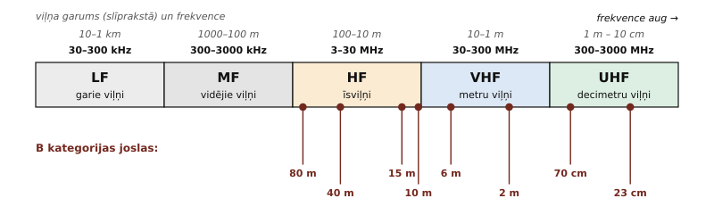
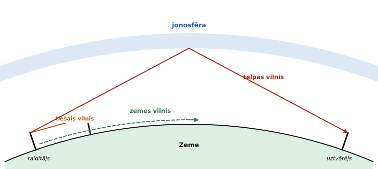
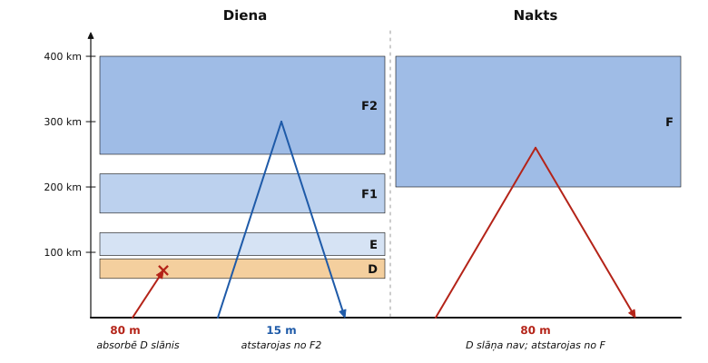
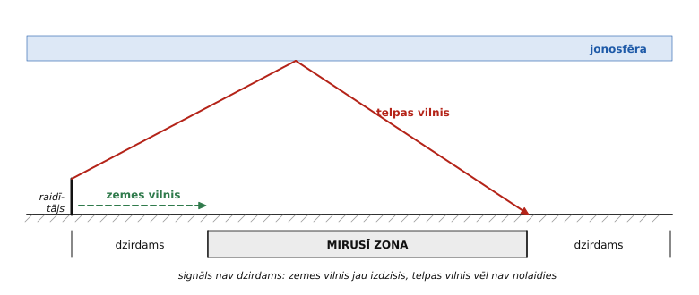
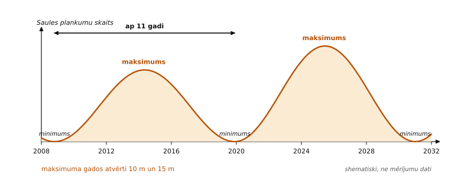
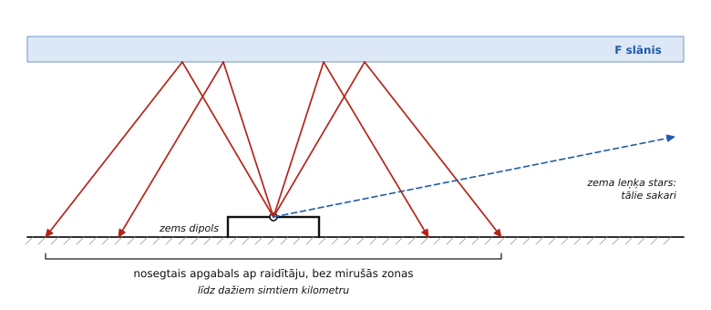
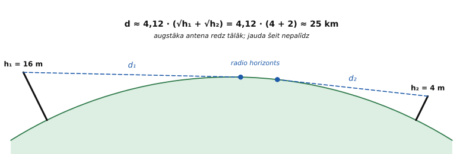
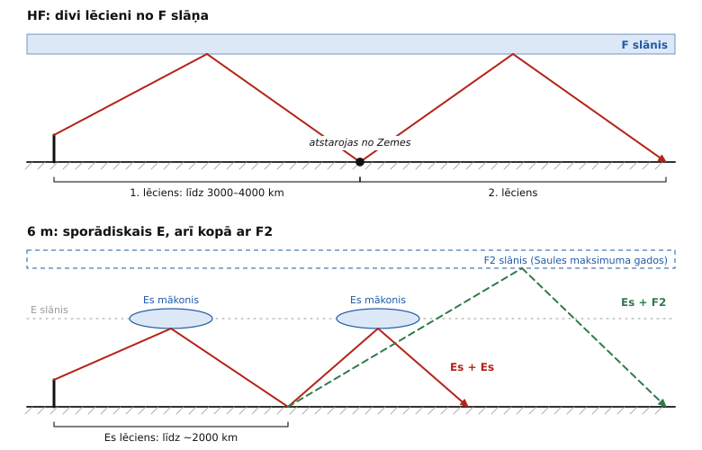

# 14. nodaļa. Frekvenču spektrs un izplatīšanās

Šī nodaļa izskaidro, kāpēc vienā diapazonā dzirdi tikai kaimiņpilsētu, bet
citā — Japānu, un kāpēc tas mainās pa stundām, gadalaikiem un gadiem.

**Video lekcija:** LRAL bezmaksas kurss, 9. nodarbība (QR kods).
**Eksāmena programma:** radioviļņu izplatīšanās; frekvenču spektrs.
**Mācību laiks:** ap 3 stundām.

## Pēc šīs nodaļas tu pratīsi

- nosaukt radiofrekvenču diapazonus no LF līdz UHF un to robežas;
- izskaidrot trīs radioviļņu izplatīšanās veidus;
- nosaukt jonosfēras slāņus un pateikt, ko katrs dara;
- paredzēt, kurš B kategorijas diapazons kurā diennakts laikā ir "atvērts";
- paskaidrot, kas ir mirusī zona, feidings un NVIS;
- novērtēt VHF un UHF sakaru attālumu pēc antenu augstuma.

## 14.1. Radiofrekvenču spektrs

Radioviļņi ir daļa no elektromagnētiskā spektra, kurā ietilpst arī
infrasarkanais starojums, gaisma un rentgenstari. Tie atšķiras tikai ar
frekvenci; radioviļņi ir spektra zemāko frekvenču gals [1].

Radiofrekvences iedala diapazonos; katrs nākamais ir desmit reizes augstāks
par iepriekšējo [1].

| Diapazons | Nosaukums | Frekvence | Viļņa garums | B kategorijas joslas |
| --- | --- | --- | --- | --- |
| LF | Garie viļņi | 30–300 kHz | 10–1 km | — |
| MF | Vidējie viļņi | 300–3000 kHz | 1000–100 m | — |
| HF | Īsviļņi | 3–30 MHz | 100–10 m | 80 m, 40 m, 15 m, 10 m |
| VHF | Metru viļņi | 30–300 MHz | 10–1 m | 6 m, 2 m |
| UHF | Decimetru viļņi | 300–3000 MHz | 1 m – 10 cm | 70 cm, 23 cm |

> **Atceries:** robežas ir trijnieki ar nullēm: 3, 30, 300, 3000. HF ir no
> 3 līdz 30 MHz; virs 30 MHz sākas VHF, virs 300 MHz — UHF.

Frekvence un viļņa garums ir saistīti: λ [m] = 300 / f [MHz] (8. nodaļa).
Jo augstāka frekvence, jo īsāks vilnis un jo mazāka antena.

## 14.2. Trīs izplatīšanās veidi

Radiovilnis no raidītāja līdz uztvērējam var nokļūt trijos veidos [1].

| Veids | Kā izplatās | Kur valda | Tipisks attālums |
| --- | --- | --- | --- |
| **Zemes vilnis** (ground wave) | Gar Zemes virsmu, sekojot tās izliekumam | LF, MF, HF apakšējā daļa | Desmiti līdz daži simti kilometru |
| **Tiešais vilnis** (line of sight) | Taisnā līnijā no antenas uz antenu | VHF, UHF un augstāk | Līdz radio horizontam, desmiti kilometru |
| **Telpas vilnis** (sky wave) | Atstarojas no jonosfēras atpakaļ uz Zemi | HF | Simti līdz tūkstoši kilometru |

Zemes vilnis ar frekvenci strauji vājinās: 80 m diapazonā tas sniedzas
desmitiem kilometru, 10 m diapazonā — tikai dažus kilometrus.

Visi tālie sakari īsviļņos notiek ar telpas vilni. Lai tos saprastu, jāiepazīst
jonosfēra.

## 14.3. Jonosfēra

**Jonosfēra** ir atmosfēras augšējā daļa, apmēram no 60 līdz 400 km
augstumā. Saules starojums tur atrauj gāzu atomiem elektronus — jonizē tos.
Jonizēts slānis radioviļņus noliec atpakaļ uz Zemi, līdzīgi kā spogulis [1].

Jonosfērā izšķir trīs slāņus.

| Slānis | Augstums | Kad pastāv | Ko dara |
| --- | --- | --- | --- |
| **D** | ap 60–90 km | Tikai dienā | Absorbē zemākās īsviļņu frekvences; neatstaro |
| **E** | ap 90–130 km | Galvenokārt dienā | Atstaro vidējos attālumos; vasarā veido sporādisko E |
| **F** | ap 150–400 km | Dienā un naktī | Galvenais slānis tālajiem sakariem |

Dienā F slānis sadalās divos, F1 un F2; naktī tie saplūst vienā.

**D slānis ir šķērslis, nevis spogulis.** Dienā tas absorbē 80 m un 40 m
signālus, pirms tie sasniedz F slāni. Pēc saulrieta D slānis drīz
izzūd, un zemie diapazoni "atveras". Tāpēc 80 m ir nakts diapazons [1].

**F slānis** ir visaugstāk, tāpēc atstarošanās no tā dod vislielāko
attālumu: ar vienu atstarojumu līdz apmēram 3000–4000 km. Tālākiem
sakariem vajag vairākus atstarojumus (skat. zemāk).

**Augstākas frekvences iet cauri.** Jo augstāka frekvence, jo stiprākai
jābūt jonizācijai, lai vilni atstarotu. Augstāko frekvenci, ko jonosfēra
konkrētā ceļā vēl atstaro, sauc par **MUF** (maximum usable frequency).
Virs MUF signāls aiziet kosmosā. Tāpēc 2 m un 70 cm signāli no jonosfēras
parasti neatstarojas, un tāpēc ar satelītiem sazinās tieši šajos diapazonos.

### Vairākkārtēja atstarošanās

Ceļu no Zemes līdz jonosfērai un atpakaļ uz Zemi sauc par vienu **atstarojumu** (angliski
hop).
Ja korespondents ir tālāk, nekā sasniedz viens atstarojums, signāls nolaižas, atstarojas no
Zemes virsmas un atkal paceļas uz jonosfēru. Ar vairākiem atstarojumiem signāls
var apiet visu zemeslodi.

| Atstarojošais slānis | Viens atstarojums, aptuveni | Piemērs no Latvijas |
| --- | --- | --- |
| **F slānis** | līdz 3000–4000 km | Spānija (ap 3000 km) — viens atstarojums; ASV austrumkrasts (ap 7000 km) un Japāna (ap 8000 km) — divi vai trīs atstarojumi |
| **E slānis**, arī sporādiskais E | līdz 2000 km | Itālija vai Balkāni vasarā 10 m un 6 m diapazonā |

- **Katrs atstarojums vājina signālu.** Daļa enerģijas zūd, atstarojoties no
  Zemes, un dienā signāls katrā atstarojumā divreiz šķērso absorbējošo D slāni.
  Jo mazāk atstarojumu, jo stiprāks signāls.
- **Jūra atstaro labāk** nekā sauszeme vai mežs, tāpēc ceļš pāri okeānam
  bieži ir labāks par ceļu pāri kontinentam.
- **Zems izstarošanas leņķis dod tālāku atstarojumu**, tātad atstarojumu
  vajag mazāk.
  Tāpēc tāliem sakariem vajag antenu ar zemu izstarošanas leņķi (13. nodaļa).
- **Atstarojumus var kombinēt.** Pirmais atstarojums var būt no sporādiskā E,
  otrais — no F slāņa; to īpaši bieži novēro 6 m diapazonā (14.7. apakšnodaļa,
  14.8. attēls).

### Mirusī zona un feidings

Telpas vilnis atgriežas uz Zemi tālu no raidītāja, bet zemes vilnis jau sen
ir izdzisis. Starp abiem ir josla, kurā signāls nav dzirdams vispār, —
**mirusī zona** (skip zone).

Tāpēc 15 m diapazonā vari dzirdēt Spāniju un nedzirdēt Lietuvu, kas ir
desmit reizes tuvāk.

**Feidings** (QSB) ir signāla stipruma svārstības. Jonosfēra nepārtraukti
mainās, un signāls bieži pienāk pa vairākiem ceļiem reizē; tie brīžiem
summējas, brīžiem dzēš viens otru.

## 14.4. Saule nosaka visu

Jonosfēru veido Saule, tāpēc izplatīšanās mainās trīs ritmos.

| Ritms | Kas mainās | Kā tas izpaužas |
| --- | --- | --- |
| **Diennakts** | Dienā jonizācija ir stipra, naktī vāja | Augstie diapazoni strādā dienā, zemie — naktī |
| **Gadalaiks** | Dienas garums un Saules augstums | Ziemā zemie diapazoni ir klusāki un labāki; vasarā vairāk atmosfēras trokšņu un sporādiskais E |
| **11 gadu cikls** | Saules plankumu skaits | Maksimuma gados 10 m un 15 m ir atvērti gandrīz katru dienu; minimuma gados tie bieži klusē |

**Saules aktivitātes cikls** ilgst apmēram 11 gadus. Jo vairāk plankumu uz
Saules, jo stiprāka jonizācija un jo augstākas frekvences jonosfēra atstaro.
Maksimuma gados ar dažiem vatiem 10 m diapazonā var sazināties ar visu
pasauli [1].

Saule mēdz arī traucēt: spēcīgi uzliesmojumi un ģeomagnētiskās vētras var uz
stundām vai dienām izslēgt īsviļņu sakarus. Ja diapazoni pēkšņi ir tukši,
vaina var nebūt tavā antenā.

## 14.5. Diapazonu raksturs

Šī tabula apkopo, ko no katra B kategorijas diapazona var gaidīt [1], [2].

| Diapazons | Dienā | Naktī | Piezīmes |
| --- | --- | --- | --- |
| **80 m** | Tuvie sakari: Latvija, Baltija (NVIS) | Eiropa; ar labu antenu arī tālāk | Nakts diapazons; vasarā daudz atmosfēras trokšņu |
| **40 m** | Baltija un Eiropa | Eiropa un tālie sakari | B kategorijai tikai CW un ciparu darba veidi |
| **15 m** | Tālā Eiropa un citi kontinenti | Parasti slēgts | Dienas diapazons; atkarīgs no Saules aktivitātes |
| **10 m** | Maksimuma gados visa pasaule; minimuma gados bieži kluss | Slēgts | Vasarā sporādiskais E dod Eiropu |
| **6 m** | Vietējie sakari; vasarā sporādiskais E, arī vairāki atstarojumi | Vietējie sakari; vasaras vakaros arī Es | Gan HF, gan VHF iezīmes (14.7.); "maģiskais diapazons" — atveras negaidīti |
| **2 m** | Tiešā redzamība, atkārtotāji | Tas pats | Tropo apstākļos simtiem kilometru |
| **70 cm** | Tiešā redzamība, atkārtotāji | Tas pats | Labāk iziet cauri ēkām; lielāki kabeļa zudumi |

> **Atceries:** zemās frekvences — nakts, augstās — diena. 80 m naktī,
> 10 m un 15 m dienā.

> **Praktisks padoms.** Nevari izlemt, kuru HF antenu būvēt pirmo? 80 m
> dipols dod drošus sakarus pa Latviju un Eiropu katru vakaru, arī YL apaļo
> galdu. 15 m vai 10 m antena ir maza un lēta, un maksimuma gados dod tālos
> sakarus. Daudzi sāk ar abām.

## 14.6. NVIS

**NVIS** (near vertical incidence skywave) ir izplatīšanās veids, kurā
signālu raida gandrīz taisni uz augšu. Jonosfēra to atstaro atpakaļ kā
lietussargs, un signāls nosedz apgabalu ap raidītāju bez mirušās zonas [1].

| | NVIS |
| --- | --- |
| Antena | Horizontāls dipols zemu virs zemes, mazāk par ceturtdaļu viļņa garuma |
| Diapazoni | 80 m; dienā arī 40 m |
| Attālums | No dažiem līdz dažiem simtiem kilometru |
| Kam der | Reģionāliem sakariem, ārkārtas sakariem, sakariem kalnainā apvidū |

Latvija no viena gala līdz otram ir ap 450 km, tāpēc ar NVIS 80 m diapazonā
var nosegt visu valsti. Tas ir iemesls, kāpēc 80 m ir galvenais diapazons
vietējiem un ārkārtas sakariem.

## 14.7. Izplatīšanās VHF un UHF diapazonos

VHF un UHF viļņi izplatās gandrīz taisni un jonosfērai parasti iet cauri.
Sakaru attālumu nosaka tas, cik tālu no antenas "redzams" horizonts.
Atmosfēra radioviļņus nedaudz noliec, tāpēc **radio horizonts** ir ap 15 %
tālāk par redzamo:

$$d\,[\text{km}] \approx 4{,}12 \cdot \left(\sqrt{h_1\,[\text{m}]} + \sqrt{h_2\,[\text{m}]}\right)$$

kur h₁ un h₂ ir abu antenu augstumi metros.

> **Piemērs.** Tava antena ir 16 m augstumā, korespondenta — 4 m augstumā.
> Cik tālu iespējams tiešs sakars?
>
> 1. √16 = 4; √4 = 2.
> 2. d ≈ 4,12 · (4 + 2) = 4,12 · 6 ≈ 24,7 km.

No formulas redzams galvenais: VHF un UHF sakaros augstums ir svarīgāks par jaudu.
Tāpēc atkārtotājus liek torņos un pakalnos — atkārtotājs 100 m augstumā
rokas stacijai ir sasniedzams no vairāk nekā 40 km.

Šķēršļi — ēkas, pakalni, mežs — VHF un UHF signālu vājina vai aiztur. Pilsētā
signāls bieži pienāk atstarots no ēkām pa vairākiem ceļiem; tāpēc, pabīdoties
par metru, uztveršana var mainīties no izcilas uz nekādu.

Dažreiz VHF un UHF signāli aiziet daudz tālāk par horizontu:

| Veids | Kas notiek | Kad |
| --- | --- | --- |
| **Tropo** | Siltā un aukstā gaisa slāņu robeža noliec vai vada viļņus | Stabils augsta spiediena laiks, rudens rīti; simtiem kilometru |
| **Sporādiskais E** (Es) | E slānī rodas blīvi jonizēti mākoņi | Maijs–augusts; 6 m un 10 m, retāk 2 m; viens atstarojums 1000–2000 km, ar vairākiem atstarojumiem tālāk |
| **Aurora** | Atstarošanās no polārblāzmas | Ģeomagnētisko vētru laikā; signāls skan šņācoši |
| **Meteori** | Atstarošanās no meteoru pēdām | Sekundes; ciparu darba veidiem |
| **EME** | Atstarošanās no Mēness | Lielām antenām un jutīgiem uztvērējiem |

### 6 m diapazons: starp HF un VHF

6 m diapazons (50 MHz) atrodas uz HF un VHF robežas, un tam ir abu
iezīmes. Ikdienā tas uzvedas kā VHF: tiešā redzamība, ar tropo — simtiem
kilometru. Kad jonizācija ir pietiekami stipra, jonosfēra 6 m signālus
atstaro, un diapazons pēkšņi uzvedas kā īsviļņu diapazons.

| Izplatīšanās veids | Kad | Attālums |
| --- | --- | --- |
| **Sporādiskais E** (Es) — galvenais | Maijs–augusts, dienā un vakarā; īsāk arī ziemas vidū | Viens atstarojums 1000–2000 km; ar vairākiem Es atstarojumiem 3000 km un tālāk |
| **F2** | Tikai Saules maksimuma gados, galvenokārt rudens un ziemas dienās, kad MUF pārsniedz 50 MHz | Citi kontinenti, tāpat kā 10 m |
| **TEP** (transekvatoriālā izplatīšanās) | Saules maksimuma gados, ap pavasara un rudens ekvinokciju, pēcpusdienā un vakarā | Pāri ekvatoram, apmēram 5000–8000 km |
| Tropo, aurora, meteori | Tāpat kā 2 m diapazonā (tabula augstāk) | Simtiem līdz 2000 km |

Šie veidi bieži **kombinējas**. Signāls var atstaroties no viena Es mākoņa,
nolaisties un atstaroties no nākamā (Es + Es), vai pēc atstarojuma no Es turpināt
ceļu caur F2 slāni (Es + F2). Latvija atrodas tālu no ekvatora, tāpēc no
šejienes TEP parasti izdodas tikai kopā ar Es atstarojumu līdz Dienvideiropai.

> **Praktisks padoms.** Ja vasarā 10 m diapazonā pēkšņi skan stipri
> signāli no 1000–2000 km attāluma, pārbaudi arī 6 m: sporādiskā E
> atvēršanās var sasniegt 50 MHz. Ātrākais veids to pamanīt ir FT8 ap
> 50,313 MHz un 6 m radiobākas.

## 14.8. Kā uzzināt, kas šobrīd strādā

Izplatīšanos nevar droši paredzēt, bet to var novērot.

- **Radiobākas.** Bākas raida nepārtraukti zināmās frekvencēs. Ja dzirdi
  bāku no Dienvidāfrikas, diapazons uz dienvidiem ir atvērts.
- **DX klasteris.** Tīmekļvietne, kur operatori ziņo, ko tikko dzirdējuši.
- **Ciparu darba veidu kartes.** Tiešsaistes kartes rāda, kur pasaulē šobrīd
  uztver FT8 signālus no tava reģiona.
- **WebSDR.** Paklausies diapazonu no uztvērēja citā valstī un uzzināsi, vai
  tur dzird Latvijas stacijas.
- **Savas ausis.** Pagriez skaņošanas kloķi. Tukšs diapazons bieži nozīmē,
  ka visi klausās un neviens nesauc CQ.

## Eksāmenā jāzina

- Diapazoni: LF 30–300 kHz; MF 300–3000 kHz; HF 3–30 MHz; VHF 30–300 MHz;
  UHF 300–3000 MHz.
- Trīs izplatīšanās veidi: zemes vilnis, tiešais vilnis, telpas
  (jonosfēras) vilnis.
- Jonosfēras slāņi: D, E, F. D slānis dienā absorbē zemās frekvences; F ir
  galvenais tālajiem sakariem.
- 80 m ir nakts diapazons; 10 m un 15 m — dienas diapazoni.
- Saules aktivitātes cikls ir 11 gadi; maksimuma gados labi strādā 10 m un
  15 m.
- Mirusī zona: apgabals starp zemes viļņa beigām un telpas viļņa
  nolaišanās vietu.
- Feidings (QSB): signāla stipruma svārstības.
- Viens atstarojums no F slāņa — līdz 3000–4000 km, no E slāņa — līdz
  2000 km. Tālākiem sakariem vajag vairākus atstarojumus; katrs vājina signālu.
- 6 m diapazonam ir gan HF, gan VHF iezīmes. Galvenā tālā izplatīšanās ir
  sporādiskais E (vasarā, iespējami vairāki atstarojumi); retāk F2 un TEP, kas
  var kombinēties ar Es.
- NVIS: antena zemu, signāls gandrīz vertikāli; reģionāli sakari, 80 m.
- VHF un UHF izplatās tiešās redzamības robežās; attālumu nosaka antenu
  augstums.
- Jo augstāka frekvence, jo īsāks viļņa garums.

## Pamēģini pats

**1. Diennakts eksperiments (trīs reizes pa 10 minūtēm).** WebSDR uztvērējā
paklausies 80 m un 15 m diapazonu pusdienlaikā, saulrietā un vēlu vakarā.
Katru reizi pieraksti:

- [ ] cik staciju dzirdi katrā diapazonā;
- [ ] no kurām valstīm tās ir;
- [ ] kurā diapazonā ir vairāk trokšņu.

Salīdzini ar 14.5. apakšnodaļas tabulu.

**2. Atrodi mirušo zonu (15 minūtes).** Dienā 15 m diapazonā pieraksti desmit
dzirdēto staciju valstis. Kura ir tuvākā? Cik tālu tā ir no uztvērēja?

**3. Aprēķini savu radio horizontu.** Izmēri vai novērtē, cik augstu būs
tava 2 m diapazona antena. Aprēķini attālumu līdz rokas stacijai (1,5 m) un līdz
tuvākajam atkārtotājam, ja zini tā augstumu.

## Kopsavilkums

- Radiofrekvenču spektru dala diapazonos ar robežām 3, 30, 300, 3000.
- Zemes vilnis iet gar virsmu, tiešais vilnis — taisni, telpas vilnis
  atstarojas no jonosfēras.
- Jonosfēru veido Saule; tāpēc izplatīšanās mainās pa diennakti, gadalaiku
  un 11 gadu ciklu.
- D slānis dienā absorbē zemos diapazonus; F slānis nodrošina tālos sakarus.
- Zemie diapazoni strādā naktī, augstie — dienā.
- Starp zemes vilni un telpas vilni ir mirusī zona.
- Tālos sakarus veido vairāki atstarojumi; katrs atstarojums vājina signālu.
- 6 m vasarā atver sporādiskais E, Saules maksimumā arī F2 un TEP.
- NVIS ar zemu antenu 80 m diapazonā nosedz visu Latviju.
- VHF un UHF sakaru attālumu nosaka antenu augstums.

## Paškontroles jautājumi

1. Kurš diapazons aptver frekvences no 3 līdz 30 MHz?
    - A. MF
    - B. VHF
    - C. HF
    - D. UHF
2. Kurā diapazonā atrodas frekvence 145 MHz?
    - A. VHF
    - B. HF
    - C. UHF
    - D. MF
3. Kurā diapazonā atrodas frekvence 435 MHz?
    - A. HF
    - B. VHF
    - C. LF
    - D. UHF
4. Kas notiek ar viļņa garumu, frekvencei pieaugot?
    - A. Tas pieaug
    - B. Tas samazinās
    - C. Tas nemainās
    - D. Tas vispirms pieaug, tad samazinās
5. Ar kuru izplatīšanās veidu notiek tālie sakari īsviļņos?
    - A. Ar zemes vilni
    - B. Ar tiešo vilni
    - C. Ar telpas vilni, kas atstarojas no jonosfēras
    - D. Pa kabeli
6. Kurš jonosfēras slānis dienā absorbē zemāko īsviļņu diapazonu signālus?
    - A. D slānis
    - B. E slānis
    - C. F slānis
    - D. Visi vienādi
7. Kurš jonosfēras slānis ir galvenais tālajiem sakariem?
    - A. D slānis
    - B. E slānis
    - C. Troposfēra
    - D. F slānis
8. Kurā diennakts laikā 80 m diapazonā iespējami tālāki sakari?
    - A. Pusdienlaikā
    - B. Naktī
    - C. Agrā pēcpusdienā
    - D. Diennakts laikam nav nozīmes
9. Kuri no šiem diapazoniem ir tipiski dienas diapazoni?
    - A. 80 m un 40 m
    - B. Tikai 80 m
    - C. 10 m un 15 m
    - D. Neviens
10. Cik ilgs ir Saules aktivitātes cikls?
    - A. 1 gads
    - B. 5 gadi
    - C. 27 dienas
    - D. Apmēram 11 gadi
11. Kas ir mirusī zona?
    - A. Apgabals, kur nav dzirdams ne zemes vilnis, ne telpas vilnis
    - B. Frekvence, kurā aizliegts raidīt
    - C. Laiks, kad diapazons ir slēgts
    - D. Apgabals tieši zem antenas
12. Kāda antena vajadzīga NVIS sakariem?
    - A. Augsta Yagi antena
    - B. Horizontāls dipols zemu virs zemes
    - C. Vertikālā antena ar radiāļiem
    - D. Paraboliskā antena
13. Kas galvenokārt nosaka tiešā sakara attālumu 2 m diapazonā?
    - A. Diennakts laiks
    - B. Saules aktivitāte
    - C. Antenu augstums
    - D. Sānjoslas izvēle
14. Viena antena ir 100 m augstumā, otra — 4 m augstumā. Kāds aptuveni ir radio horizonts?
    - A. 12 km
    - B. 104 km
    - C. 430 km
    - D. 49 km
15. Kā sauc signāla stipruma svārstības, ko rada izmaiņas jonosfērā?
    - A. Feidings (QSB)
    - B. Harmonikas
    - C. Deviācija
    - D. Spoguļkanāls
16. Cik tālu aptuveni sasniedz viens atstarojums no F slāņa?
    - A. 300–400 km
    - B. 3000–4000 km
    - C. 30 000 km
    - D. Tikai līdz horizontam
17. Kas ir galvenais tālās izplatīšanās veids 6 m diapazonā vasarā?
    - A. Zemes vilnis
    - B. EME
    - C. Sporādiskais E
    - D. NVIS

**Atvērtie jautājumi**

18. Ir janvāra vakars, pulksten 21. Tu gribi sazināties ar draugu Liepājā,
    pats esi Daugavpilī. Kuru B kategorijas diapazonu izvēlēsies un kāpēc?
19. Paskaidro, kāpēc 15 m diapazonā dienā vari dzirdēt Itāliju, bet ne
    Igauniju.

## Atbildes

| Nr. | Atbilde | Skaidrojums |
| --- | --- | --- |
| 1 | C | HF — īsviļņi, 3–30 MHz. |
| 2 | A | VHF ir 30–300 MHz. |
| 3 | D | UHF ir 300–3000 MHz. |
| 4 | B | λ = 300 / f: lielāka frekvence, īsāks vilnis. |
| 5 | C | Jonosfēra atstaro īsviļņus atpakaļ uz Zemi. |
| 6 | A | D slānis absorbē; naktī tas izzūd. |
| 7 | D | F slānis ir visaugstāk, tāpēc atstarojums sniedzas vistālāk. |
| 8 | B | Naktī nav D slāņa, kas absorbē 80 m signālus. |
| 9 | C | Augstajām frekvencēm vajag stipru jonizāciju, kas ir dienā. |
| 10 | D | Apmēram 11 gadi starp diviem maksimumiem. |
| 11 | A | Zemes vilnis jau izdzisis, telpas vilnis vēl nav nolaidies. |
| 12 | B | Zema horizontāla antena izstaro galvenokārt uz augšu. |
| 13 | C | VHF un UHF izplatās tiešās redzamības robežās. |
| 14 | D | 4,12 · (10 + 2) ≈ 49 km. |
| 15 | A | Feidings; Q kodos QSB. |
| 16 | B | F slānis ir augstu, tāpēc viens atstarojums sniedzas tālu; tālāk vajag vairākus atstarojumus. |
| 17 | C | Es mākoņi vasarā atstaro 50 MHz; viens atstarojums 1000–2000 km. |

Atvērtie jautājumi: astoņpadsmitajā atbilde ir 80 m — attālums ir ap 400 km,
naktī D slāņa nav, un ar zemu dipolu (NVIS) signāls nosedz visu Latviju;
15 m un 10 m naktī ir slēgti, VHF un UHF nesniedz tik tālu. Deviņpadsmitajā
jāpiemin mirusī zona: Igaunija ir par tālu zemes vilnim un par tuvu pirmajai
telpas viļņa nolaišanās vietai.

## Padziļināti

- **Saules indeksi.** Saules plūsma (SFI) rāda jonizācijas līmeni: jo
  augstāka, jo labāk augstajiem diapazoniem. K un A indeksi rāda
  ģeomagnētiskos traucējumus: jo zemāki, jo mierīgāka jonosfēra.
- **Pelēkā līnija.** Josla starp dienu un nakti. Gar to D slānis jau ir
  izzudis, bet F slānis vēl stiprs, un zemajos diapazonos īsu brīdi
  iespējami ļoti tāli sakari.
- **Kritiskā frekvence.** Augstākā frekvence, ko jonosfēra atstaro, raidot
  tieši uz augšu. NVIS strādā tikai zem tās; tāpēc NVIS der 80 m, bet ne
  15 m.
- **Garais ceļš.** Signāls var sasniegt korespondentu arī apkārt zemeslodei
  pretējā virzienā. Reizēm tas ir stiprāks par īso ceļu.

## Nodaļas avoti

1. LRAL bezmaksas kurss 2026, 9. nodarbība "Frekvenču spektrs un
   izplatīšanās", prezentācija un video lekcija. lral.lv.
2. LRAL bezmaksas kurss 2026, 10. nodarbība "Licence izsniegta — kas
   tagad?", slaids par HF diapazonu izvēli. lral.lv.
