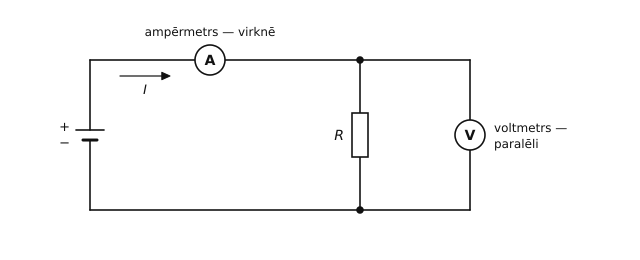
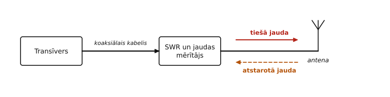
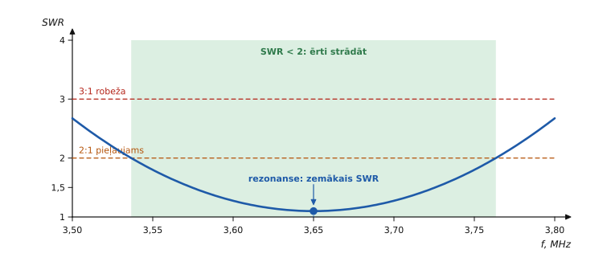
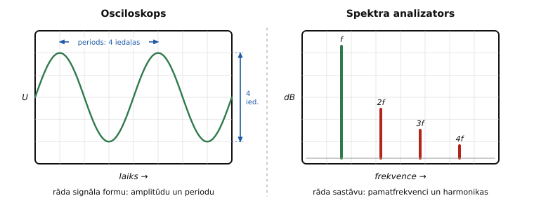

# 15. nodaļa. Mērījumi

Šī nodaļa iemāca izmērīt to, ko iepriekšējās nodaļās rēķinājām: spriegumu,
strāvu, pretestību, jaudu un SWR — un nesabojāt ne mērierīci, ne sevi.

**Video lekcija:** atsevišķas nodarbības nav; saistītās tēmas ir 5., 7. un
8. nodarbībā.
**Eksāmena programma:** mērījumi.
**Mācību laiks:** ap 2 stundām.

## Pēc šīs nodaļas tu pratīsi

- pareizi pieslēgt voltmetru, ampērmetru un ommetru;
- lietot multimetru sprieguma, strāvas un pretestības mērīšanai;
- izmērīt raidītāja izejas jaudu uz slodzes ekvivalenta;
- izmērīt antenas SWR un saprast rādījumu;
- pateikt, ko rāda osciloskops, frekvenču skaitītājs un antenu analizators.

## 15.1. Ko mēra un ar ko

| Lielums | Mērierīce | Kā pieslēdz |
| --- | --- | --- |
| Spriegums | Voltmetrs | **Paralēli** — pie abiem punktiem, starp kuriem mēra |
| Strāva | Ampērmetrs | **Virknē** — ķēdi pārtrauc un ierīci ieslēdz pārtraukumā |
| Pretestība | Ommetrs | Pie detaļas, kas **atslēgta** no sprieguma |
| Jauda | Jaudas mērītājs | Kabelī starp raidītāju un slodzi |
| SWR | SWR mērītājs | Kabelī starp raidītāju un antenu |
| Frekvence | Frekvenču skaitītājs | Pie mērāmā signāla avota |

Kāpēc tieši tā:

- **Voltmetram ir ļoti liela iekšējā pretestība.** Pieslēgts paralēli, tas
  ķēdi gandrīz neietekmē.
- **Ampērmetram ir ļoti maza iekšējā pretestība.** Ieslēgts virknē, tas
  strāvu gandrīz nemaina.

> **Uzmanību!** Ampērmetru nekad nepieslēdz paralēli sprieguma avotam. Tā
> mazā pretestība rada īsslēgumu: labākajā gadījumā izdeg mērierīces
> drošinātājs, sliktākajā — mērierīce vai vadi.

## 15.2. Multimetrs

**Multimetrs** apvieno voltmetru, ampērmetru un ommetru vienā ierīcē. Tā ir
pirmā mērierīce, kas vajadzīga katram radioamatierim.

| Režīms | Apzīmējums | Ko mēra |
| --- | --- | --- |
| Līdzspriegums | V ⎓ vai DCV | Baterijas, barošanas bloka izeja |
| Maiņspriegums | V ~ vai ACV | Tīkla spriegums, transformatora izeja |
| Līdzstrāva | A ⎓ | Ierīces patērētā strāva |
| Pretestība | Ω | Rezistori, vadu un savienojumu veselums |
| Nepārtrauktība | Skaņas simbols | Pīkst, ja starp taustiem ir savienojums |

Pieci noteikumi, kas pasargā multimetru:

1. Pirms mērīšanas iestati pareizo režīmu.
2. Ja nezini, cik liels būs rādījums, sāc ar lielāko diapazonu.
3. Strāvas mērīšanai sarkanais tausts jāpārsprauž uz ligzdu "A"; pēc
   mērījuma pārsprauž atpakaļ.
4. Pretestību un nepārtrauktību mēra tikai atslēgtā ķēdē.
5. Mērot līdzspriegumu, sarkanais tausts pie plusa, melnais pie mīnusa.

Maiņsprieguma režīmā multimetrs rāda **efektīvo vērtību** (7. nodaļa): tīkla
spriegumam tas rādīs ap 230 V, nevis 325 V amplitūdu.

> **Piemērs.** Gribi pārbaudīt, vai barošanas bloks dod 13,8 V.
>
> 1. Režīms: līdzspriegums, diapazons 20 V.
> 2. Sarkano taustu pie plus spailes, melno pie mīnus spailes — paralēli
>    izejai.
> 3. Nolasi rādījumu. 13,6–14,0 V ir kārtībā.
> 4. Atkārto ar pieslēgtu transīveru raidīšanas laikā: ja spriegums nokrīt
>    zem 12,5 V, bloks vai vadi ir par vāju.

> **Praktisks padoms.** Nepārtrauktības režīms ir visbiežāk lietotais.
> Ar to pārbauda koaksiālo kabeli pēc savienotāju pielodēšanas: centrālajam
> vadam jāpīkst no gala līdz galam, ekrānam tāpat, bet starp centrālo vadu
> un ekrānu nedrīkst pīkstēt.

## 15.3. Slodzes ekvivalents

**Slodzes ekvivalents** (dummy load) ir 50 Ω rezistors, kas raidītāja jaudu
pārvērš siltumā un neko neizstaro. Raidītājs "redz" ideālu antenu ar
SWR 1:1.

Kam to lieto:

- raidītāja pārbaudei un regulēšanai, nevienam netraucējot;
- izejas jaudas mērīšanai;
- lietota transīvera pārbaudei pirms pirkšanas;
- traucējumu meklēšanai (16. nodaļa).

Slodzes ekvivalentam ir divi parametri: pretestība (50 Ω) un jauda, ko tas
iztur. Lēts ekvivalents 100 W iztur tikai dažus desmitus sekunžu; seko
norādītajam darba laikam un ļauj tam atdzist.

## 15.4. Jaudas un SWR mērītājs

**SWR mērītāju** ieslēdz koaksiālajā kabelī starp raidītāju un antenu. Tas
mēra divas jaudas: **tiešo**, kas iet uz antenu, un **atstaroto**, kas nāk
atpakaļ. No to attiecības iegūst SWR (13. nodaļa). Lielākā daļa mērītāju
rāda arī pašu jaudu vatos.

**Kā izmēra SWR:**

1. Izvēlies frekvenci un pārliecinies, ka tā ir brīva.
2. Samazini jaudu līdz 5–10 W.
3. Izvēlies nemainīga nesēja režīmu: FM, AM vai CW.
4. Nospied raidīšanu uz dažām sekundēm un nolasi SWR.
5. Atkārto diapazona apakšā, vidū un augšā.

| Kur SWR ir zemākais | Ko tas nozīmē | Ko darīt |
| --- | --- | --- |
| Diapazona vidū | Antena ir pareiza garuma | Neko |
| Diapazona apakšā vai zem tā | Antena ir par garu | Saīsināt |
| Diapazona augšā vai virs tā | Antena ir par īsu | Pagarināt |

**Jaudas mērīšana.** FM un CW režīmā jauda ir nemainīga, un mērītājs to rāda
pareizi. SSB režīmā jauda seko balsij: parasts mērītājs rāda vidējo vērtību,
kas ir krietni mazāka par galotnes jaudu. Atļauto jaudu noteikumi norāda kā
galotnes jaudu, tāpēc SSB mērīšanai vajag mērītāju ar PEP režīmu.

Ja raidītājs spēj dot vairāk jaudas, nekā tev atļauts, tam jābūt izejas
jaudas mērītājam [1].

> **Uzmanību!** SWR, ko mēra pie transīvera, izskatās labāks par īsto, ja
> kabelim ir lieli zudumi: atstarotā jauda atceļā pa kabeli vājinās. Ļoti
> garš vai bojāts kabelis var rādīt gandrīz 1:1 arī tad, ja antenas galā
> nav nekā. Šaubu gadījumā mēri pie antenas.

## 15.5. Antenu analizators

**Antenu analizators** ir neliels signālu ģenerators ar mērītāju vienā
korpusā. Tas pats pārskrien visu diapazonu ar ļoti mazu jaudu un parāda SWR
līkni; labāki modeļi rāda arī pretestību.

Līknes zemākais punkts ir antenas rezonanses frekvence. Ja tas ir zemāk par
vajadzīgo frekvenci, antena ir par garu un tā jāsaīsina; ja augstāk — par īsu.

| | SWR mērītājs | Antenu analizators |
| --- | --- | --- |
| Signāla avots | Tavs raidītājs | Iebūvēts ģenerators |
| Traucē citiem | Jā, mērīšanas laikā tu raidi | Praktiski nē |
| Ko redz | Vienu frekvenci vienā reizē | Visu diapazonu uzreiz |
| Kur lieto | Pastāvīgi ieslēgts stacijā | Antenu būvē un noskaņošanā |

Lēti vektoru analizatori ir padarījuši šo mērīšanu pieejamu katram; antenu
būvētājam analizators ir otrā svarīgākā mērierīce pēc multimetra.

## 15.6. Frekvence un signāla forma

| Ierīce | Ko rāda | Kam noder |
| --- | --- | --- |
| **Frekvenču skaitītājs** | Signāla frekvenci kā skaitli | Ģeneratora vai raidītāja frekvences pārbaude |
| **Osciloskops** | Sprieguma izmaiņas **laikā** — signāla formu | Amplitūda, periods, kropļojumi |
| **Spektra analizators** | Signāla sastāvu pa **frekvencēm** | Harmonikas, joslas platums, blakusizstarojumi |

No osciloskopa attēla var nolasīt periodu un aprēķināt frekvenci.

> **Piemērs.** Osciloskopā (15.4. attēls) viens pilns signāla periods aizņem
> 4 iedaļas.
> Laika skala ir 0,5 ms uz iedaļu. Kāda ir signāla frekvence?
>
> 1. Periods: T = 4 · 0,5 ms = 2 ms = 0,002 s.
> 2. Frekvence: f = 1 / T = 1 / 0,002 = 500 Hz.

> **Piemērs.** Tajā pašā attēlā signāls no zemākā līdz augstākajam punktam
> aizņem 4 iedaļas, sprieguma skala ir 2 V uz iedaļu. Kāda ir amplitūda un
> efektīvā vērtība?
>
> 1. No smailes līdz smailei: 4 · 2 V = 8 V.
> 2. Amplitūda ir puse: 4 V.
> 3. Efektīvā vērtība: 0,707 · 4 ≈ 2,8 V.

Radioamatierim nav jāpērk spektra analizators: SDR uztvērēja ūdenskrituma
attēls parāda to pašu — signāla platumu un to, kas ir blakus.

## 15.7. Mērījumu precizitāte

Neviens mērījums nav absolūti precīzs. Trīs lietas, kas jāpatur prātā:

- **Mērierīce ietekmē ķēdi.** Voltmetrs paņem nelielu strāvu, ampērmetrs
  rada nelielu sprieguma kritumu. Parasti to var neņemt vērā, bet ne
  vienmēr.
- **Katrai ierīcei ir kļūda.** Lēta SWR mērītāja jaudas rādījums var
  atšķirties no īstā par 10–20 %.
- **Savienojumi.** Lielākā daļa "dīvaino" rādījumu rodas no slikta kontakta
  taustos, savienotājos vai kabelī.

> **Atceries:** ja rādījums šķiet neticams, vispirms pārbaudi mērīšanas
> veidu un savienojumus, tikai tad meklē bojājumu iekārtā.

## Eksāmenā jāzina

- Voltmetru pieslēdz paralēli; tam ir liela iekšējā pretestība.
- Ampērmetru ieslēdz virknē; tam ir maza iekšējā pretestība.
- Pretestību mēra atslēgtā ķēdē.
- Multimetrs maiņsprieguma režīmā rāda efektīvo vērtību.
- Slodzes ekvivalents: 50 Ω, neizstaro; raidītāja pārbaudei.
- SWR mērītāju ieslēdz starp raidītāju un antenu; tas salīdzina tiešo un
  atstaroto jaudu.
- Osciloskops rāda signālu laikā; spektra analizators — pa frekvencēm.
- Frekvenci no perioda: f = 1 / T.

## Pamēģini pats

**1. Trīs mērījumi ar multimetru (15 minūtes).**

- [ ] Izmēri AA baterijas spriegumu.
- [ ] Izmēri jebkura rezistora pretestību un salīdzini ar krāsu kodu.
- [ ] Ar nepārtrauktības režīmu pārbaudi pagarinātāja vadu vai koaksiālo
  kabeli (atvienotu no visa).

**2. Uzzīmē pieslēgumu (5 minūtes).** Uzzīmē ķēdi ar bateriju un lampiņu un
parādi, kur pieslēgsi voltmetru un kur ampērmetru.

**3. Nolasi osciloskopu (10 minūtes).** Vietnē falstad.com/circuit pieslēdz
maiņsprieguma avotu rezistoram un atver osciloskopa logu. Nolasi periodu un
aprēķini frekvenci; salīdzini ar avota iestatījumu.

## Kopsavilkums

- Spriegumu mēra paralēli, strāvu virknē, pretestību atslēgtā ķēdē.
- Multimetrs ir pirmā un svarīgākā mērierīce.
- Raidītāju pārbauda uz slodzes ekvivalenta.
- SWR mēra ar mazu jaudu, brīvā frekvencē, nemainīga nesēja režīmā.
- SSB galotnes jaudu parasts mērītājs nerāda.
- Antenu analizators parāda SWR visā diapazonā, netraucējot citiem.
- Osciloskops rāda formu laikā, spektra analizators — sastāvu pa
  frekvencēm.

## Paškontroles jautājumi

1. Kā pieslēdz voltmetru, lai izmērītu spriegumu uz rezistora?
    - A. Virknē ar rezistoru
    - B. Paralēli rezistoram
    - C. Rezistora vietā
    - D. Pie viena rezistora izvada
2. Kā ieslēdz ampērmetru, lai izmērītu strāvu ķēdē?
    - A. Virknē, ķēdes pārtraukumā
    - B. Paralēli sprieguma avotam
    - C. Paralēli slodzei
    - D. Starp plusu un zemi
3. Kādai jābūt voltmetra iekšējai pretestībai?
    - A. Pēc iespējas mazai
    - B. Vienādai ar 50 Ω
    - C. Vienādai ar mērāmo pretestību
    - D. Pēc iespējas lielai
4. Kas notiek, ja ampērmetru pieslēdz paralēli barošanas avotam?
    - A. Tas rāda avota spriegumu
    - B. Nekas
    - C. Rodas īsslēgums
    - D. Tas rāda nulli
5. Kādos apstākļos mēra detaļas pretestību ar ommetru?
    - A. Kad ķēde ir atslēgta no sprieguma
    - B. Kad ķēdē plūst darba strāva
    - C. Tikai maiņstrāvas ķēdē
    - D. Tikai raidīšanas laikā
6. Ko rāda multimetrs maiņsprieguma režīmā, mērot tīkla spriegumu?
    - A. Amplitūdu, ap 325 V
    - B. Efektīvo vērtību, ap 230 V
    - C. Spriegumu no smailes līdz smailei, ap 650 V
    - D. Frekvenci, 50 Hz
7. Kas ir slodzes ekvivalents?
    - A. Antena ar lielu pastiprinājumu
    - B. Rezerves barošanas bloks
    - C. Kabelis ar maziem zudumiem
    - D. 50 Ω rezistors, kas jaudu pārvērš siltumā un neizstaro
8. Kur ieslēdz SWR mērītāju?
    - A. Starp mikrofonu un transīveru
    - B. Starp barošanas bloku un transīveru
    - C. Koaksiālajā kabelī starp raidītāju un antenu
    - D. Paralēli antenai
9. Ko salīdzina SWR mērītājs?
    - A. Tiešo un atstaroto jaudu
    - B. Ieejas un izejas frekvenci
    - C. Barošanas spriegumu un strāvu
    - D. Divu antenu pastiprinājumu
10. Zemākais SWR ir zem diapazona apakšējās malas. Ko tas nozīmē?
    - A. Antena ir par īsu
    - B. Antena ir par garu
    - C. Kabelis ir bojāts
    - D. Raidītāja jauda ir par lielu
11. Ko rāda osciloskops?
    - A. Signāla sastāvu pa frekvencēm
    - B. Antenas pretestību
    - C. Raidītāja jaudu
    - D. Sprieguma izmaiņas laikā
12. Osciloskopā viens periods aizņem 5 iedaļas pie 2 ms uz iedaļu. Kāda ir signāla frekvence?
    - A. 10 Hz
    - B. 500 Hz
    - C. 100 Hz
    - D. 2,5 kHz
13. Ar kuru ierīci vislabāk redzamas raidītāja harmonikas?
    - A. Ar spektra analizatoru
    - B. Ar multimetru
    - C. Ar SWR mērītāju
    - D. Ar ommetru

**Atvērtie jautājumi**

14. Apraksti soli pa solim, kā izmērīsi jaunas dipola antenas SWR un kā
    izlemsi, vai tā jāsaīsina vai jāpagarina.
15. Paskaidro, kāpēc SWR mērījums pie transīvera var izskatīties labāks,
    nekā tas ir pie antenas.

## Atbildes

| Nr. | Atbilde | Skaidrojums |
| --- | --- | --- |
| 1 | B | Spriegums ir starp diviem punktiem; voltmetrs jāpieslēdz pie abiem. |
| 2 | A | Strāvai jāplūst caur ampērmetru. |
| 3 | D | Liela pretestība nozīmē, ka voltmetrs ķēdi neietekmē. |
| 4 | C | Ampērmetra pretestība ir ļoti maza. |
| 5 | A | Ommetrs pats dod mērīšanas strāvu; svešs spriegums izkropļo rādījumu vai bojā ierīci. |
| 6 | B | Multimetri rāda efektīvo vērtību. |
| 7 | D | Raidītājs redz ideālu slodzi, bet nekas netiek izstarots. |
| 8 | C | Tam jāmēra jauda, kas iet uz antenu un nāk no tās. |
| 9 | A | No tiešās un atstarotās jaudas attiecības iegūst SWR. |
| 10 | B | Garāka antena rezonē zemākā frekvencē; tā jāsaīsina. |
| 11 | D | Osciloskops — laikā; spektra analizators — pa frekvencēm. |
| 12 | C | T = 5 · 2 ms = 10 ms = 0,01 s; f = 1 / 0,01 = 100 Hz. |
| 13 | A | Spektra analizatorā harmonikas redzamas kā atsevišķas līnijas. |

Atvērtie jautājumi: četrpadsmitajā jābūt brīvai frekvencei, mazai jaudai,
nemainīga nesēja režīmam un mērījumiem vismaz trīs punktos diapazonā;
lēmums pēc tā, kurā pusē SWR ir zemāks. Piecpadsmitajā jāpiemin, ka kabeļa
zudumi vājina atstaroto jaudu atceļā.

## Padziļināti

- **Vektoru analizators.** Mēra ne tikai SWR, bet arī pretestības aktīvo un
  reaktīvo daļu. Ar to var noteikt, vai antena ir par garu vai par īsu, no
  viena mērījuma.
- **Jutības mērīšana.** Uztvērēja jutību mēra ar signālu ģeneratoru, kas dod
  precīzi zināmu, ļoti vāju signālu.
- **Kalibrēšana.** Mērierīce ir tik precīza, cik precīzs ir etalons, ar ko
  tā salīdzināta. Frekvences pārbaudei var izmantot etalonfrekvenču un laika
  signālu raidstacijas.

## Nodaļas avoti

1. Ministru kabineta 2023. gada 23. maija noteikumi Nr. 257, 54. punkts.
   <https://likumi.lv/ta/id/342127> (skatīts 2026-11-12).

Nodaļa uzrakstīta no jauna, balstoties uz grāmatas 7., 8., 12. un
13. nodaļu; ārēju mācību materiālu teksts un attēli nav izmantoti.
