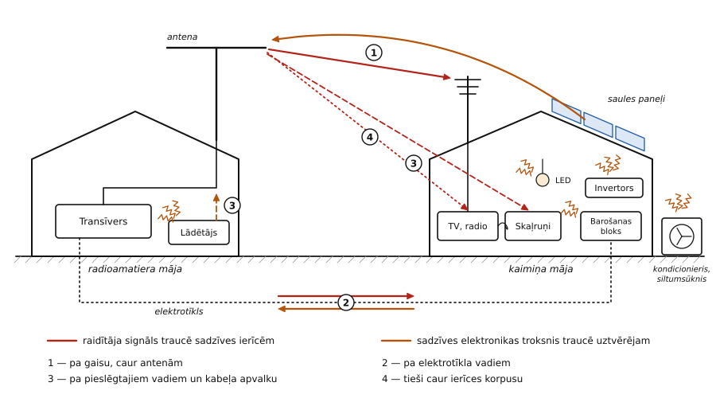

# 16. nodaļa. Traucējumi un elektromagnētiskā saderība

Šī nodaļa iemāca, kā panākt, lai tava stacija netraucētu citiem, ko darīt,
ja tomēr traucē, un kā atrast trokšņus, kas traucē tev.

**Video lekcija:** atsevišķas nodarbības nav; saistītās tēmas ir 2., 7. un
8. nodarbībā.
**Eksāmena programma:** traucējumi un noturība pret tiem.
**Mācību laiks:** ap 3 stundām.

## Pēc šīs nodaļas tu pratīsi

- paskaidrot, kas ir elektromagnētiskā saderība;
- atšķirt traucējumus, kuru cēlonis ir raidītājā, no tiem, kuru cēlonis ir
  traucētajā ierīcē;
- nosaukt ceļus, pa kuriem traucējums nonāk ierīcē;
- izvēlēties pareizo līdzekli: filtru, ferītu, balunu vai zemējumu;
- rīkoties saskaņā ar MK noteikumiem, ja saņem sūdzību;
- atrast trokšņu avotu savās mājās.

## 16.1. Kas ir elektromagnētiskā saderība

**Elektromagnētiskā saderība** (EMS) ir iekārtu spēja darboties blakus,
savstarpēji netraucējot. MK noteikumi to definē kā pasākumus, kas nodrošina
radioiekārtu darbību bez kaitīgiem savstarpējiem traucējumiem [1].

Saderībai ir divas puses:

| Puse | Jautājums | Kas par to atbild |
| --- | --- | --- |
| **Izstarojumi** | Cik daudz nevēlama signāla iekārta izstaro? | Raidītāja īpašnieks |
| **Noturība** | Cik labi iekārta iztur svešus signālus? | Iekārtas ražotājs un īpašnieks |

Radioamatiera stacija ir abās pusēs uzreiz: tā var traucēt citiem, un citi
var traucēt tai.

> **Atceries:** tas, ka kaimiņa ierīce reaģē uz tavu raidītāju, vēl
> nenozīmē, ka tavs raidītājs ir vainīgs. Vispirms jānoskaidro, kurā pusē ir
> cēlonis.

## 16.2. Divi cēloņi

Kad raidi un kaimiņa televizorā parādās svītras, tam var būt divi pilnīgi
dažādi iemesli.

| | Cēlonis raidītājā | Cēlonis traucētajā ierīcē |
| --- | --- | --- |
| Kas notiek | Raidītājs izstaro signālu frekvencē, kurā ierīce strādā | Ierīce neiztur tava pamatsignāla stiprumu |
| Tipiski | Harmonikas, pārmodulācija, parazītiskās svārstības | Lēts uztvērējs, vāji ekranēti vadi, antenas pastiprinātājs |
| Pazīme | Traucē konkrētā frekvencē vai kanālā | Traucē visos kanālos; reaģē arī ierīces bez uztvērēja |
| Kur novērš | Pie raidītāja | Pie traucētās ierīces |
| Līdzeklis | Zemo frekvenču filtrs, pareiza regulēšana | Augsto frekvenču filtrs, ferīti, labāki kabeļi |

**Cēlonis raidītājā.** 12. nodaļā redzējām, ka raidītājs bez darba
frekvences izstaro arī harmonikas. Ja harmonika trāpa frekvencē, kurā strādā
cita iekārta, tā tiek traucēta, lai cik laba tā būtu. Par to atbild
radioamatieris.

**Cēlonis ierīcē.** Tavs signāls ir tīrs un atļautajā joslā, bet tik stiprs,
ka ierīces ieejas pakāpe tiek pārslogota vai signāls iekļūst pa vadiem. Skaļruņi
ar pastiprinātāju, telefoni, signalizācijas, skārienjutīgi slēdži nav
radiouztvērēji, tomēr tajos esošie pusvadītāji stipru signālu "detektē" kā
diode detektoruztvērējā.

> **Piemērs.** Raidot 21,2 MHz, kaimiņa FM radio 106 MHz frekvencē dzird
> tavu balsi. Kas varētu būt cēlonis?
>
> 1. Pārbaudi harmonikas: 21,2 · 5 = 106 MHz.
> 2. Piektā harmonika trāpa tieši uztveramajā frekvencē.
> 3. Cēlonis, visticamāk, ir raidītājā; līdzeklis — zemo frekvenču filtrs
>    izejā un raidītāja pārbaude.

## 16.3. Kā traucējums nonāk ierīcē

Lai traucējumu novērstu, jāzina, pa kuru ceļu tas iekļūst.

| Ceļš | Kā izpaužas | Kā pārbaudīt |
| --- | --- | --- |
| Caur ierīces antenu | Traucē tikai radio un TV uztveršanu | Atvieno antenu — traucējums pazūd |
| Pa elektrotīkla vadiem | Traucē vairākas ierīces vienā mājā | Baro ierīci no akumulatora — traucējums pazūd |
| Pa pieslēgtajiem vadiem | Skaļruņu, telefona, datu kabeļi darbojas kā antenas | Atvieno vadus pa vienam |
| Tieši caur korpusu | Ierīcei nav ekrāna vai tas ir slikts | Traucējums paliek, kad viss atvienots |

Īpašs gadījums ir **strāva uz kabeļa apvalka** tavā pusē. Ja dipolam nav
baluna vai antena ir nesimetriska, koaksiālā kabeļa apvalks izstaro visā
garumā, arī mājas iekšpusē, tieši blakus sadzīves tehnikai. Pazīmes: "kož"
mikrofons vai transīvera korpuss, raidīšanas laikā nojūk dators, mainās SWR,
ja pieskaras kabelim.

## 16.4. Līdzekļi

| Līdzeklis | Kur liek | Pret ko palīdz |
| --- | --- | --- |
| **Zemo frekvenču filtrs** (LPF) | Raidītāja izejā | Harmonikas |
| **Augsto frekvenču filtrs** (HPF) | Televizora vai radio antenas ieejā | Īsviļņu raidītāja pamatsignāls |
| **Ferīta gredzeni un uzmavas** | Uz vadiem pie traucētās ierīces; uz koaksiālā kabeļa pie antenas | Strāvas, kas plūst pa vadu ārpusi |
| **Baluns 1:1** | Antenas pieslēgvietā | Strāva uz kabeļa apvalka |
| **Tīkla filtrs** | Starp rozeti un ierīci | Traucējumi pa elektrotīklu |
| **Labs zemējums** | Stacijā: visi korpusi savienoti vienā punktā | Potenciālu starpības, statiskie lādiņi |
| **Antenas novietojums** | Pēc iespējas tālāk no mājām un vadiem, augstāk | Visi veidi |
| **Mazāka jauda** | — | Visi veidi |

Ferītu lieto tā: vadu vairākas reizes izver caur gredzenu, pēc iespējas tuvu
traucētajai ierīcei. Signālam vada iekšpusē tas netraucē, bet strāvai pa vada
ārpusi rada lielu pretestību.

> **Praktisks padoms.** Lētākais un ātrākais līdzeklis ir samazināt jaudu.
> Noteikumi prasa lietot mazāko jaudu, ar kuru sakars iespējams [1]. No
> 100 W uz 25 W ir tikai viena S vienība korespondentam, bet traucējums
> kaimiņam samazinās četras reizes.

> **Uzmanību!** Nekad neatver un nepārbūvē svešu ierīci. Filtrus un ferītus
> liek ārpusē, uz vadiem un ieejām, un tikai ar īpašnieka piekrišanu.
> Par iejaukšanos svešā tehnikā atbildība pāriet uz tevi.

## 16.5. Kā meklēt cēloni

Rīkojies sistemātiski, mainot tikai vienu lietu vienā reizē, un visu
pieraksti.

1. **Sāc ar savām mājām.** Ja tava paša televizors, radio un dators strādā
   bez traucējumiem, raidītājs, visticamāk, ir tīrs.
2. **Pieraksti apstākļus.** Kurā diapazonā, ar kādu jaudu, kādā darba veidā,
   kurā virzienā pagriezta antena traucējums parādās un kurā ne.
3. **Samazini jaudu.** Ja traucējums pazūd pie mazākas jaudas, tā ir
   pārslodze; ja paliek, meklē harmonikas.
4. **Raidi uz slodzes ekvivalenta.** Ja traucējums paliek, signāls izplūst
   pa elektrotīklu vai no paša raidītāja, nevis no antenas.
5. **Aprēķini harmonikas.** Pārbaudi, vai kāda no tām sakrīt ar traucēto
   frekvenci.
6. **Pārbaudi ceļu** pie traucētās ierīces pēc 16.3. tabulas.
7. **Liec līdzekli** atbilstoši atrastajam cēlonim un pārbaudi vēlreiz.

> **Piemērs.** Kaimiņa datora skaļruņos dzirdama tava balss, kad raidi SSB
> 80 m diapazonā. Radio un televizors viņam strādā normāli.
>
> 1. Skaļruņi nav radiouztvērējs, tātad harmonikas nav pie vainas.
> 2. Skaļruņu vadi darbojas kā antena, un pastiprinātājs signālu detektē.
> 3. Līdzeklis: ferīta gredzeni uz skaļruņu un barošanas vadiem, pēc
>    iespējas tuvu pastiprinātājam. Savā pusē: pārbaudi balunu un samazini
>    jaudu.

## 16.6. Ko prasa noteikumi

MK noteikumi Nr. 257 traucējumiem velta atsevišķu nodaļu [1].

| Prasība | Punkts |
| --- | --- |
| Pirms radiostacijas lietošanas jāpārliecinās, ka tā atbilst noteikumiem un blakusizstarojumu prasībām | 62. |
| Kaitīgus radiotraucējumus radīt nedrīkst | 63. |
| Ārpusjoslas izstarojumu kopējā jauda nedrīkst pārsniegt 1 % no izstarotās | 57. |
| Jālieto mazākā nepieciešamā jauda | 53. |
| ES var noteikt ierobežojumus traucējumu novēršanai | 61. |

Ja traucējumi konstatēti, 64. punkts nosaka kārtību:

1. radioamatieris pilnveido savu radiostaciju, līdz traucējumi novērsti vai
   samazināti līdz pieļaujamam līmenim;
2. ja cēlonis ir traucētajā uztvērējā, to novērš uztvērēja īpašnieks;
3. par papildu pasākumiem puses vienojas;
4. ja vienoties neizdodas, ierobežojumus nosaka ES.

> **Uzmanību!** Ja tava stacija traucē navigācijas vai drošības dienestu
> sakarus, raidīšana jāpārtrauc nekavējoties un to drīkst atsākt tikai pēc
> cēloņa novēršanas (65. punkts) [1].

## 16.7. Saruna ar kaimiņu

Tehniskā puse ir puse darba. Otra puse ir attiecības.

- **Uzklausi un neaizstāvies.** Kaimiņam ir īsta problēma, pat ja cēlonis ir
  viņa ierīcē.
- **Piedāvā pārbaudi kopā.** Vienojieties par laiku, kad tu raidi un viņš
  vēro. Tas uzreiz parāda, vai traucējums vispār sakrīt ar tavu raidīšanu.
- **Rādi žurnālu.** Ja traucējums bija laikā, kad tu neraidīji, cēlonis ir
  citur.
- **Paskaidro vienkārši.** "Jūsu skaļruņu vadi uztver manu signālu; uzliksim
  filtru" ir saprotamāk nekā "jūsu ierīcei ir nepietiekama noturība".
- **Palīdzi ar līdzekli.** Ferīta gredzens maksā dažus eiro un bieži
  atrisina visu.
- **Nesoli to, ko nevari izpildīt.** Neapsoli, ka traucējumu vairs nebūs,
  pirms neesi atradis cēloni.

Antenu ierīkojot, par to ir vērts pastāstīt kaimiņiem jau iepriekš. Cilvēki
biežāk sūdzas par antenu, ko redz, nekā par traucējumiem, ko dzird.

## 16.8. Kad traucē tev

Pilsētā lielākā problēma parasti ir pretējā: sadzīves elektronika rada
troksni, kas nosedz vājus signālus. Q kodos to sauc par QRM; dabiskos
trokšņus — par QRN (5. nodaļa).

| Avots | Kā skan vai izskatās |
| --- | --- |
| Impulsu barošanas bloki, lādētāji | Signāli ik pēc vienādiem frekvences soļiem; dūkoņa |
| LED apgaismojums | Plats troksnis, kas pazūd, izslēdzot gaismu |
| Saules paneļu invertori | Troksnis tikai dienā |
| Datu pārraide pa elektrotīklu | Plats troksnis lielā daļā īsviļņu |
| Elektriskais gans | Regulāri klikšķi reizi sekundē |
| Elektromotori, vecas sadzīves ierīces | Sprakšķi, kamēr ierīce strādā |

**Kā atrast avotu savās mājās:**

1. Ieslēdz uztvērēju no akumulatora traucētajā frekvencē.
2. Izslēdz mājas galveno drošinātāju. Ja troksnis pazūd, avots ir tavās
   mājās.
3. Ieslēdz drošinātājus pa vienam, līdz troksnis atgriežas.
4. Šajā ķēdē atvieno ierīces pa vienai.

Ja avots nav tavās mājās, ar portatīvu uztvērēju var apiet apkārtni: jo
tuvāk avotam, jo stiprāks troksnis.

> **Praktisks padoms.** Pret troksni visvairāk palīdz antena, kas atrodas
> tālāk no mājām, un baluns, kas neļauj kabeļa apvalkam uztvert troksni
> mājas iekšpusē. Uztvērēja trokšņu slāpētāji (NB, NR) palīdz, bet cēloni
> nenovērš.

## Eksāmenā jāzina

- Elektromagnētiskā saderība: iekārtu darbība bez savstarpējiem kaitīgiem
  traucējumiem.
- Harmonikas aiztur zemo frekvenču filtrs raidītāja izejā.
- Īsviļņu raidītāja pamatsignālu televizora ieejā aiztur augsto frekvenču
  filtrs.
- Ferīti aiztur strāvas pa vadu ārpusi.
- Traucējumu gadījumā radioamatieris pilnveido savu staciju; ja cēlonis ir
  uztvērējā, to novērš uztvērēja īpašnieks; strīdu izšķir ES.
- Traucējot navigācijas vai drošības dienestiem — raidīšana jāpārtrauc
  nekavējoties.
- Ārpusjoslas izstarojumi: ne vairāk kā 1 % no izstarotās jaudas.
- Jālieto mazākā nepieciešamā jauda.

## Pamēģini pats

**1. Trokšņu karte (20 minūtes).** Ar pārnēsājamu radio (AM vai īsviļņu
diapazonā, noskaņotu starp stacijām) apej savu dzīvokli un pieliec to pie:

- [ ] telefona lādētāja;
- [ ] LED spuldzes;
- [ ] datora un monitora;
- [ ] rūtera.

Pieraksti, kura ierīce rada visvairāk trokšņa un cik tālu tas dzirdams.

**2. Aprēķini harmonikas (10 minūtes).** Katrai B kategorijas HF joslai
aprēķini harmonikas no otrās līdz piektajai joslas vidum. Atzīmē tās, kas
trāpa FM apraides joslā 87,5–108 MHz.

**3. Sagatavo sarunu.** Uzraksti trīs teikumus, ko teiktu kaimiņam, kurš
atnāk ar sūdzību par traucējumiem televizorā.

## Kopsavilkums

- Saderībai ir divas puses: izstarojumi un noturība.
- Vispirms jānoskaidro, vai cēlonis ir raidītājā vai traucētajā ierīcē.
- Harmonikas novērš pie raidītāja ar zemo frekvenču filtru.
- Pārslodzi novērš pie ierīces: augsto frekvenču filtrs, ferīti.
- Strāvu uz kabeļa apvalka novērš baluns.
- Mazāka jauda samazina visus traucējumus uzreiz.
- Noteikumi nosaka kārtību: vispirms radioamatieris, tad uztvērēja
  īpašnieks, tad vienošanās, tad ES.
- Trokšņus, kas traucē tev, meklē, izslēdzot ķēdes pa vienai.

## Paškontroles jautājumi

1. Ko nozīmē elektromagnētiskā saderība?
    - A. Visu iekārtu darbību vienā frekvencē
    - B. Iekārtu spēju darboties blakus, savstarpēji netraucējot
    - C. Antenas un kabeļa pretestību vienādību
    - D. Raidītāja un uztvērēja kopīgu barošanu
2. Kuru filtru liek raidītāja izejā, lai samazinātu harmoniku izstarošanu?
    - A. Zemo frekvenču filtru
    - B. Augsto frekvenču filtru
    - C. Sprostfiltru tīkla frekvencei
    - D. Nekādu
3. Kuru filtru liek televizora antenas ieejā, lai pasargātu to no īsviļņu raidītāja pamatsignāla?
    - A. Zemo frekvenču filtru
    - B. Joslas filtru 3–30 MHz
    - C. Augsto frekvenču filtru
    - D. SSB filtru
4. Raidītājs strādā 21,3 MHz. Kura tā harmonika trāpa FM apraides joslā 87,5–108 MHz?
    - A. Otrā (42,6 MHz)
    - B. Trešā (63,9 MHz)
    - C. Ceturtā (85,2 MHz)
    - D. Piektā (106,5 MHz)
5. Tava balss dzirdama kaimiņa datora skaļruņos, bet radio un televizors viņam strādā normāli. Kas ir visticamākais cēlonis?
    - A. Skaļruņu vadi uztver tavu signālu, un pastiprinātājs to detektē
    - B. Tavs raidītājs izstaro harmonikas
    - C. Tavs raidītājs strādā ārpus joslas
    - D. Kaimiņa skaļruņi ir noskaņoti uz tavu frekvenci
6. Kam lieto ferīta gredzenus uz vadiem?
    - A. Lai palielinātu signāla stiprumu
    - B. Lai aizturētu augstfrekvences strāvas pa vada ārpusi
    - C. Lai pagarinātu antenu
    - D. Lai stabilizētu barošanas spriegumu
7. Traucējums kaimiņa televizorā paliek arī tad, kad raidi uz slodzes ekvivalenta. Ko tas nozīmē?
    - A. Antena ir par garu
    - B. Kaimiņa televizors ir bojāts
    - C. Signāls izplūst citā ceļā, nevis no antenas, piemēram, pa elektrotīklu
    - D. Slodzes ekvivalents izstaro tāpat kā antena
8. Kas pēc MK noteikumiem jādara radioamatierim, ja viņa stacija rada kaitīgus traucējumus?
    - A. Nekas, ja stacija ir rūpnieciski ražota
    - B. Jāpārdod stacija
    - C. Jāpārceļas uz citu dzīvesvietu
    - D. Jāpilnveido stacija, līdz traucējumi novērsti vai samazināti līdz pieļaujamam līmenim
9. Tava stacija traucē aviācijas navigācijas sakarus. Kā jārīkojas?
    - A. Nekavējoties jāpārtrauc raidīšana līdz cēloņa novēršanai
    - B. Jāsamazina jauda uz pusi
    - C. Jāpaziņo ES trīs darbdienu laikā un jāturpina
    - D. Jāpāriet uz telegrāfu
10. Traucējuma cēlonis ir kaimiņa uztvērēja nepietiekama noturība. Kas to novērš pēc noteikumiem?
    - A. Radioamatieris par saviem līdzekļiem
    - B. Uztvērēja īpašnieks
    - C. ES
    - D. Uztvērēja ražotājs
11. Kas izlemj, ja radioamatieris un traucētās iekārtas īpašnieks nevar vienoties?
    - A. Latvijas Radioamatieru līga
    - B. Pašvaldība
    - C. "Elektroniskie sakari"
    - D. Policija
12. Kāds ir vienkāršākais veids, kā uzreiz samazināt jebkuru traucējumu, ko rada tava stacija?
    - A. Palielināt jaudu
    - B. Pāriet uz AM
    - C. Pagarināt kabeli
    - D. Samazināt jaudu
13. Kā visātrāk noskaidrot, vai trokšņa avots ir tavās mājās?
    - A. Izslēgt galveno drošinātāju un klausīties ar akumulatora barotu uztvērēju
    - B. Palielināt uztvērēja skaļumu
    - C. Nomainīt antenu
    - D. Pāriet uz citu diapazonu

**Atvērtie jautājumi**

14. Kaimiņš sūdzas, ka, tev raidot, viņa televizorā pazūd attēls visos
    kanālos. Apraksti, kā tu noskaidrosi cēloni un kādus līdzekļus
    izmēģināsi, norādot secību.
15. Paskaidro, kāpēc dipolam bez baluna var būt vairāk traucējumu mājas
    tehnikai nekā tam pašam dipolam ar balunu.

## Atbildes

| Nr. | Atbilde | Skaidrojums |
| --- | --- | --- |
| 1 | B | Saderība nozīmē darbību bez savstarpējiem kaitīgiem traucējumiem. |
| 2 | A | Harmonikas ir virs darba frekvences; LPF tās aiztur. |
| 3 | C | Televīzijas signāli ir augstāki par īsviļņiem; HPF īsviļņus aiztur. |
| 4 | D | 5 · 21,3 = 106,5 MHz; pārējās ir zem 87,5 MHz. |
| 5 | A | Skaļruņi nav uztvērējs; signāls iekļūst pa vadiem. |
| 6 | B | Ferīts rada lielu pretestību strāvai pa vada ārpusi. |
| 7 | C | Slodzes ekvivalents neizstaro, tātad signāls iet citu ceļu. |
| 8 | D | 64. punkts. |
| 9 | A | 65. punkts: nekavējoties. |
| 10 | B | 64. punkts: uztvērēja traucējumu cēloni novērš tā īpašnieks. |
| 11 | C | 64. punkts: ja vienoties neizdodas, ierobežojumus nosaka ES. |
| 12 | D | Mazāka jauda samazina gan harmonikas, gan pārslodzi. |
| 13 | A | Ja troksnis pazūd, avots ir tavā elektrotīklā. |

Atvērtie jautājumi: četrpadsmitajā "visos kanālos" norāda uz pārslodzi, nevis
harmoniku; secība — pārbaude savās mājās, jaudas samazināšana, slodzes
ekvivalents, augsto frekvenču filtrs un ferīti pie televizora, baluns un
antenas novietojums savā pusē. Piecpadsmitajā jāpiemin strāva uz kabeļa
apvalka, kas izstaro mājas iekšpusē.

## Padziļināti

- **Intermodulācija.** Ja nelineārā elementā satiekas divi stipri signāli,
  rodas jaunas frekvences — to summas un starpības. Tā var rasties arī
  sarūsējušā žogā vai notekcaurulē.
- **Blakusizstarojumu normas.** MK noteikumu 4. pielikums nosaka, par cik
  decibeliem blakusizstarojumiem jābūt vājākiem par pamatsignālu
  (4. nodaļa).
- **CE zīme.** Sadzīves elektronikai Eiropā jāatbilst noturības un
  izstarojumu prasībām. Praksē lētas ierīces tās bieži neizpilda, un tas ir
  arguments sarunā ar kaimiņu, nevis iemesls strīdam.

## Nodaļas avoti

1. Ministru kabineta 2023. gada 23. maija noteikumi Nr. 257, 2.4., 53., 57.
   un 61.–65. punkts. <https://likumi.lv/ta/id/342127>
   (skatīts 2026-11-12).

Nodaļa uzrakstīta no jauna, balstoties uz grāmatas 3., 10., 12. un
13. nodaļu; ārēju mācību materiālu teksts un attēli nav izmantoti.
