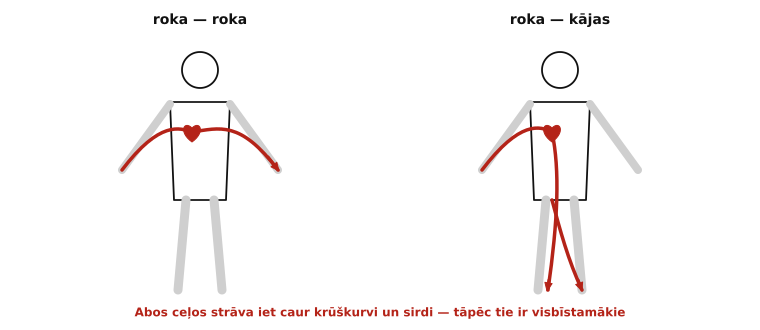
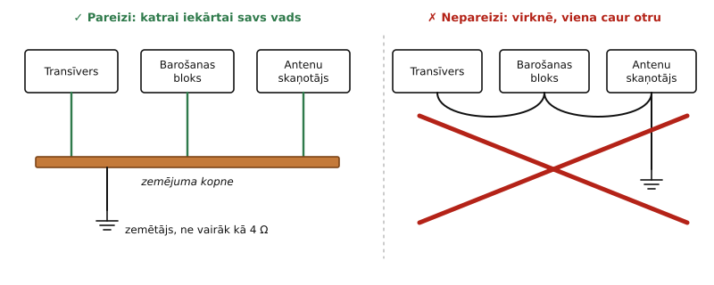
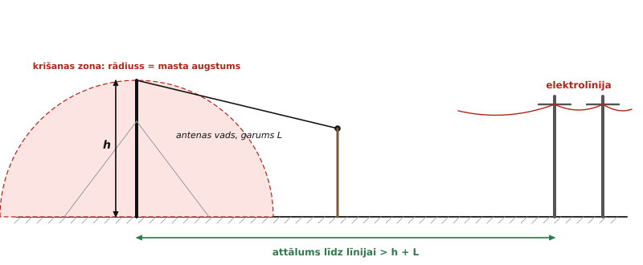
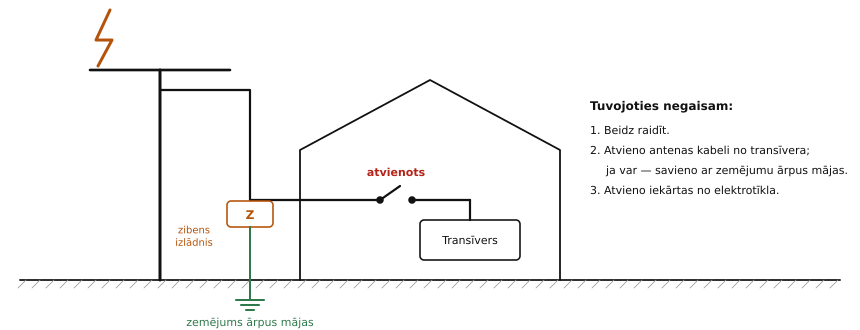

# 17. nodaļa. Drošības tehnika

Šī nodaļa ir par to, kā no hobija atgriezties veselam: par elektrību, zemējumu,
darbu augstumā un ugunsdrošību. Eksāmenā drošības tehnika ir atsevišķa tēma
ar konkrētiem skaitļiem, kas jāzina no galvas.

**Video lekcija:** LRAL bezmaksas kurss, 3. nodarbība (QR kods).
**Eksāmena programma:** drošība.
**Mācību laiks:** ap 3 stundām.

## Pēc šīs nodaļas tu pratīsi

- nosaukt, cik liela strāva cilvēkam ir bīstama;
- rīkoties, ja cilvēks cietis no elektriskās strāvas;
- izvēlēties vadus un ierīkot zemējumu atbilstoši prasībām;
- atpazīt telpas ar paaugstinātu elektrobīstamību un zināt tajās pieļaujamo
  spriegumu;
- nosaukt aizsarglīdzekļus darbam ar iekārtām līdz 1000 V;
- droši uzstādīt mastu un antenu.

## 17.1. Kā strāva iedarbojas uz cilvēku

Bīstams ir nevis spriegums pats par sevi, bet strāva, kas plūst caur
ķermeni. Cik liela tā būs, nosaka spriegums un ķermeņa pretestība; slapja
āda pretestību samazina daudzkārt.

Maiņstrāvas (50 Hz) iedarbība uz cilvēku [1]:

| Strāva | Iedarbība |
| --- | --- |
| 0,6–1,5 mA | Jūtama, bet parasti nekaitīga |
| 5–25 mA | **Satverošā strāva**: muskuļi saraujas, un cilvēks pats vairs nevar atlaist vadītāju |
| 50–80 mA | Dzīvībai bīstama: elpošanas traucējumi |
| 100 mA | Ļoti augsts nāves risks |

> **Piemērs.** Cik liela strāva plūst caur cilvēku, kurš pieskāries 230 V,
> ja ķermeņa pretestība ir 2000 Ω?
>
> 1. I = U / R = 230 / 2000 = 0,115 A.
> 2. Tas ir 115 mA — vairāk par 100 mA robežu.
> 3. Tīkla spriegums ir nāvējošs.

> **Atceries:** 100 mA ir desmitā daļa ampēra. Transīvers raidot patērē
> 20 A — divsimt reižu vairāk. Cilvēka nogalināšanai pietiek ar strāvu, ko
> mājas drošinātājs pat nepamana.

## 17.2. Rīcība elektrotraumas gadījumā

Ja cilvēks cietis no elektriskās strāvas iekārtā līdz 1000 V, rīkojas šādā
secībā [1]:

1. **Nekavējoties atslēdz spriegumu**: izslēdz slēdzi, izrauj kontaktdakšu,
   izslēdz drošinātāju.
2. **Ja atslēgt nav iespējams**, atrauj cietušo no vadītāja ar izolējošu
   priekšmetu: sausu koka nūju, dēli, sausu apģērbu.
3. **Ja tas notiek augstumā**, parūpējies, lai cietušais, atbrīvots no
   strāvas, nenokristu.
4. **Zvani 112.**
5. **Pārbaudi elpošanu un asinsriti.** Ja to nav, sāc mākslīgo elpināšanu un
   netiešo sirds masāžu un turpini līdz mediķu ierašanās brīdim.

> **Uzmanību!** Glābjot citu, neaizmirsti par savu drošību. Nepieskaries
> cietušajam ar kailām rokām, kamēr viņš ir zem sprieguma: tu kļūsi par otru
> cietušo.

## 17.3. Vadi un zemējums

**Vadu šķērsgriezums.** Par tievs vads sakarst un var aizdegties.
Minimālās prasības [1]:

| Kam | Mazākais vara vada šķērsgriezums |
| --- | --- |
| Aparatūras un pārvietojamu patērētāju pieslēgšanai elektrotīklam | 0,75 mm² |
| Zemējuma vadam | 1,5 mm² |

**Zemējums** savieno iekārtu metāla korpusus ar zemi. Ja izolācija sabojājas
un korpuss nonāk zem sprieguma, strāva aizplūst pa zemējumu, nevis caur
cilvēku, un nostrādā drošinātājs.

Prasības zemējumam [1]:

- katrai iekārtai ir **atsevišķs savienojums** ar zemējumu — iekārtas
  nesaslēdz virknē vienu caur otru;
- zemējuma pretestība nedrīkst pārsniegt **4 Ω**;
- vispirms izmanto **dabīgos zemētājus**, ja to pretestība nepārsniedz 4 Ω.

| Dabīgie zemētāji — drīkst | Aizliegts izmantot |
| --- | --- |
| Zemē ierakti ūdens cauruļvadi | Gāzes caurules |
| Artēzisko aku ārējās caurules | Degvielas cauruļvadus |
| Ēku dzelzsbetona un metāla konstrukcijas, kas saskaras ar zemi | Apkures radiatorus |
| | Zemē ieraktu kabeļu svina čaulas |
| | Alumīnija kabeļu apvalkus |

Ja zemējuma maģistrāle atrodas ārpus ēkas, pievads gar ēkas sienu vai stabu
jānosedz ar metāla cauruli vai leņķdzelzi līdz **2,5 m** augstumam no
zemes [1].

> **Atceries:** četri — zemējuma pretestība ne vairāk kā 4 Ω.
> Gāze, apkure, kabeļu apvalki — nekad.

## 17.4. Instrumenti un aizsarglīdzekļi

**Elektroinstrumentu izolācija.** Izolācijas pretestībai starp strāvu
vadošajām daļām un korpusu jābūt [1]:

| Instruments | Izolācijas pretestība |
| --- | --- |
| Parasts elektroinstruments | ne mazāk kā 0,5 MΩ |
| Instruments ar dubultizolāciju | ne mazāk kā 2 MΩ |

**Aizsarglīdzekļi** iekārtās līdz 1000 V iedalās divās grupās [1].

| Pamataizsarglīdzekļi | Papildu aizsarglīdzekļi |
| --- | --- |
| Izolējošās stangas | Dielektriskās kalošas |
| Izolējošās mērknaibles | Dielektriskie paklāji |
| Sprieguma indikatori | Pārnesamie zemējumi |
| Dielektriskie cimdi | Izolējošie paliktņi un uzmavas |
| Montāžas instrumenti ar izolētiem rokturiem | Norobežojumi un sētiņas |
| | Drošības plakāti un zīmes |

Pamataizsarglīdzekļi iztur iekārtas darba spriegumu, un ar tiem drīkst
pieskarties spriegumam pakļautām daļām. Papildu līdzekļi vieni paši
neaizsargā; tos lieto kopā ar pamatlīdzekļiem.

## 17.5. Telpu elektrobīstamība

Tā pati iekārta sausā istabā un mitrā pagrabā nav vienlīdz bīstama. Telpas
iedala pēc elektrobīstamības, un no tā atkarīgs, kādu spriegumu drīkst lietot
pārnēsājamiem instrumentiem un lampām [1].

| Telpas veids | Pazīmes | Lielākais spriegums instrumentiem un lampām |
| --- | --- | --- |
| **Ar paaugstinātu bīstamību** | Viena no pazīmēm: relatīvais mitrums ilgstoši virs 75 %; strāvu vadoši putekļi; strāvu vadoša grīda (metāla, klona, dzelzsbetona, ķieģeļu); temperatūra ilgstoši virs 30 °C; iespēja vienlaikus pieskarties zemētām metāla konstrukcijām un iekārtas korpusam | **42 V** |
| **Sevišķi bīstama** | Relatīvais mitrums tuvu 100 % (griesti, sienas un grīda klāti ar mitrumu); ķīmiski aktīva vide; divas vai vairākas paaugstinātas bīstamības pazīmes vienlaikus | **12 V** |

> **Piemērs.** Garāžā ir betona grīda un metāla plaukti, pie kuriem pieslēgts
> zemējums. Kāda tā ir telpa?
>
> 1. Betona grīda vada strāvu — viena pazīme.
> 2. Var vienlaikus pieskarties zemētam plauktam un iekārtas korpusam — otra
>    pazīme.
> 3. Divas pazīmes vienlaikus: sevišķi bīstama telpa; pārnēsājamiem
>    instrumentiem un lampām ne vairāk kā 12 V.

Skaitlis 42 V parādās arī MK noteikumos: stacijas barošanas spriegums uz
antenām un fīderiem nedrīkst pārsniegt 42 V [2].

## 17.6. Ugunsdrošība

Elektroiekārtas, kas ir zem sprieguma, drīkst dzēst tikai ar līdzekli, kas
nevada strāvu [1].

| Atļauts | Aizliegts |
| --- | --- |
| Ogļskābās gāzes (CO₂) ugunsdzēšamais aparāts | Ūdens |
| | Putu ugunsdzēšamais aparāts |

Ūdens un putas vada strāvu: dzēsējs pats nonāk zem sprieguma. Ja iespējams,
vispirms atslēdz spriegumu.

> **Praktisks padoms.** Stacijas barošanu ierīko tā, lai visu varētu atslēgt
> ar vienu slēdzi, kas ir viegli aizsniedzams un zināms arī ģimenes
> locekļiem. Blakus noliec CO₂ ugunsdzēšamo aparātu.

## 17.7. Masti, antenas un darbs augstumā

Lielākā daļa smago negadījumu radioamatieru vidū notiek nevis pie
transīvera, bet uz jumta.

**Stiprināšana.** Antenas, mastus un atsaites drīkst stiprināt tikai pie
ēkas nesošajām konstrukcijām [1]. Skursteņi, ventilācijas šahtas, margas un
jumta segums tam neder.

**Cilvēku skaits masta pacelšanai** [1]:

| Masta garums | Mazākais cilvēku skaits |
| --- | --- |
| 7 m | 2 |
| Vairāk nekā 8 m | 6 |

**Pieslienamās kāpnes** nedrīkst būt garākas par **5 m** [1].

> **Uzmanību!** Nekad neceļ mastu un nevelc antenas vadu elektrolīniju
> tuvumā. Mastam krītot vai vadam atsitoties pret gaisvadu līniju, spriegums
> nonāk tieši rokās. Attālumam līdz līnijai jābūt lielākam par masta
> augstumu un antenas garumu kopā.

Vēl trīs noteikumi, kas nav eksāmena skaitļi, bet glābj dzīvību:

- augstumā nestrādā viens; otram cilvēkam jābūt uz zemes;
- nestrādā lietū, stiprā vējā un tumsā;
- uz jumta lieto drošības jostu, kas piestiprināta pie nesošās konstrukcijas.

## 17.8. Zibens un augstfrekvences enerģija

**Zibens.** Antena ir augstākais vadītājs apkārtnē. Tuvojoties negaisam:

1. beidz raidīt;
2. atvieno antenas kabeli no transīvera un, ja iespējams, savieno to ar
   zemējumu ārpus mājas;
3. atvieno iekārtas no elektrotīkla.

Zibens nav jātrāpa tieši: arī tuvs spēriens kabelī inducē spriegumu, kas
iznīcina transīvera ieeju.

**Augstfrekvences enerģija.** Raidīšanas laikā antenā un kabeļa galos ir
augstfrekvences spriegums, kas var radīt dziļus apdegumus.

- Raidīšanas laikā nepieskaries antenai un neizolētiem vadiem.
- Antenu novieto tā, lai tai nevarētu nejauši pieskarties cilvēki un
  dzīvnieki; to prasa arī MK noteikumi [2].
- Rokas staciju raidot netur ar antenu pie sejas.
- Ar virziena antenu un lielu jaudu neraidi virzienā, kur tuvu atrodas
  cilvēki.

**Akumulatori.** 12 V spriegums nav bīstams pieskaroties, bet akumulatora
īsslēguma strāva ir simtiem ampēru: uzgriežņu atslēga starp spailēm izkūst.
Barošanas vadā pie akumulatora vienmēr liec drošinātāju.

## Eksāmenā jāzina

- Strāvas: 0,6–1,5 mA jūtama; 5–25 mA satverošā; 50–80 mA dzīvībai bīstama;
  100 mA — ļoti augsts nāves risks.
- Elektrotrauma: atslēgt spriegumu; ja nevar — atraut ar izolējošu
  priekšmetu; zvanīt 112; elpināšana un sirds masāža.
- Vara vads pieslēgšanai tīklam: ne mazāk kā 0,75 mm². Zemējuma vads:
  1,5 mm².
- Zemējuma pretestība: ne vairāk kā 4 Ω.
- Aizliegtie zemētāji: gāzes caurules, apkures radiatori, kabeļu svina
  čaulas, alumīnija kabeļu apvalki.
- Zemējuma pievada nosegums gar sienu: līdz 2,5 m.
- Izolācijas pretestība: 0,5 MΩ parastam instrumentam, 2 MΩ ar
  dubultizolāciju.
- Telpas ar paaugstinātu bīstamību: 42 V. Sevišķi bīstamas telpas: 12 V.
- Mitruma robeža: 75 %; temperatūras robeža: 30 °C.
- Elektroiekārtas dzēš ar CO₂; ar ūdeni un putām — aizliegts.
- Masts 7 m — 2 cilvēki; virs 8 m — 6 cilvēki.
- Pieslienamās kāpnes: ne garākas par 5 m.
- Antenas un mastus stiprina tikai pie nesošajām konstrukcijām.

## Pamēģini pats

**1. Apskati savu nākamo staciju (15 minūtes).** Telpā, kur plāno iekārtot
staciju, noskaidro:

- [ ] kāda ir grīda un vai tā vada strāvu;
- [ ] vai rozetēm ir zemējuma kontakts;
- [ ] kur ir drošinātāju sadale un kā ātri atslēgt spriegumu;
- [ ] pie kā varētu pieslēgt stacijas zemējumu.

**2. Skaitļu kartītes (20 minūtes).** Uz kartītēm vienā pusē uzraksti
jautājumu ("zemējuma pretestība"), otrā — skaitli ("4 Ω"). Izveido kartītes
visiem "Eksāmenā jāzina" skaitļiem un atkārto, līdz nekļūdies.

**3. Negaisa plāns.** Uzraksti trīs soļus, ko darīsi, kad tuvosies negaiss,
un pārbaudi, vai antenas kabeli tiešām var viegli atvienot.

## Kopsavilkums

- Bīstama ir strāva caur ķermeni; jau 100 mA var nogalināt.
- Vispirms atslēdz spriegumu, tad palīdzi cietušajam; sargā arī sevi.
- Katrai iekārtai savs zemējuma vads; pretestība līdz 4 Ω; gāzes un apkures
  caurules nekad.
- Mitrās un vadošās telpās pārnēsājamiem instrumentiem 42 V vai 12 V.
- Degošu elektroiekārtu dzēš ar CO₂.
- Mastu ceļ vairāki cilvēki, tālu no elektrolīnijām, un stiprina pie
  nesošajām konstrukcijām.
- Negaisā antenas atvieno.

## Paškontroles jautājumi

1. Kā sauc maiņstrāvu 5–25 mA, pie kuras cilvēks pats vairs nevar atlaist vadītāju?
    - A. Jūtamā strāva
    - B. Satverošā strāva
    - C. Darba strāva
    - D. Īsslēguma strāva
2. Pie kādas maiņstrāvas (50 Hz) nāves risks ir ļoti augsts?
    - A. 1 mA
    - B. 5 mA
    - C. 100 mA
    - D. 10 mA
3. Kas jādara vispirms, ja cilvēks ir zem sprieguma?
    - A. Nekavējoties jāatslēdz spriegums
    - B. Jāzvana 112
    - C. Jāsāk sirds masāža
    - D. Jāatvelk cietušais aiz rokas
4. Spriegumu atslēgt nav iespējams. Kā atbrīvo cietušo?
    - A. Atvelk ar kailām rokām
    - B. Aplej ar ūdeni
    - C. Gaida mediķus
    - D. Atrauj ar izolējošu priekšmetu
5. Kāds ir mazākais pieļaujamais vara vada šķērsgriezums aparatūras pieslēgšanai elektrotīklam?
    - A. 0,5 mm²
    - B. 0,75 mm²
    - C. 1,5 mm²
    - D. 2,5 mm²
6. Kāda ir lielākā pieļaujamā zemējuma pretestība elektroiekārtām?
    - A. 0,5 Ω
    - B. 10 Ω
    - C. 4 Ω
    - D. 42 Ω
7. Ko drīkst izmantot kā dabīgo zemētāju?
    - A. Zemē ieraktu ūdens cauruļvadu
    - B. Gāzes cauruli
    - C. Apkures radiatoru
    - D. Alumīnija kabeļa apvalku
8. Līdz kādam augstumam no zemes jānosedz zemējuma pievads gar ēkas sienu?
    - A. 0,5 m
    - B. 1 m
    - C. 5 m
    - D. 2,5 m
9. Kādai jābūt parasta elektroinstrumenta izolācijas pretestībai?
    - A. Ne mazāk kā 0,5 MΩ
    - B. Ne mazāk kā 4 Ω
    - C. Ne vairāk kā 0,5 MΩ
    - D. Ne mazāk kā 100 kΩ
10. Kāds lielākais spriegums pieļaujams pārnēsājamiem instrumentiem un lampām telpās ar paaugstinātu elektrobīstamību?
    - A. 230 V
    - B. 42 V
    - C. 12 V
    - D. 127 V
11. Kāds lielākais spriegums pieļaujams pārnēsājamiem instrumentiem un lampām sevišķi bīstamās telpās?
    - A. 42 V
    - B. 24 V
    - C. 12 V
    - D. 5 V
12. Pie kāda relatīvā mitruma telpa ir ar paaugstinātu elektrobīstamību?
    - A. Ilgstoši virs 30 %
    - B. Ilgstoši virs 50 %
    - C. Tikai pie 100 %
    - D. Ilgstoši virs 75 %
13. Ar ko atļauts dzēst elektroiekārtas?
    - A. Ar ogļskābās gāzes ugunsdzēšamo aparātu
    - B. Ar ūdeni
    - C. Ar putu ugunsdzēšamo aparātu
    - D. Ar jebkuru no minētajiem
14. Kuri no šiem ir pamataizsarglīdzekļi iekārtās līdz 1000 V?
    - A. Dielektriskās kalošas un paklāji
    - B. Dielektriskie cimdi, sprieguma indikatori, instrumenti ar izolētiem rokturiem
    - C. Drošības plakāti un zīmes
    - D. Norobežojumi un sētiņas
15. Cik cilvēku vismaz vajadzīgs, lai paceltu mastu, kas garāks par 8 m?
    - A. 2
    - B. 3
    - C. 6
    - D. 4
16. Cik garas drīkst būt pieslienamās kāpnes?
    - A. Ne garākas par 3 m
    - B. Ne garākas par 7 m
    - C. Ne garākas par 10 m
    - D. Ne garākas par 5 m
17. Pie kā drīkst stiprināt antenas, mastus un atsaites?
    - A. Tikai pie ēkas nesošajām konstrukcijām
    - B. Pie skursteņa
    - C. Pie jumta margām
    - D. Pie jebkuras izturīgas vietas

**Atvērtie jautājumi**

18. Paskaidro, kāpēc elektroiekārtu nedrīkst dzēst ar ūdeni.
19. Tu plāno pagalmā uzstādīt 9 m mastu. Uzraksti drošības pasākumu sarakstu
    no plānošanas līdz pacelšanai.

## Atbildes

| Nr. | Atbilde | Skaidrojums |
| --- | --- | --- |
| 1 | B | Muskuļi saraujas, un roku atlaist vairs nevar. |
| 2 | C | 100 mA; jau 50–80 mA ir dzīvībai bīstami. |
| 3 | A | Kamēr spriegums nav atslēgts, apdraudēts ir arī glābējs. |
| 4 | D | Ar sausu, strāvu nevadošu priekšmetu. |
| 5 | B | 0,75 mm²; zemējuma vadam 1,5 mm². |
| 6 | C | 4 Ω. |
| 7 | A | Gāzes caurules, radiatorus un kabeļu apvalkus izmantot aizliegts. |
| 8 | D | 2,5 m, ar metāla cauruli vai leņķdzelzi. |
| 9 | A | 0,5 MΩ; ar dubultizolāciju 2 MΩ. |
| 10 | B | 42 V. |
| 11 | C | 12 V. |
| 12 | D | 75 %; tuvu 100 % telpa jau ir sevišķi bīstama. |
| 13 | A | CO₂ nevada strāvu; ūdens un putas vada. |
| 14 | B | Kalošas, paklāji, plakāti un norobežojumi ir papildu aizsarglīdzekļi. |
| 15 | C | Seši cilvēki. |
| 16 | D | 5 m. |
| 17 | A | Skurstenis un margas nav nesošās konstrukcijas. |

Atvērtie jautājumi: astoņpadsmitajā jāpiemin, ka ūdens vada strāvu un
dzēsējs nonāk zem sprieguma. Deviņpadsmitajā jābūt: attālums līdz
elektrolīnijām, stiprinājums pie nesošām konstrukcijām vai pamata, atsaites,
vismaz seši cilvēki, piemēroti laikapstākļi, zemējums un zibens aizsardzība.

## Padziļināti

- **Noplūdes strāvas automāts.** Atslēdz ķēdi, ja daļa strāvas aizplūst uz
  zemi, piemēram, caur cilvēku. Mājokļos parasti nostrādā pie 30 mA — zem
  dzīvībai bīstamās robežas.
- **Lampu tehnika.** Vecos lampu pastiprinātājos ir simtiem un tūkstošiem
  voltu, un kondensatori lādiņu glabā ilgi. Iesācējam tos atvērt nevajag.
- **Elektromagnētiskā lauka robežvērtības.** Iedzīvotāju aizsardzībai ir
  noteiktas lauka intensitātes normas. Ar B kategorijas jaudām un antenu
  dažu metru attālumā no cilvēkiem tās parasti netiek pārsniegtas, bet ar
  VHF/UHF virziena antenām tas ir jāpārbauda.

## Nodaļas avoti

1. LRAL bezmaksas kurss 2026, 3. nodarbība "Drošības jautājumi
   radioamatieriem", prezentācija un video lekcija. lral.lv.
2. Ministru kabineta 2023. gada 23. maija noteikumi Nr. 257, 53. un
   58.–60. punkts. <https://likumi.lv/ta/id/342127> (skatīts 2026-11-12).
