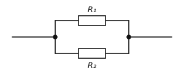
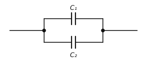
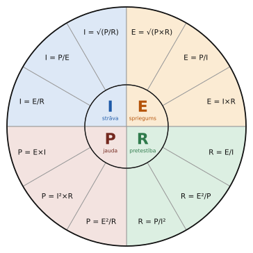
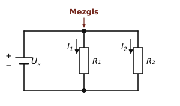
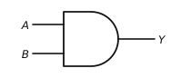
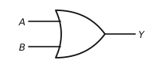
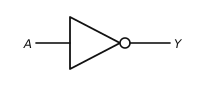
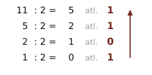

# A pielikums. Formulu lapa

Eksāmenā vajadzīgās formulas, mērvienības un tabulas vienuviet. Lapas saturs
un secība atbilst LRAL bezmaksas kursa formulu lapai, ko izveidojis Matīss
YL3RZ; šeit mainīts noformējums un precizēts Kirhofa likumu formulējums.

::: fl-poras
::: fl-kol

## 1. Pretestība (rezistori)

**Virknes slēgums:**

{.fl-att}

$$R_{kop} = R_1 + R_2 + \cdots + R_n \quad \text{[Ω]}$$

**Paralēlais slēgums:**

{.fl-att}

$$\frac{1}{R_{kop}} = \frac{1}{R_1} + \frac{1}{R_2} + \cdots + \frac{1}{R_n} \quad \text{[Ω]}$$

Diviem rezistoriem: $R_{kop} = \dfrac{R_1 \cdot R_2}{R_1 + R_2}$ [Ω]

::: fl-apz
| $R_{kop}$, $R_1$, $R_2$ — pretestība [Ω]
:::

## 2. Kapacitāte (kondensatori)

**Virknes slēgums:**

{.fl-att}

$$\frac{1}{C_{kop}} = \frac{1}{C_1} + \frac{1}{C_2} + \cdots + \frac{1}{C_n} \quad \text{[F]}$$

**Paralēlais slēgums:**

{.fl-att}

$$C_{kop} = C_1 + C_2 + \cdots + C_n \quad \text{[F]}$$

::: fl-apz
| $C_{kop}$, $C_1$, $C_2$ — kapacitāte [F]
:::

:::
::: fl-kol

## 3. Jauda un Oma likums

{.fl-att .fl-ritenis}

::: fl-apz
| $P$ — jauda [W]
| $E$ — spriegums [V] (tekstā — U)
| $I$ — strāva [A]
| $R$ — pretestība [Ω]
:::

## 4. Maiņstrāva un līdzstrāva

**Efektīvā vērtība (RMS):**

$$U_{RMS} = \frac{U_{max}}{\sqrt{2}} \approx U_{max} \cdot \text{0,707} \quad \text{[V]}$$

$$U_{max} = U_{RMS} \cdot \sqrt{2} \approx U_{RMS} \cdot \text{1,414} \quad \text{[V]}$$

$$U_{p\text{-}p} = 2 \cdot U_{max} \quad \text{[V]}$$

::: fl-apz
| $U_{RMS}$ — efektīvais spriegums [V]
| $U_{max}$ — amplitūdas spriegums [V]
| $U_{p\text{-}p}$ — spriegums no smailes līdz smailei [V]
:::

:::
:::

::: fl-pilna

## Metriskie prefiksi un decibeli (dB)

::: fl-prefiksi
::: fl-tab1

| Prefikss | $10^n$ | Skaitlis | Piemērs |
| --- | --- | --- | --- |
| tera (T) | $10^{12}$ | 1 000 000 000 000 | 1 TΩ |
| giga (G) | $10^{9}$ | 1 000 000 000 | 1 GHz |
| mega (M) | $10^{6}$ | 1 000 000 | 1 MΩ |
| kilo (k) | $10^{3}$ | 1 000 | 1 kΩ |
| hekto (h) | $10^{2}$ | 100 | 1 hF |
| deka (da) | $10^{1}$ | 10 | 1 daV |
| deci (d) | $10^{-1}$ | 0,1 | 1 dV |
| centi (c) | $10^{-2}$ | 0,01 | 1 cm |
| mili (m) | $10^{-3}$ | 0,001 | 1 mA |
| mikro (µ) | $10^{-6}$ | 0,000001 | 1 µF |
| nano (n) | $10^{-9}$ | 0,000000001 | 1 nF |
| piko (p) | $10^{-12}$ | 0,000000000001 | 1 pF |

:::
::: fl-tab2

| dB | Jauda (×) |
| --- | --- |
| 1 dB | 1,26 |
| 2 dB | 1,58 |
| 3 dB | 2,0 |
| 4 dB | 2,51 |
| 6 dB | 3,98 |
| 8 dB | 6,31 |
| 10 dB | 10 |
| 15 dB | 31,6 |
| 20 dB | 100 |
| 25 dB | 316 |
| 30 dB | 1000 |
| 40 dB | 10000 |

:::
::: fl-db

$$P_{dB} = 10 \cdot \lg\left(\frac{P}{P_{ref}}\right) \quad \text{[dB]}$$

$$U_{dB} = 20 \cdot \lg\left(\frac{U}{U_{ref}}\right) \quad \text{[dB]}$$

::: fl-apz
| $P$ — jauda [W]
| $U$ — spriegums [V]
| $P_{ref}$, $U_{ref}$ — atskaites līmeņi
:::

:::
:::
:::

::: fl-poras
::: fl-kol

## 5. Rezonējošā frekvence

**Rezonanses frekvence:**

$$f = \frac{1}{2\pi\sqrt{LC}} \quad \text{[Hz]}$$

**Reaktīvā pretestība:**

$$X_C = \frac{1}{2\pi f C}\ \text{[Ω]} \qquad X_L = 2\pi f L\ \text{[Ω]}$$

::: fl-apz
| $f$ — rezonanses frekvence [Hz]
| $X_C$ — kapacitatīvā pretestība [Ω]
| $X_L$ — induktīvā pretestība [Ω]
| $L$ — induktivitāte [H]
| $C$ — kapacitāte [F]
| $\pi$ ≈ 3,14159
:::

## 6. Frekvence un viļņa garums

**Viļņa garums un frekvence**

$$f = \frac{c}{\lambda}\ \text{[Hz]} \qquad \lambda\,\text{[m]} = \frac{300}{f\,\text{[MHz]}}$$

**Periods un frekvence**

$$f = \frac{1}{T}\ \text{[Hz]} \qquad T = \frac{1}{f}\ \text{[s]}$$

::: fl-apz
| $\lambda$ — viļņa garums [m]
| $T$ — periods [s]
| $f$ — frekvence [Hz, MHz]
| $c$ — gaismas ātrums $\approx 3 \cdot 10^8$ [m/s]
:::

:::
::: fl-kol

## 7. Sin/cos maiņspriegums

$$u\text{(}t\text{)} = U_{max} \cdot \sin\text{(}\omega t + \phi\text{)}$$

$$u\text{(}t\text{)} = U_{max} \cdot \cos\text{(}\omega t + \phi\text{)}$$

$$\omega = 2\pi f$$

::: fl-apz
| $u\text{(}t\text{)}$ — mom. spriegums [V]
| $U_{max}$ — amplitūda [V]
| $\omega$ — leņķ. frekvence [rad/s]
| $T$ — periods [s]
:::

## 8. Kirhofa likumi

**KCL (strāvu likums):** mezglā ieplūstošo strāvu summa ir vienāda ar izplūstošo strāvu summu.

$$\sum I_{ie} = \sum I_{iz} \quad \text{[A]}$$

**KVL (spriegumu likums):** noslēgtā kontūrā visu spriegumu algebriskā summa ir nulle — avotu spriegumu summa ir vienāda ar sprieguma kritumu summu.

$$\sum U = 0 \quad \text{[V]}$$

{.fl-att}

:::
:::

::: fl-pilna

## 9. Loģiskās shēmas

::: fl-tris
::: fl-vien

**UN (AND)**

{.fl-att .fl-varti}

| A | B | Y |
| --- | --- | --- |
| 0 | 0 | 0 |
| 0 | 1 | 0 |
| 1 | 0 | 0 |
| 1 | 1 | 1 |

:::
::: fl-vien

**VAI (OR)**

{.fl-att .fl-varti}

| A | B | Y |
| --- | --- | --- |
| 0 | 0 | 0 |
| 0 | 1 | 1 |
| 1 | 0 | 1 |
| 1 | 1 | 1 |

:::
::: fl-vien

**NE (NOT)**

{.fl-att .fl-varti}

| A | Y |
| --- | --- |
| 0 | 1 |
| 1 | 0 |

:::
:::
:::

::: fl-pilna

## 10. Binārā sistēma

::: fl-tris
::: fl-vien

**Binārais → decimālais**

Saskaita $2^n$ pozīcijas ar 1:

$1011_2 = 1 \cdot 2^3 + 0 \cdot 2^2 + 1 \cdot 2^1 + 1 \cdot 2^0$

$8 + 0 + 2 + 1 = \mathbf{11_{10}}$

:::
::: fl-vien

**Pakāpes**

| | |
| --- | --- |
| $2^0 = 1$ | $2^4 = 16$ |
| $2^1 = 2$ | $2^5 = 32$ |
| $2^2 = 4$ | $2^6 = 64$ |
| $2^3 = 8$ | $2^7 = 128$ |

:::
::: fl-vien

**Decimālais → binārais**

Dala ar 2, raksta atlikumus; rezultātu lasa no apakšas uz augšu:

{.fl-att}

:::
:::
:::

*© 2026 Matīss YL3RZ*
