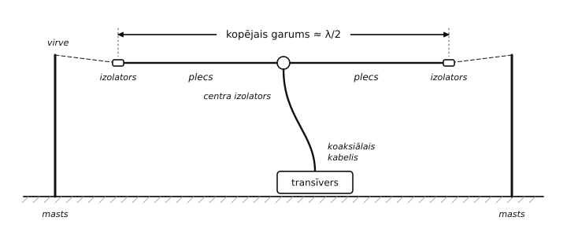

Šī lapa nav grāmatas daļa. Tā parāda maketa elementus, kas 5. nodaļā neparādās,
lai recenzenti var novērtēt visu stilu.

## 7.3. Oma likums {.c-kategorija}

Strāva ķēdē ir tieši proporcionāla spriegumam un apgriezti proporcionāla
pretestībai: $U = I \cdot R$. Rezonanses frekvenci svārstību kontūram aprēķina:

$$f = \frac{1}{2\pi\sqrt{LC}}$$

### Sīkāks dalījums (h3)

Pamatteksts ar **terminu treknrakstā** un atsauci [1].

> **Atceries:** viļņa garums metros ≈ 300 / frekvence megahercos.

> **Padziļināti.** Neobligāts skaidrojums tiem, kas grib zināt vairāk.
